# R Packages: Install from CRAN, Offline, and Bioconductor

---

## Contents

1. [Quick links](#quick-links)
2. [What is an R package?](#1-what-is-an-r-package)
3. [Why packages matter](#2-why-packages-matter)
4. [Install from CRAN (online)](#3-install-from-cran-online)
5. [Install offline from CRAN](#4-install-offline-from-cran)
6. [Install from Bioconductor](#5-install-from-bioconductor)
7. [Bioconductor offline install](#6-bioconductor-offline-install)
8. [Use your package](#7-use-your-package-load-help-and-run)
9. [Recap](#8-recap)
10. [Quiz](#quiz)

---

## Quick links

| Resource | Link |
|---|---|
| CRAN (R and packages) | https://cran.r-project.org/ |
| CRAN: packages by name | https://cran.r-project.org/web/packages/available_packages_by_name.html |
| CRAN: `readr` page | https://cran.r-project.org/web/packages/readr/index.html |
| `readr` documentation | https://readr.tidyverse.org/ |
| Bioconductor | https://bioconductor.org/ |
| Bioconductor: `DESeq2` | https://bioconductor.org/packages/DESeq2/ |
| R package primer | https://kbroman.org/pkg_primer/ |

---

## 1. What is an R package?

An **R package** is a collection of **functions, data, documentation, and tests** bundled together in a standardized format.

Packages let developers and users:

- Share code easily
- Reuse solutions across projects
- Extend R's core functionality dramatically

---

## 2. Why packages matter

The core of R is small. Packages add tools for specific jobs:

| Task | Example packages |
|---|---|
| Data import | `readr`, `haven` |
| Data wrangling | `dplyr`, `tidyr` |
| Visualization | `ggplot2`, `plotly` |
| Reporting | `rmarkdown`, `knitr` |


Most R packages live in one of two places:

- **CRAN**, the main repository for general R packages
- **Bioconductor**, for computational biology and bioinformatics


---

## 3. Install from CRAN (online)

You need an internet connection for this method.

### Option A: RStudio menu

1. Click **Tools** in the top menu.
2. Click **Install Packages...**

<p align="center"><a href="images2/Slide38.png">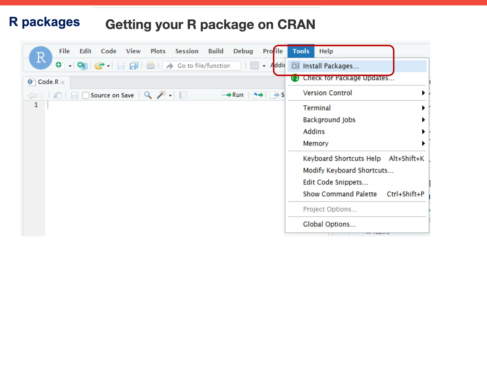 Install Packages" width="500"></a></p>

3. Set **Install from** to **Repository (CRAN)**.
4. Type the package name, for example `readr`. RStudio suggests matches as you type.
5. Keep **Install dependencies** ticked.
6. Click **Install**.

<p align="center"><a href="images2/Slide39.png">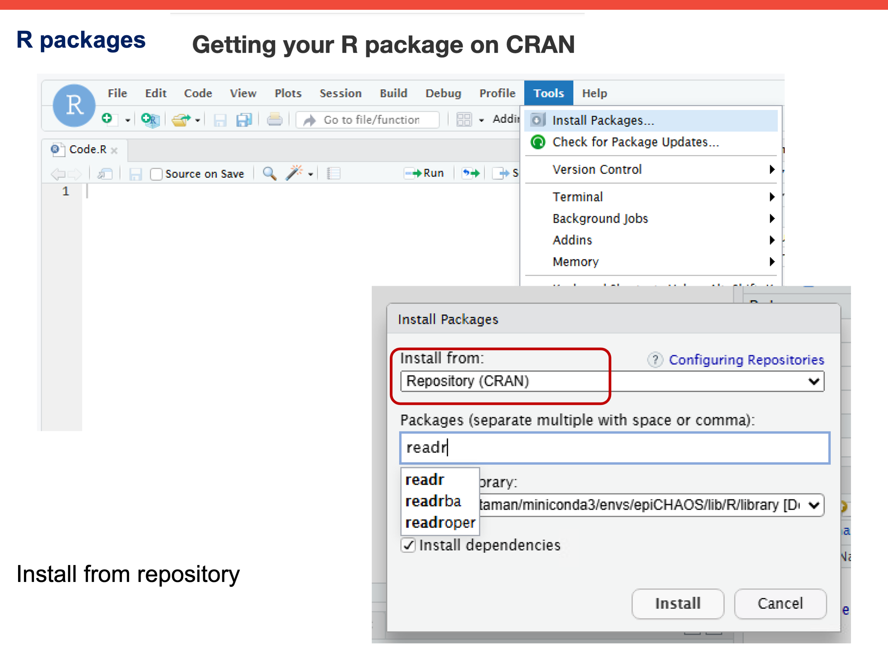</a></p>

### Option B: One line of code

```r
install.packages("readr")
```

Package names go in quotation marks when installing.

---

## 4. Install offline from CRAN

Use this when your computer has no direct internet access. You download the package file on another machine and install it from a local file.

### Step 1: Open CRAN

Go to https://cran.r-project.org/ and click **Packages** in the left menu under *Software*.

<p align="center"><a href="images2/Slide40.png">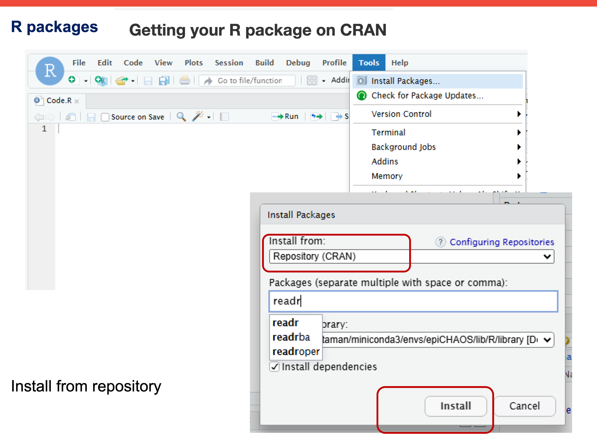</a></p>

### Step 2: Open the package list

On the *Contributed Packages* page, click **Table of available packages, sorted by name**.

<p align="center"><a href="images2/Slide41.png">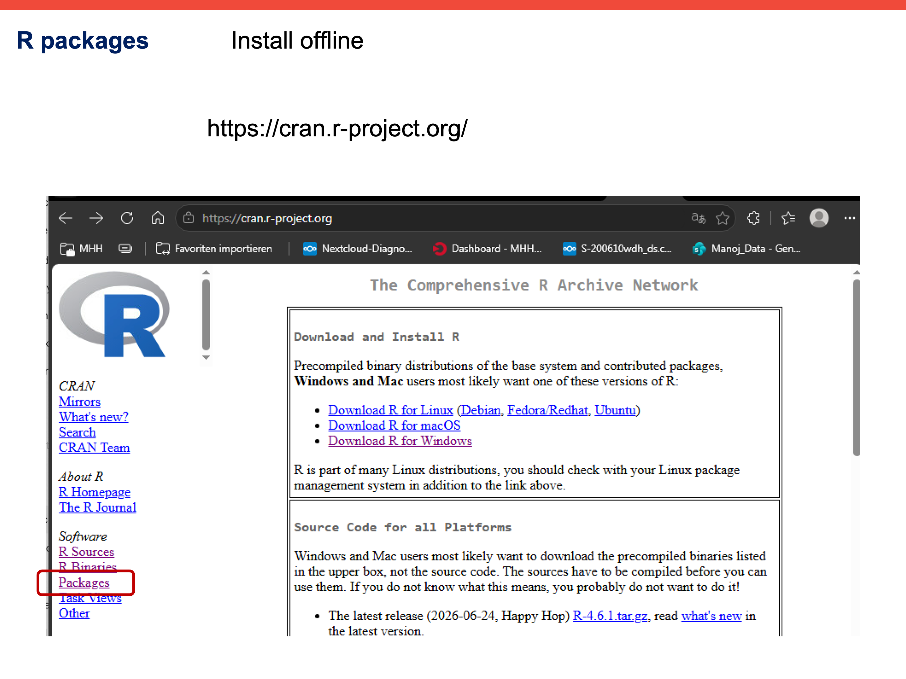</a></p>

### Step 3: Find your package

Click the first letter of the package name (for example **R** for `readr`).

<p align="center"><a href="images2/Slide42.png">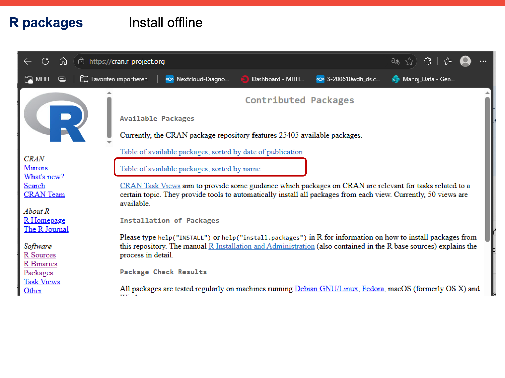</a></p>

Then click the package name in the list.

<p align="center"><a href="images2/Slide43.png">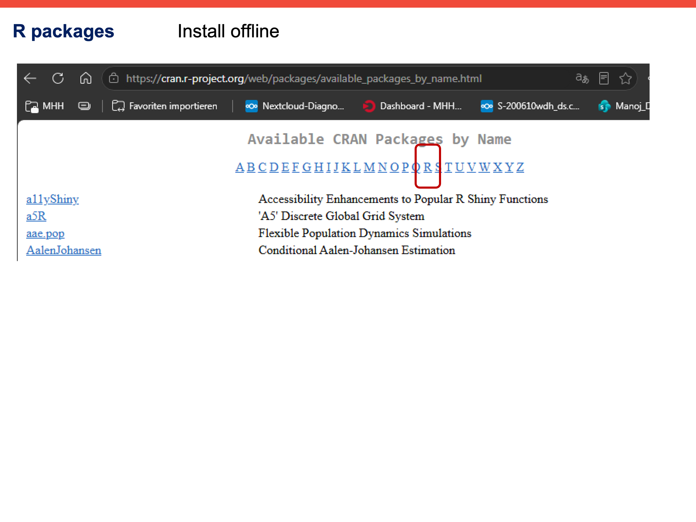</a></p>

### Step 4: Download the right file

On the package page, scroll to **Downloads** and pick the file for your system:

| Your system | Download |
|---|---|
| Windows | Windows binaries (`.zip`) |
| macOS | macOS binaries (`.tgz`) |
| Linux or any system | Package source (`.tar.gz`) |

For `readr`, the Windows file is `readr_2.2.0.zip`.

<p align="center"><a href="images2/Slide44.png">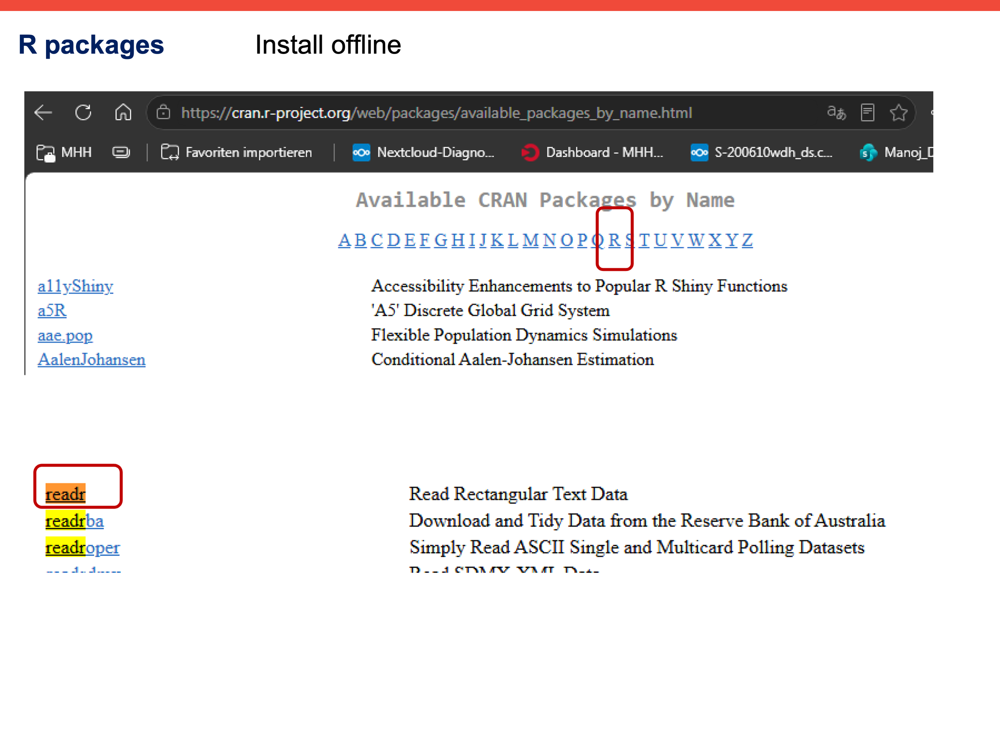</a></p>

> Pick the binary that matches your R version. `r-release` suits most users.

### Step 5: Install from the local file

1. In RStudio, click **Tools > Install Packages...**

<p align="center"><a href="images2/Slide45.png">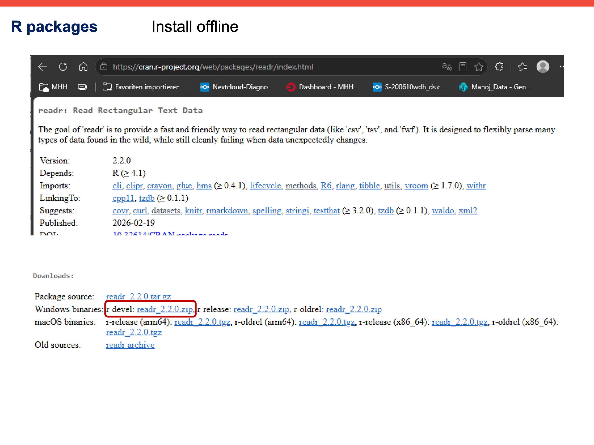 Install Packages" width="500"></a></p>

2. Change **Install from** to **Package Archive File (.tar.gz)**.

<p align="center"><a href="images2/Slide46.png">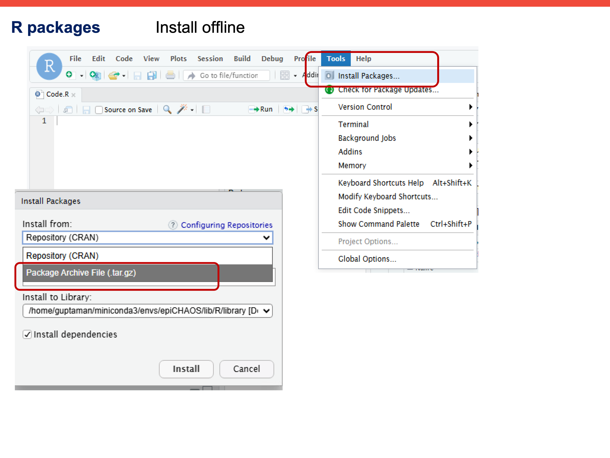</a></p>

3. Browse to the downloaded file (for example `readr_2.2.0.zip` in *Downloads*) and click **Open**.

<p align="center"><a href="images2/Slide47.png">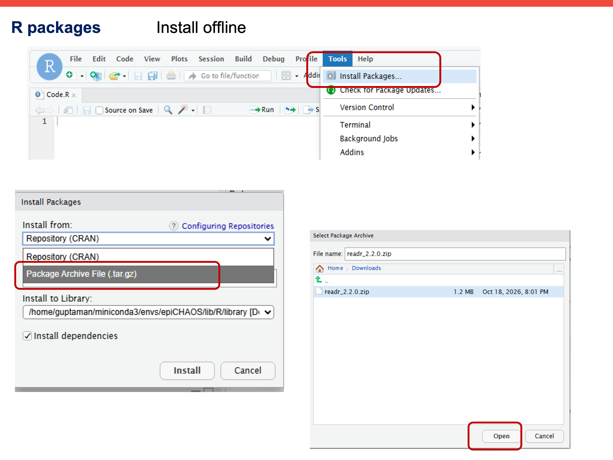</a></p>

4. Click **Install**.

### The same step in code

```r
# Windows binary
install.packages("C:/Users/yourname/Downloads/readr_2.2.0.zip",
                 repos = NULL, type = "win.binary")

# Source package (any system)
install.packages("~/Downloads/readr_2.2.0.tar.gz",
                 repos = NULL, type = "source")
```

`repos = NULL` tells R to use the local file instead of CRAN.

> Offline installs do not fetch dependencies automatically. Download and install any missing dependencies the same way. The package page lists them under *Imports* and *Depends*.

---

## 5. Install from Bioconductor

Bioconductor hosts packages for biological data analysis, such as `DESeq2` for differential gene expression.

### Step 1: Open Bioconductor

Go to https://bioconductor.org/

<p align="center"><a href="images2/Slide48.png">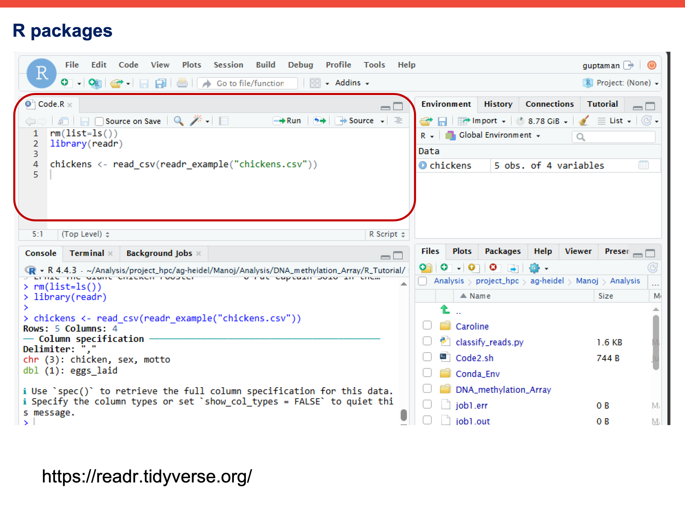</a></p>

### Step 2: Search for the package

Type the package name in the search box, for example `deseq2`, and click the matching package.

<p align="center"><a href="images2/Slide49.png">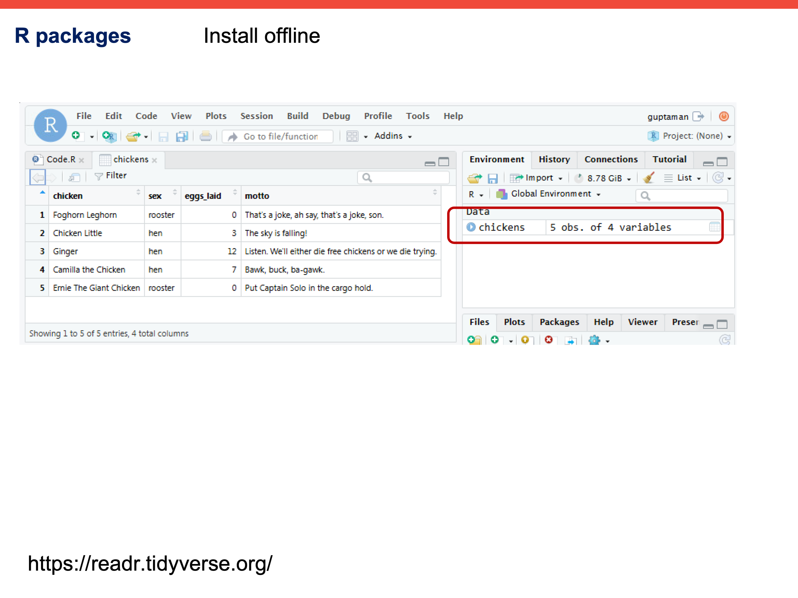</a></p>

### Step 3: Copy the install code

The package page shows the installation code:

<p align="center"><a href="images2/Slide50.png">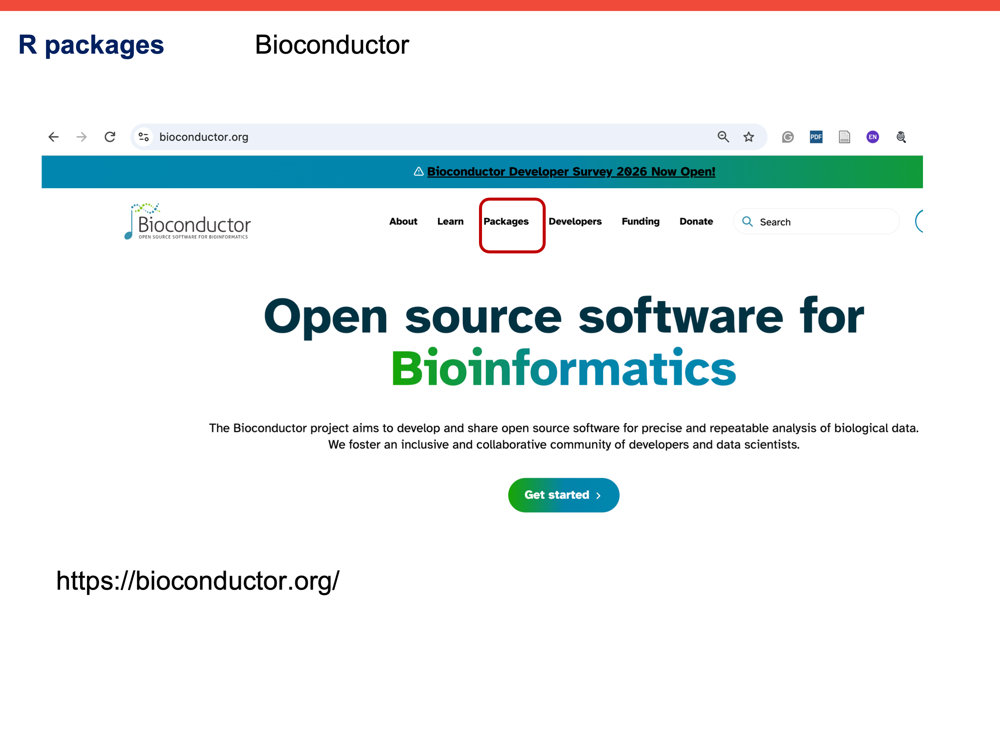</a></p>

```r
if (!require("BiocManager", quietly = TRUE))
    install.packages("BiocManager")

BiocManager::install("DESeq2")
```

What this does:

- The first two lines install `BiocManager` from CRAN if it is missing.
- `BiocManager::install()` installs the Bioconductor package and its dependencies.

> Bioconductor versions are tied to R versions. Use the R version shown on the package page.

---

## 6. Bioconductor offline install

The same idea as CRAN offline. Download the archive from the package page, then install it from the file.

Each Bioconductor package page has a **Package Archives** table:

| File type | Use when |
|---|---|
| Source Package (`.tar.gz`) | Any system |
| Windows Binary (`.zip`) | Windows |
| macOS Binary (`.tgz`) | macOS (choose Intel or Apple silicon) |

<p align="center"><a href="images2/Slide51.png">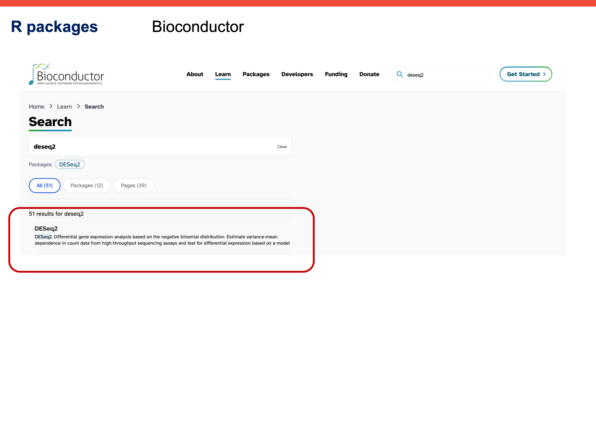</a></p>

Install it with **Tools > Install Packages... > Package Archive File**, or in code:

```r
install.packages("~/Downloads/DESeq2_1.52.0.tar.gz",
                 repos = NULL, type = "source")
```

> `DESeq2` has many dependencies (54 on the package page). Offline installs of Bioconductor packages are harder than online ones. Use the online method whenever you can.

---

## 7. Use your package: load, help, and run

Installing a package is a one-time step. Loading it is needed in every new R session.

<p align="center"><a href="images2/Slide52.png">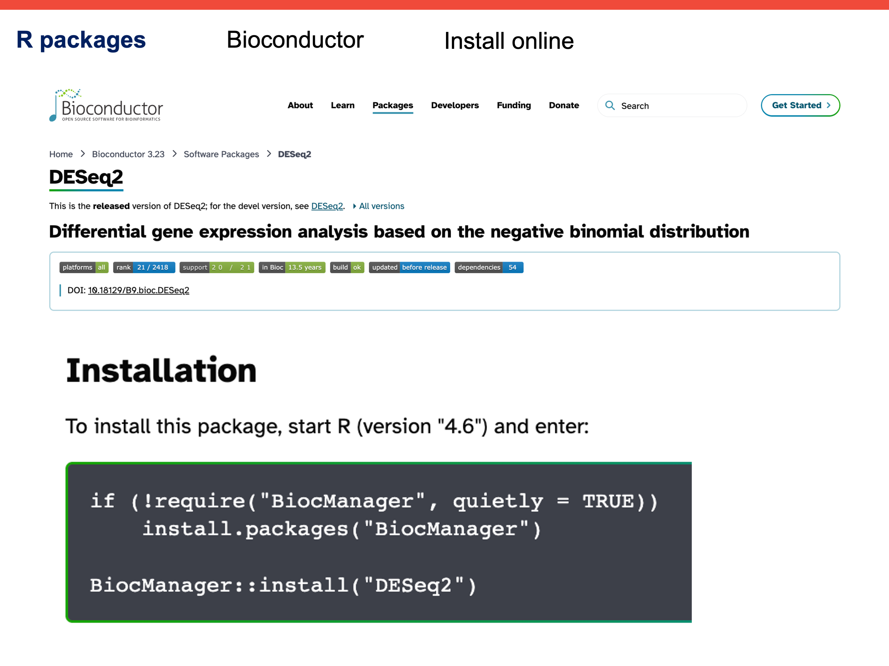</a></p>

### The four steps

```r
# 1. Install (once)
install.packages("readr")

# 2. Load (every session)
library(readr)

# 3. Get help
?read_csv
vignette("readr")

# 4. Use it
chickens <- read_csv(readr_example("chickens.csv"))
```

### Worked example with `readr`

```r
rm(list = ls())          # clear the environment

library(readr)

chickens <- read_csv(readr_example("chickens.csv"))
```

`readr_example()` points to a small example file that ships with the package. R prints the column specification when it reads the file.

<p align="center"><a href="images2/Slide53.png">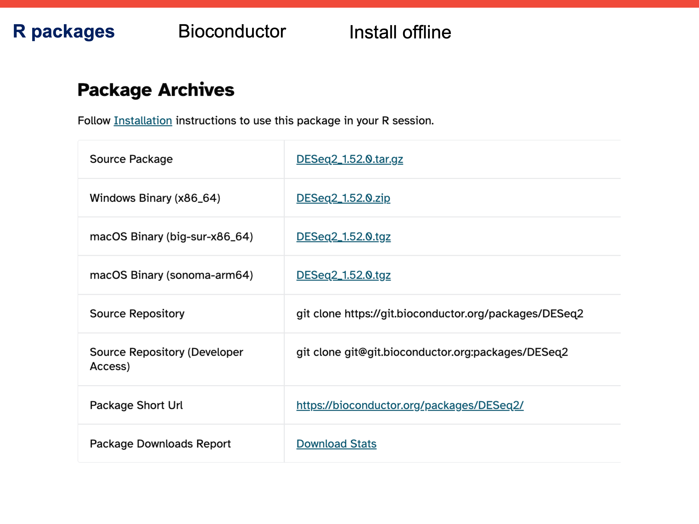</a></p>

Inspect the result:

```r
chickens
View(chickens)
```

The `chickens` object has 5 rows and 4 columns: `chicken`, `sex`, `eggs_laid`, and `motto`.

<p align="center"><a href="images2/Slide54.png">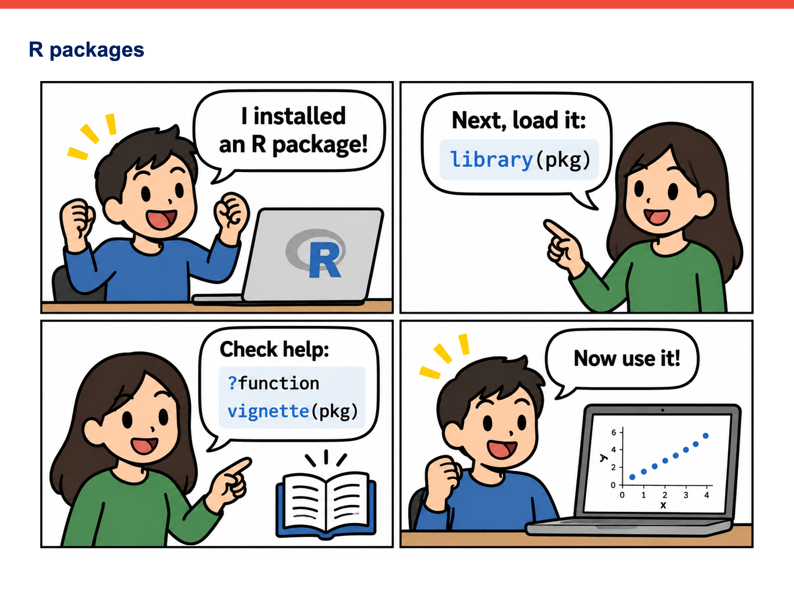</a></p>

More about `readr`: https://readr.tidyverse.org/

---

## 8. Recap

- Created a working folder
- Set the path to the working folder
- Created the first R script, named `Example.R`
- Syntax in R
- The hash tag `#` is important for commenting
- R packages have predefined functions and can be reused

<p align="center"><a href="images2/Slide55.png">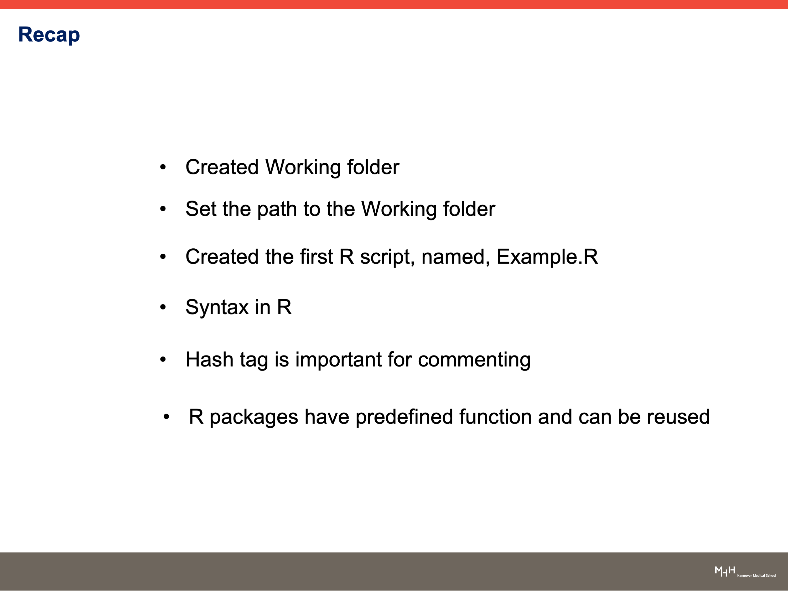</a></p>

---

## Quiz

**Q1. What is an R package?**

<details><summary>Show answer</summary>

A collection of functions, data, documentation, and tests bundled in a standard format.

</details>

**Q2. Which repository would you use for `ggplot2`, and which for `DESeq2`?**

<details><summary>Show answer</summary>

`ggplot2` is on CRAN. `DESeq2` is on Bioconductor.

</details>

**Q3. Write the code to install `readr` online.**

<details><summary>Show answer</summary>

```r
install.packages("readr")
```

</details>

**Q4. Which RStudio menu opens the package installer?**

<details><summary>Show answer</summary>

**Tools > Install Packages...**

</details>

**Q5. In the installer, which setting lets you install from a downloaded file?**

<details><summary>Show answer</summary>

Set **Install from** to **Package Archive File (.tar.gz)**.

</details>

**Q6. Which argument tells `install.packages()` to use a local file?**

<details><summary>Show answer</summary>

`repos = NULL`

</details>

**Q7. Write the code to install `DESeq2` from Bioconductor.**

<details><summary>Show answer</summary>

```r
if (!require("BiocManager", quietly = TRUE))
    install.packages("BiocManager")

BiocManager::install("DESeq2")
```

</details>

**Q8. After installing, which function loads a package?**

<details><summary>Show answer</summary>

`library(package_name)`, for example `library(readr)`.

</details>

**Q9. How do you open help for a function and list a package's vignettes?**

<details><summary>Show answer</summary>

`?function_name` for help and `vignette("pkg")` for vignettes.

</details>

### Try it yourself

1. Install `readr` from CRAN using the RStudio menu.
2. Load it and read `chickens.csv` into an object called `chickens`.
3. Install `DESeq2` from Bioconductor using code.

<details><summary>Show hints</summary>

```r
# 1: Tools > Install Packages... > Repository (CRAN) > readr > Install

# 2
library(readr)
chickens <- read_csv(readr_example("chickens.csv"))

# 3
if (!require("BiocManager", quietly = TRUE))
    install.packages("BiocManager")
BiocManager::install("DESeq2")
```

</details>

---
