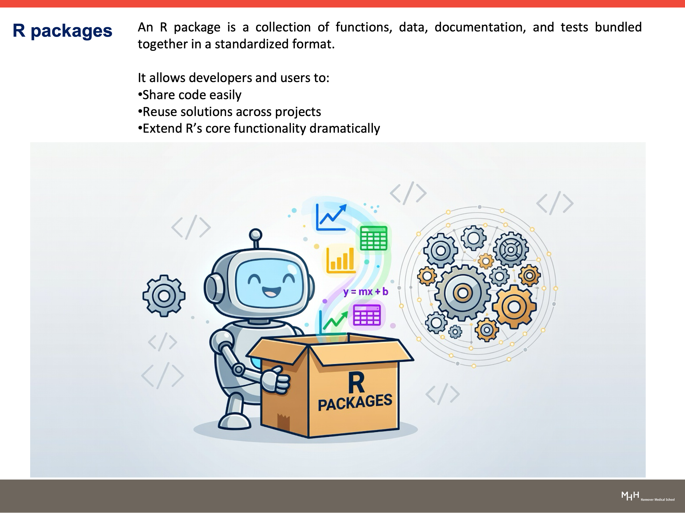
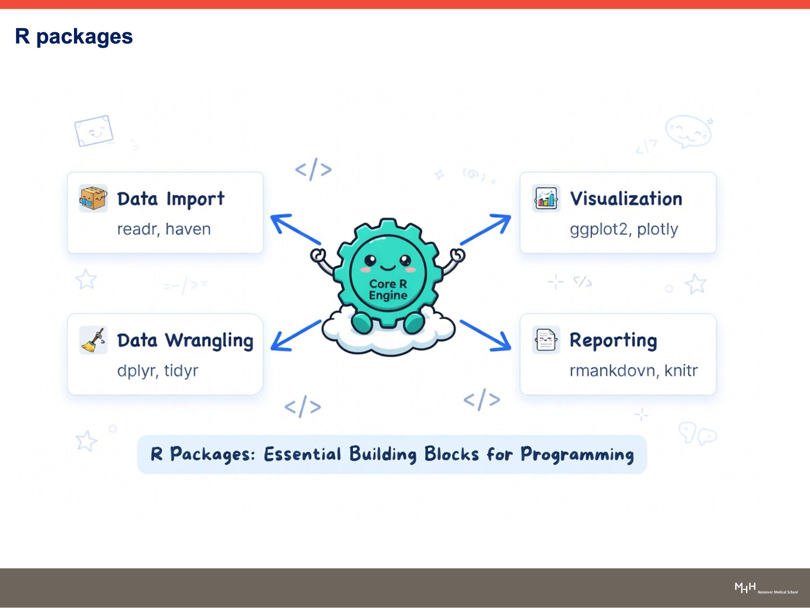
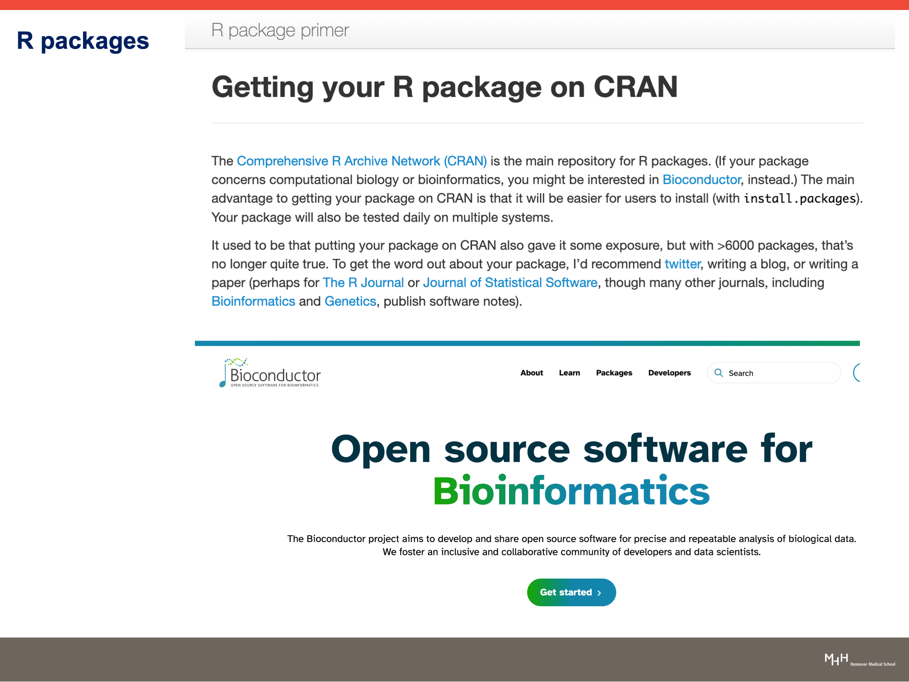

# R Packages: Install from CRAN, Offline, and Bioconductor

**Instructors:** Dr. Manoj Kumar Gupta and Dr. Joachim Wolff
**Affiliation:** Hannover Medical School (MHH), Germany

---

## Contents

1. [Quick links](#quick-links)
2. [What is an R package?](#1-what-is-an-r-package)
3. [Why packages matter](#2-why-packages-matter)
4. [Install packages from CRAN (online)](#3-install-packages-from-cran-online)
5. [Install packages offline](#4-install-packages-offline)
6. [Install packages from Bioconductor](#5-install-packages-from-bioconductor)
7. [Bioconductor offline install](#6-bioconductor-offline-install)
8. [Use your package: load, help, and run](#7-use-your-package-load-help-and-run)
9. [Recap](#8-recap)
10. [Quiz](#quiz)

---

## Quick links

| Resource | Link |
|---|---|
| CRAN (R packages and R downloads) | https://cran.r-project.org/ |
| CRAN: available packages by name | https://cran.r-project.org/web/packages/available_packages_by_name.html |
| CRAN: `readr` package page | https://cran.r-project.org/web/packages/readr/index.html |
| `readr` documentation | https://readr.tidyverse.org/ |
| Bioconductor home | https://bioconductor.org/ |
| Bioconductor: `DESeq2` package page | https://bioconductor.org/packages/DESeq2/ |
| R package primer (Getting your package on CRAN) | https://kbroman.org/pkg_primer/ |

---

## 1. What is an R package?

An **R package** is a collection of **functions, data, documentation, and tests** bundled together in a standardized format.

Packages let developers and users:

- Share code easily
- Reuse solutions across projects
- Extend R's core functionality dramatically



---

## 2. Why packages matter

The core of R is small. Packages add tools for specific jobs:

| Task | Example packages |
|---|---|
| Data import | `readr`, `haven` |
| Data wrangling | `dplyr`, `tidyr` |
| Visualization | `ggplot2`, `plotly` |
| Reporting | `rmarkdown`, `knitr` |

Packages are the **essential building blocks for programming in R**.



### Where do packages come from?

- **CRAN** (Comprehensive R Archive Network) is the main repository for R packages. It is easy to install from with `install.packages()`, and packages are tested daily on multiple systems.
- **Bioconductor** is for computational biology and bioinformatics packages.



---

## 3. Install packages from CRAN (online)

### Step 1: Open the Install Packages window

In RStudio go to **Tools > Install Packages...**


### Step 2: Choose the repository and package

1. Set **Install from:** to **Repository (CRAN)**.
2. Type the package name, for example `readr`. RStudio suggests matching names as you type.
3. Keep **Install dependencies** ticked.
4. Click **Install**.


### Or use code

```r
install.packages("readr")
```

> **Tip:** you can install several packages at once, separated by a comma or space in the dialog, or with `install.packages(c("readr", "dplyr"))` in code.

---

## 4. Install packages offline

Use this when your computer cannot reach CRAN, or when you need a specific file version.

### Step 1: Go to CRAN

Open https://cran.r-project.org/ and click **Packages** in the left menu, under *Software*.


### Step 2: Open the list by name

On the *Contributed Packages* page click **Table of available packages, sorted by name**.


### Step 3: Find your package

The list is alphabetical. Click the first letter of the package (here **R** for `readr`), then click the package name.


### Step 4: Download the right file

On the package page (`readr`, version 2.2.0), find the **Downloads** section:

| System | File to download |
|---|---|
| Windows | `readr_2.2.0.zip` (Windows binaries) |
| macOS | `readr_2.2.0.tgz` (choose arm64 or x86_64 to match your Mac) |
| Any system (source) | `readr_2.2.0.tar.gz` |

Also check the **Depends** and **Imports** lists on the page: those packages must be installed too.


### Step 5: Install from the local file

1. Go to **Tools > Install Packages...**
2. Change **Install from:** to **Package Archive File (.tar.gz)**. On Windows this option also accepts `.zip`.
3. Click **Browse** and pick the downloaded file (for example `readr_2.2.0.zip` in *Downloads*), then click **Open**.
4. Click **Install**.


Or use code:

```r
# Windows
install.packages("C:/Users/yourname/Downloads/readr_2.2.0.zip",
                 repos = NULL, type = "win.binary")

# macOS / Linux (source file)
install.packages("~/Downloads/readr_2.2.0.tar.gz",
                 repos = NULL, type = "source")
```

> **Dependencies:** an offline install does not download the packages it needs. If you see `there is no package called ...`, install those packages first.

---

## 5. Install packages from Bioconductor

Bioconductor hosts open source software for **bioinformatics**: https://bioconductor.org/

### Step 1: Open the website

Go to https://bioconductor.org/ and click **Packages** in the top menu.


### Step 2: Search for your package

Type the package name in the search box (here `deseq2`). The result list shows the package and a short description. For DESeq2 it is *differential gene expression analysis based on the negative binomial distribution*.


### Step 3: Run the install commands

The package page shows the installation code. Start R and enter:

```r
if (!require("BiocManager", quietly = TRUE))
    install.packages("BiocManager")

BiocManager::install("DESeq2")
```

The first lines install `BiocManager` (once). The second command installs `DESeq2`.


> If R asks `Update all/some/none?`, answer `n` unless you want to update every package.

---

## 6. Bioconductor offline install

The same package page has a **Package Archives** table. Download the file that matches your system:

| System | File |
|---|---|
| Any system (source) | `DESeq2_1.52.0.tar.gz` |
| Windows (x86_64) | `DESeq2_1.52.0.zip` |
| macOS (Intel, big-sur-x86_64) | `DESeq2_1.52.0.tgz` |
| macOS (Apple silicon, sonoma-arm64) | `DESeq2_1.52.0.tgz` |

Then install it with **Tools > Install Packages... > Package Archive File** as in section 4.


> Bioconductor packages have many dependencies (the DESeq2 page lists 54). Offline installs are therefore harder than online installs. Use `BiocManager::install()` whenever you can.

---

## 7. Use your package: load, help, and run

Installing is only the first step.

1. **Load** the package with `library()`.
2. **Check help** with `?function` and `vignette("pkg")`.
3. **Now use it!**


### Example: `readr`

Documentation: https://readr.tidyverse.org/

```r
rm(list = ls())               # clear the environment
library(readr)                # load the package

chickens <- read_csv(readr_example("chickens.csv"))
```

The Environment pane now shows `chickens` (5 obs. of 4 variables). R prints a *column specification* message, which is normal.


Click `chickens` in the Environment pane to open the data table:

| chicken | sex | eggs_laid | motto |
|---|---|---|---|
| Foghorn Leghorn | rooster | 0 | That's a joke, ah say, that's a joke, son. |
| Chicken Little | hen | 3 | The sky is falling! |
| Ginger | hen | 12 | Listen. We'll either die free chickens or we die trying. |
| Camilla the Chicken | hen | 7 | Bawk, buck, ba-gawk. |
| Ernie The Giant Chicken | rooster | 0 | Put Captain Solo in the cargo hold. |


> **Tip:** package names need quotation marks in `install.packages("readr")` but not in `library(readr)`.

---

## 8. Recap

- Created a working folder
- Set the path to the working folder
- Created the first R script, named `Example.R`
- Syntax in R
- The hash tag `#` is important for commenting
- R packages have predefined functions and can be reused


---

## Quiz

**Q1. What is an R package?**

<details><summary>Show answer</summary>

A collection of functions, data, documentation, and tests bundled in a standardized format.

</details>

**Q2. Name the main repository for R packages and the one for bioinformatics packages.**

<details><summary>Show answer</summary>

CRAN is the main repository. Bioconductor is the one for bioinformatics.

</details>

**Q3. Which menu path opens the package installer in RStudio?**

<details><summary>Show answer</summary>

**Tools > Install Packages...**

</details>

**Q4. Which "Install from" option do you choose for an offline install?**

<details><summary>Show answer</summary>

**Package Archive File (.tar.gz)**. On Windows this also accepts `.zip`.

</details>

**Q5. Write the code to install DESeq2 from Bioconductor.**

<details><summary>Show answer</summary>

```r
if (!require("BiocManager", quietly = TRUE))
    install.packages("BiocManager")

BiocManager::install("DESeq2")
```

</details>

**Q6. After installing a package, which function loads it?**

<details><summary>Show answer</summary>

`library(package_name)`, for example `library(readr)`.

</details>

**Q7. How do you open help for a function, and how do you list a package's long-form guides?**

<details><summary>Show answer</summary>

`?function_name` for help, and `vignette("pkg")` for vignettes.

</details>

### Try it yourself

1. Install `readr` from CRAN using the RStudio menu.
2. Load it and read the example file `chickens.csv` into an object called `chickens`.
3. Install `DESeq2` from Bioconductor using code.

<details><summary>Show hints</summary>

```r
# 1: Tools > Install Packages... > Repository (CRAN) > readr > Install

# 2
library(readr)
chickens <- read_csv(readr_example("chickens.csv"))

# 3
if (!require("BiocManager", quietly = TRUE))
    install.packages("BiocManager")
BiocManager::install("DESeq2")
```

</details>
