<div align="center">

# Tutorial 4: Biostatistics, from Question to Evidence

**TCGA Pan-Cancer clinical + gene-expression data set: 9,672 tumour samples, 32 cancer types, 30 questions**


</div>

> **How to read this tutorial.** Each section contains a short clinical
> question, a hint that points at the right statistical tool, the R code,
> the real output from our data, and a "What to look for" note. A quiz at
> the end lets you test yourself. Code blocks are designed to run in order,
> top to bottom. All figures are saved in `figures2/`.

## Table of contents

- [Learning objectives](#learning-objectives)
- [Before you start](#before-you-start)
- [Setup](#setup)
- [Section 1. Get to know the data (Q1-Q5)](#section-1-get-to-know-the-data)
- [Section 2. Describe the patients (Q6-Q10)](#section-2-describe-the-patients)
- [Section 3. Compare two groups (Q11-Q14)](#section-3-compare-two-groups)
- [Section 4. Compare multiple groups (Q15-Q19)](#section-4-compare-multiple-groups)
- [Section 5. Relationships and categorical data (Q20-Q24)](#section-5-relationships-and-categorical-data)
- [Section 6. Report and interpret (Q25-Q28)](#section-6-report-and-interpret)
- [Section 7. Survival analysis (Q29-Q30)](#section-7-survival-analysis)
- [Decision guide: which test?](#decision-guide-which-test)
- [Common mistakes to avoid](#common-mistakes-to-avoid)
- [Practice exercises](#practice-exercises)
- [Quiz](#-quiz)

## Learning objectives

1. Turn a clinical question into the right descriptive, inferential or
   time-to-event procedure.
2. Check assumptions (normality, equal variance, expected counts) before
   choosing a parametric or non-parametric test.
3. Report effect sizes and confidence intervals alongside p-values.
4. Correct p-values when making many comparisons.
5. Fit Kaplan-Meier curves and a Cox model, and check the
   proportional-hazards assumption.

## Before you start

- R 4.3 or newer.
- Run `install_all_packages.R` once. This tutorial uses only: tidyverse,
  ggpubr, rstatix, effectsize, car, FSA, broom, survival, survminer,
  scales, patchwork, ggsignif.
- The data file `Data/TCGA_pancancer_combined_geneexpression.rds` (clinical
  data merged with BIRC5, CDKN2A, KRAS, MSLN, SMAD4 and TP53 expression).

## Setup

```r
rm(list = ls())
suppressPackageStartupMessages({
  library(tidyverse); library(ggpubr); library(rstatix)
  library(effectsize); library(car); library(FSA); library(broom)
  library(survival); library(survminer); library(scales)
  library(patchwork); library(ggsignif)
})
```

Create the output folder and a helper that saves every figure:

```r
dir.create("figures2", showWarnings = FALSE)
save_fig <- function(p, name, w = 7, h = 5) {
  ggsave(file.path("figures2", paste0(name, ".png")),
         plot = p, width = w, height = h, dpi = 300)
}
theme_set(theme_bw(base_size = 12))
```

Load the data and keep short, friendly column names:

```r
raw <- readRDS("Data/TCGA_pancancer_combined_geneexpression.rds")

clin <- raw %>%
  transmute(patient_id, sample_barcode, cancer_type,
            Age = age_at_initial_pathologic_diagnosis,
            Gender = gender, Race = race,
            Stage = ajcc_pathologic_tumor_stage,
            Vital = vital_status, Tumor = tumor_status,
            OS, OS.time, PFI, PFI.time,
            BIRC5, CDKN2A, KRAS, MSLN, SMAD4, TP53) %>%
  mutate(Age_Group = cut(Age, c(0, 40, 60, 80, Inf),
                         labels = c("<40", "40-59", "60-79", "80+"),
                         right = FALSE))


str(clin)
```
```r
'data.frame':	9672 obs. of  20 variables:
# $ patient_id    : chr  "TCGA-OR-A5J1" "TCGA-OR-A5J2" "TCGA-OR-A5J3" "TCGA-OR-A5J5" ...
# $ sample_barcode: chr  "TCGA-OR-A5J1-01" "TCGA-OR-A5J2-01" "TCGA-OR-A5J3-01" "TCGA-OR-A5J5-01" ...
# $ cancer_type   : chr  "ACC" "ACC" "ACC" "ACC" ...
# $ Age           : num  58 44 23 30 29 30 66 22 53 52 ...
# $ Gender        : chr  "MALE" "FEMALE" "FEMALE" "MALE" ...
# $ Race          : chr  "WHITE" "WHITE" "WHITE" "WHITE" ...
# $ Stage         : chr  "Stage II" "Stage IV" "Stage III" "Stage III" ...
# $ Vital         : chr  "Dead" "Dead" "Alive" "Dead" ...
# $ Tumor         : chr  "WITH TUMOR" "WITH TUMOR" "WITH TUMOR" "WITH TUMOR" ...
# $ OS            : num  1 1 0 1 0 1 1 0 1 1 ...
# $ OS.time       : num  1355 1677 2091 365 2703 ...
# $ PFI           : num  1 1 1 1 0 1 1 1 1 0 ...
# $ PFI.time      : num  754 289 53 50 2703 ...
# $ BIRC5         : num  5.66 6.11 5.78 9.61 2.87 ...
# $ CDKN2A        : num  8.06 9.42 6.75 10.35 6.75 ...
# $ KRAS          : num  9.91 10.04 9.88 9.22 8.51 ...
# $ MSLN          : num  1.55 0.49 0 0 0 0.49 0.5 0 1.04 6.84 ...
# $ SMAD4         : num  10.27 10.55 9.53 9.42 9.4 ...
# $ TP53          : num  9.14 7.38 9.9 10.19 8.95 ...
# $ Age_Group     : Factor w/ 4 levels "<40","40-59",..: 2 2 1 1 1 1 3 1 2 2 ...

```
---

## Section 1. Get to know the data

### Q1. How many rows and columns are in the dataset?

> **Hint:** `dim()` returns rows then columns.

```r
dim(raw)
```
```
[1] 9672   51
```

**What to look for:** 9,672 rows and 51 columns.

*Fix applied:* none, clean.

> **Note:** **Rows are not always patients.** Always confirm what one row
> means (Q2) before counting. Pitfall: reporting "9,672 patients" when the
> rows are samples.

### Q2. What does each row represent, and what type is each column?

> **Hint:** `str()` shows types. Look at the ID column.

```r
str(raw[, 1:15])
```

```r
#'data.frame':	9672 obs. of  15 variables:
# $ sample_barcode                     : chr  "TCGA-OR-A5J1-01" "TCGA-OR-A5J2-01" "TCGA-OR-A5J3-01" "TCGA-OR-A5J5-01" ...
# $ BIRC5                              : num  5.66 6.11 5.78 9.61 2.87 ...
# $ CDKN2A                             : num  8.06 9.42 6.75 10.35 6.75 ...
# $ KRAS                               : num  9.91 10.04 9.88 9.22 8.51 ...
# $ MSLN                               : num  1.55 0.49 0 0 0 0.49 0.5 0 1.04 6.84 ...
# $ SMAD4                              : num  10.27 10.55 9.53 9.42 9.4 ...
# $ TP53                               : num  9.14 7.38 9.9 10.19 8.95 ...
# $ patient_id                         : chr  "TCGA-OR-A5J1" "TCGA-OR-A5J2" "TCGA-OR-A5J3" "TCGA-OR-A5J5" ...
# $ cancer_type                        : chr  "ACC" "ACC" "ACC" "ACC" ...
# $ age_at_initial_pathologic_diagnosis: num  58 44 23 30 29 30 66 22 53 52 ...
# $ gender                             : chr  "MALE" "FEMALE" "FEMALE" "MALE" ...
# $ race                               : chr  "WHITE" "WHITE" "WHITE" "WHITE" ...
# $ ajcc_pathologic_tumor_stage        : chr  "Stage II" "Stage IV" "Stage III" "Stage III" ...
# $ clinical_stage                     : chr  NA NA NA NA ...
# $ histological_type                  : chr  "Adrenocortical carcinoma- Usual Type" "Adrenocortical carcinoma- Usual Type" "Adrenocortical carcinoma- Usual Type" "Adrenocortical carcinoma- Usual Type" ...

```


```r
head(raw$sample_barcode) # # one row = one tumour sample
```


```r
#[1] "TCGA-OR-A5J1-01" "TCGA-OR-A5J2-01" "TCGA-OR-A5J3-01" "TCGA-OR-A5J5-01" "TCGA-OR-A5J6-01" "TCGA-OR-A5J7-01"
```


**What to look for:** each row is one tumour sample, for example
`TCGA-OR-A5J1-01`. Gene columns are numeric (`num`). Clinical columns such
as `gender` and `race` are text (`chr`).

*Fix applied:* none, clean.

> **Note:** **The type decides the test.** Numeric columns get means and
> t-tests, text columns become groups. Pitfall: a stage coded as 1, 2, 3
> would be treated as a number by mistake.

### Q3. How many missing values are in each column?

> **Hint:** `is.na()` flags missing cells, `colSums()` counts them.

```r
sort(colSums(is.na(raw)), decreasing = TRUE)[1:15]
```
```r
#              Redaction             cause_of_death new_tumor_event_site_other       new_tumor_event_site             residual_tumor              margin_status        Subtype_Integrative 
#                     9654                       9458                       9232                       8485                       8474                       8420                       8331 
#          Subtype_protein           menopause_status       new_tumor_event_type                Subtype_CNA              Subtype_miRNA             clinical_stage new_tumor_event_dx_days_to 
#                    8162                       7823                       7821                       7622                       7486                       7349                       7105 
#         Subtype_DNAmeth 
#                    7077 
```


**What to look for:** some columns are nearly empty (`Redaction`: 9,654
missing; `cause_of_death`: 9,458; `new_tumor_event_site_other`: 9,232).
`clinical_stage` is missing in 7,349 rows.

*Fix applied:* we only use columns with good coverage.

> **Note:** **Missing data is information.** Pitfall: running a test on a
> column that is 98 percent empty means you analyse a tiny, possibly biased
> subset.

### Q4. Are the IDs unique?

> **Hint:** `duplicated()` marks repeated values.

```r
sum(duplicated(raw $ sample_barcode))
sum(duplicated(raw $ patient_id))
```
```
[1] 0
[1] 0
```

**What to look for:** both are 0, so every row is a different patient and
the observations are independent.

*Fix applied:* none, clean.

> **Note:** **Independence is an assumption of almost every test.** If one
> patient had two samples, they would be counted twice. Pitfall: ignoring
> repeated samples from the same person.


### Q5. How many patients are in each stage category?

> **Hint:** `table()` hides missing values by default. Add `useNA = "ifany"`
> to count them too, and compare the two calls.

```r
# Version A: default, missing values are silently dropped
table(clin $ Stage)

```
**Output (Version A):**

```
#[Discrepancy]     [Unknown]      I/II NOS            IS       Stage I      Stage IA      Stage IB      Stage II     Stage IIA     Stage IIB     Stage IIC     Stage III    Stage IIIA    Stage IIIB 
#           52             5             1            46          1209           362           367           590           780           676            52           651           484           240 
#   Stage IIIC      Stage IV     Stage IVA     Stage IVB     Stage IVC       Stage X 
#          190           445           331            19             7            13 
```


```r

# Version B: missing values are counted
table(clin $ Stage, useNA = "ifany")
```


**Output (Version B):**

```
#[Discrepancy]     [Unknown]      I/II NOS            IS       Stage I      Stage IA      Stage IB
#           52             5             1            46          1209           362           367
#     Stage II     Stage IIA     Stage IIB     Stage IIC     Stage III    Stage IIIA    Stage IIIB
#          590           780           676            52           651           484           240
#   Stage IIIC      Stage IV     Stage IVA     Stage IVB     Stage IVC       Stage X          <NA>
#          190           445           331            19             7            13          3152
```

**Comparing the two calls**

| | Version A: `table(clin$Stage)` | Version B: `useNA = "ifany"` |
|---|---|---|
| Stage categories shown | 24 | 24 |
| `<NA>` column | absent | **3,152** |
| Patients counted | 6,520 | 9,672 (the full cohort) |
| Risk | You may think 6,520 is your sample size | Totals match `nrow(clin)` |

The category counts are identical. The only difference is the `<NA>`
column, which holds 3,152 patients (about 33 percent of the cohort).

**What to look for:**

- **Sub-stages:** IA, IB, IIA, IIB, IIC, IIIA, IIIB, IIIC, IVA, IVB and IVC
  all belong to a main stage.
- **Odd labels:** `[Discrepancy]`, `[Unknown]`, `I/II NOS`, `IS` and
  `Stage X` are not usable stages.
- **Missing values:** 3,152 patients have no stage at all.

**Quick check:**

```r
nrow(clin)                       # 9672
sum(table(clin $ Stage))           # 6520, NA dropped
sum(table(clin $ Stage, useNA = "ifany"))   # 9672, matches nrow
```

> **Fix applied:** from Q15 onward we keep only Stage I, II, III and IV
> (2,888 patients with age available).
>
> **Note: tiny categories break tests.**
> Sparse labels such as `[Unknown]` (n = 5) or `I/II NOS` (n = 1) give
> unstable estimates and expected counts below 5.
>
> | Option | When to use it |
> |---|---|
> | Drop the label | It is not a real stage (`[Unknown]`, `[Discrepancy]`) |
> | Merge into a main stage | Sub-stages (IA and IB into Stage I) |
> | Report separately | The group is clinically meaningful |
>
> **Pitfall:** leaving `[Unknown]` in as if it were a real stage. **Always
> report which labels you dropped or merged.**

---

## Section 2. Describe the patients

### Q6. What are the mean and median ages?

> **Hint:** compare the mean with the median to spot skew.

```r
clin %>% summarise(mean_age = mean(Age, na.rm = TRUE),
                   median_age = median(Age, na.rm = TRUE),
                   sd_age = sd(Age, na.rm = TRUE))
```
```
  mean_age median_age   sd_age
1    59.29         61    14.33
```

**What to look for:** the median (61) is slightly above the mean (59.3),
which suggests a mild left skew.

*Fix applied:* `na.rm = TRUE` removes the 43 missing ages.

> **Note:** **Mean and median answer different questions.** The mean is
> pulled by extremes, the median is not. Pitfall: forgetting `na.rm = TRUE`
> and getting `NA`.

### Q7. How are patients distributed by gender, race and vital status?

> **Hint:** one `table()` per column.

```r
table(clin $ Gender, useNA = "ifany")
table(clin $ Race, useNA = "ifany")
table(clin$Vital, useNA = "ifany")
```

**What to look for:** 5,017 female and 4,655 male. White patients dominate
(6,901 of 9,672). 6,960 are alive and 2,710 are dead.

*Fix applied:* one `[Discrepancy]` and two missing vital status values are
excluded later.

> **Note:** **TCGA is not a population sample.** Race is heavily
> imbalanced, so subgroup results for small groups are unreliable.
> Pitfall: comparing 13 Pacific Islander patients with 6,901 White patients
> as if the groups were equally informative.

### Q8. What does the age distribution look like?

> **Hint:** a histogram shows shape, a boxplot shows spread and outliers.

```r
p8a <- ggplot(clin, aes(Age)) +
  geom_histogram(bins = 30, fill = "steelblue", colour = "white") +
  labs(title = "Age at diagnosis", x = "Age (years)", y = "Patients")
p8b <- ggplot(clin, aes(y = Age)) +
  geom_boxplot(fill = "steelblue", width = 0.3) +
  labs(title = "Boxplot of age", y = "Age (years)")
save_fig(p8a + p8b, "Q08_age_distribution", 9, 4.5)
```

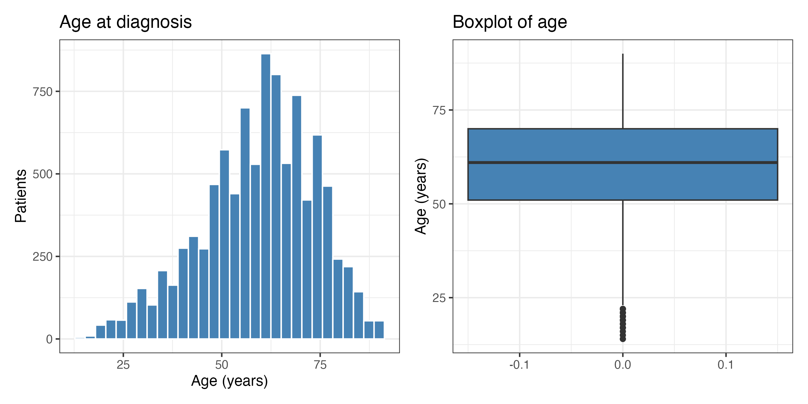

**What to look for:** a peak around 60 to 70 and a tail toward young ages.

*Fix applied:* the warning "Removed 43 rows" is just the missing ages.

> **Note:** **Always plot before testing.** Pitfall: running a t-test on a
> clearly skewed variable without ever looking at it.

### Q9. Are there unusually high or low ages?

> **Hint:** `range()` gives the extremes, `boxplot.stats()` lists outliers.

```r
range(clin $ Age, na.rm = TRUE)
boxplot.stats(clin $ Age)$out
```

**What to look for:** ages run from 14 to 90. The boxplot flags only young
outliers (14 to 22 years).

*Fix applied:* none. These are plausible patients, not typing errors.

> **Note:** **An outlier is not an error.** Remove a value only if you can
> show it is impossible. Pitfall: deleting real young patients to make the
> distribution look normal.

### Q10. What are the mean and median of a continuous measurement?

> **Hint:** the dataset has no cigarette column, so we use TP53 expression.

```r
clin %>% summarise(mean_TP53 = mean(TP53, na.rm = TRUE),
                   median_TP53 = median(TP53, na.rm = TRUE))
```
```
  mean_TP53 median_TP53
1     10.34       10.44
```

**What to look for:** mean and median are close, so the distribution is
fairly symmetric.

*Fix applied:* we swapped the question's variable to match the columns
available.

> **Note:** **Use the columns you actually have.** Pitfall: forcing a
> question onto a column that does not exist in your file.

---

## Section 3. Compare two groups

Keep only patients with a known vital status:

```r
two <- clin %>% filter(Vital %in% c("Alive", "Dead"), !is.na(Age))
```

### Q11. Is age different between Alive and Dead patients?

> **Hint:** a boxplot by group shows centre and spread side by side.

```r
p11 <- ggboxplot(two, x = "Vital", y = "Age", fill = "Vital",
                 palette = "jco", add = "jitter",
                 add.params = list(alpha = 0.15)) +
  labs(x = NULL, y = "Age (years)") + theme(legend.position = "none")
save_fig(p11, "Q11_age_by_vital")
```

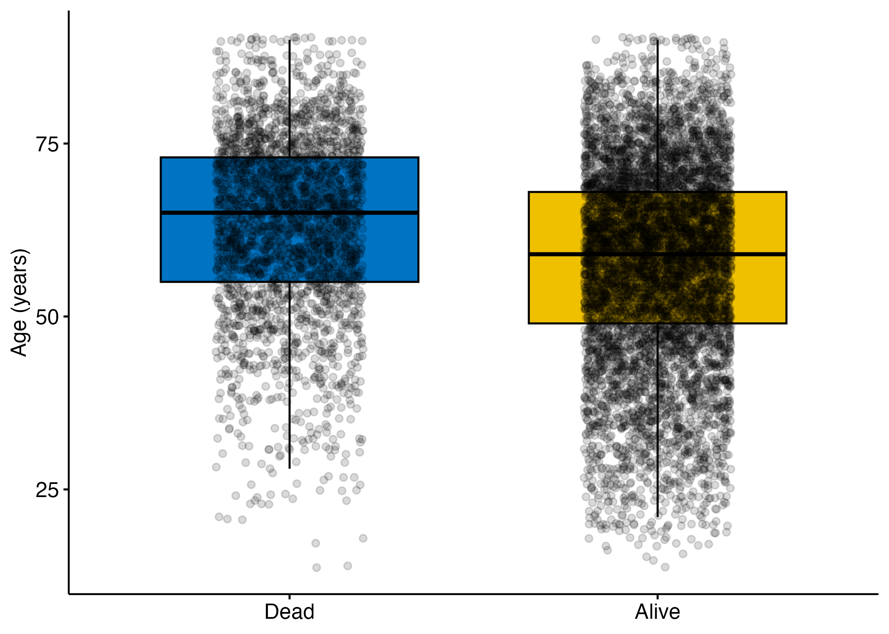

**What to look for:** the Dead group sits higher, with a similar spread.

*Fix applied:* none, clean.

> **Note:** **A picture suggests, a test confirms.** Pitfall: claiming a
> difference from the plot alone.

### Q12. Is age approximately normal within each group?

> **Hint:** Q-Q plots should follow the diagonal line. Shapiro-Wilk gives a
> p-value.

```r
p12 <- ggplot(two, aes(sample = Age)) +
  stat_qq() + stat_qq_line(colour = "red") +
  facet_wrap(~ Vital) + labs(title = "Q-Q plots of age by vital status")
save_fig(p12, "Q12_qq_age_by_vital", 8, 4)
```

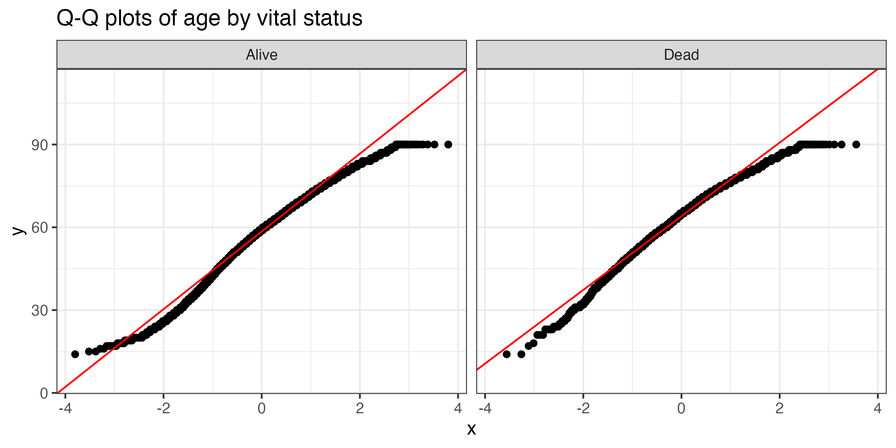

```r
two %>% group_by(Vital) %>%
  summarise(shapiro_p = shapiro.test(sample(Age, min(n(), 5000)))$p.value)
```
```
  Vital shapiro_p
1 Alive  5.91e-22
2 Dead   3.92e-19
```

**What to look for:** both p-values are tiny and the Q-Q points bend away
from the line, so age is not strictly normal.

*Fix applied:* Shapiro-Wilk accepts at most 5,000 values, so we sample.

> **Note:** **With thousands of samples, Shapiro rejects almost anything.**
> Judge the Q-Q plot and the sample size together. Pitfall: switching to a
> non-parametric test only because Shapiro gave p < 0.05 with n in the
> thousands.

### Q13. Welch's t-test or the Wilcoxon rank-sum test?

> **Hint:** Welch compares means and does not need equal variances.
> Wilcoxon compares ranks.

```r
t.test(Age ~ Vital, data = two)
wilcox.test(Age ~ Vital, data = two)
cohens_d(Age ~ Vital, data = two)
```
```
Welch:     t = -18.96, p < 2.2e-16
           mean Alive = 57.66, mean Dead = 63.48
           95% CI of difference: -6.42 to -5.22
Wilcoxon:  W = 7163946, p < 2.2e-16
Cohen's d: -0.41 (95% CI -0.46 to -0.37)
```

**What to look for:** both tests agree. Dead patients are about 5.8 years
older. Cohen's d of 0.41 is a small-to-moderate effect.

*Fix applied:* none. With large groups the t-test is robust despite mild
non-normality, and Wilcoxon confirms it.

> **Note:** **Run both when unsure, and report agreement.** Pitfall:
> choosing the test that gives the smaller p-value after the fact.

### Q14. Is TP53 expression different between Alive and Dead?

> **Hint:** expression is often skewed, so start with Wilcoxon.

```r
p14 <- ggboxplot(two, x = "Vital", y = "TP53", fill = "Vital",
                 palette = "jco") +
  stat_compare_means(method = "wilcox.test") +
  labs(x = NULL, y = "TP53 expression") + theme(legend.position = "none")
save_fig(p14, "Q14_TP53_by_vital")
wilcox.test(TP53 ~ Vital, data = two)
```

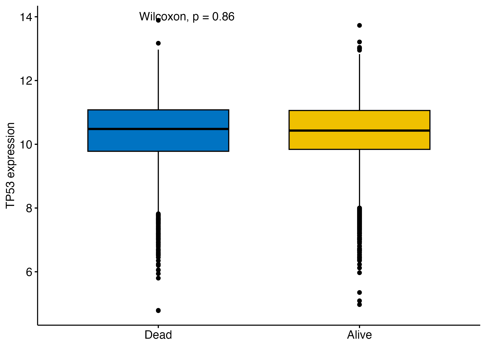

```
W = 9331275, p-value = 0.8556
```

**What to look for:** p = 0.86, so there is no evidence of a difference in
TP53 expression.

*Fix applied:* none, clean.

> **Note:** **Not significant does not mean no effect.** It means we found
> none here. Pitfall: writing "TP53 is unrelated to survival". This test
> only compared RNA levels by vital status at one time point, and ignores
> follow-up time and cancer type.

---

## Section 4. Compare multiple groups

Keep the four main stages:

```r
stg <- clin %>%
  filter(Stage %in% c("Stage I", "Stage II", "Stage III", "Stage IV"),
         !is.na(Age))
```

### Q15. Does mean age differ across stages?

> **Hint:** boxplot by stage, then one-way ANOVA.

```r
p15 <- ggboxplot(stg, x = "Stage", y = "Age", fill = "Stage",
                 palette = "jco") +
  labs(x = NULL, y = "Age (years)") + theme(legend.position = "none")
save_fig(p15, "Q15_age_by_stage")

stage_anova <- aov(Age ~ Stage, data = stg)
summary(stage_anova)
```

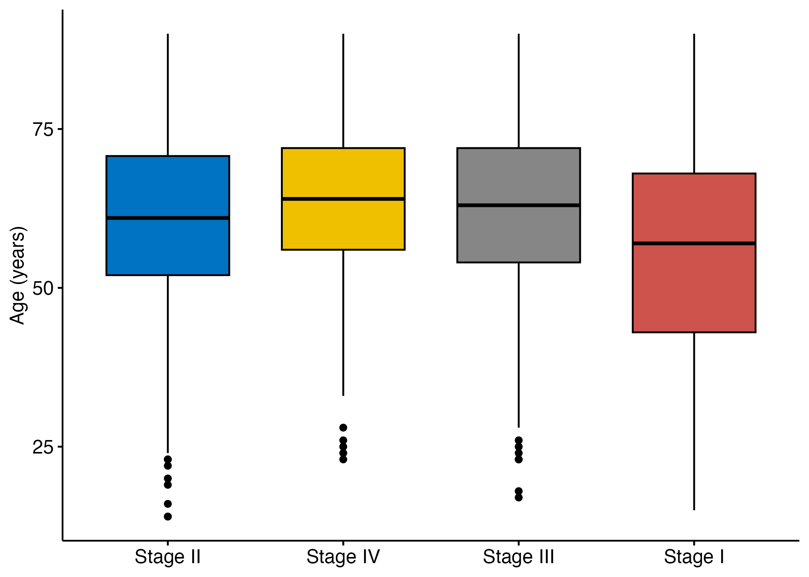

```
Stage       Df  Sum Sq Mean Sq F value Pr(>F)
Stage        3   35785   11928   55.97 <2e-16 ***
Residuals 2884  614649     213
```

**What to look for:** a highly significant overall difference
(F = 55.97). ANOVA tells you that at least one stage differs, not which.

*Fix applied:* only the four main stages are kept.

> **Note:** **A significant ANOVA is only a gate.** You still need a
> post-hoc test. Pitfall: saying "all stages differ" after a significant F.

### Q16. Are the ANOVA assumptions reasonable?

> **Hint:** residuals should be roughly normal (Q-Q plot) and the groups
> should have similar variance (Levene's test).

```r
res <- residuals(stage_anova)
p16 <- ggplot(data.frame(res), aes(sample = res)) +
  stat_qq() + stat_qq_line(colour = "red") +
  labs(title = "Q-Q plot of ANOVA residuals")
save_fig(p16, "Q16_anova_residuals", 5, 5)
leveneTest(Age ~ factor(Stage), data = stg)
```

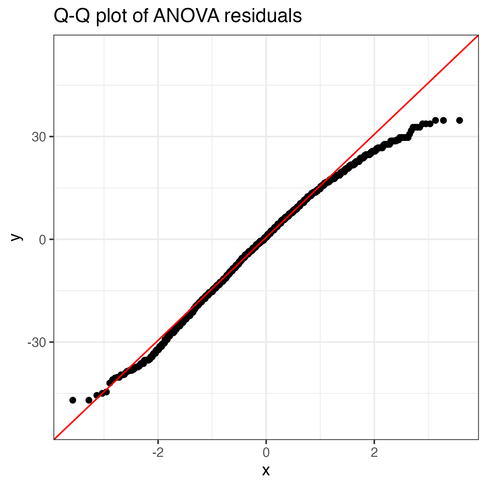

```
Levene's Test: F = 37.23, p < 2.2e-16
```

**What to look for:** Levene's test rejects equal variances, so one
assumption fails.

*Fix applied:* we confirm with Kruskal-Wallis (Q18) and Dunn (Q19).

> **Note:** **Check assumptions on residuals, not on raw data.** Pitfall:
> testing normality of the raw age column instead of the model residuals.

### Q17. Which stages differ? (Tukey HSD)

> **Hint:** Tukey HSD is built into base R and compares all pairs while
> controlling the family-wise error. It replaces Duncan's test, which needs
> a package outside our installer.

```r
tuk <- TukeyHSD(stage_anova)
tuk
```

| Pair | Difference (years) | Adjusted p |
|---|---|---|
| II - I | 5.69 | < 0.001 |
| III - I | 7.28 | < 0.001 |
| IV - I | 8.19 | < 0.001 |
| III - II | 1.59 | 0.225 |
| IV - II | 2.50 | 0.033 |
| IV - III | 0.91 | 0.740 |

Plot the intervals:

```r
tuk_df <- as.data.frame(tuk$Stage) %>% rownames_to_column("pair")
p17 <- ggplot(tuk_df, aes(diff, pair)) +
  geom_pointrange(aes(xmin = lwr, xmax = upr)) +
  geom_vline(xintercept = 0, linetype = 2, colour = "red") +
  labs(x = "Mean age difference (years)", y = NULL,
       title = "Tukey HSD: pairwise stage differences")
save_fig(p17, "Q17_tukey_stage", 7, 4)
```

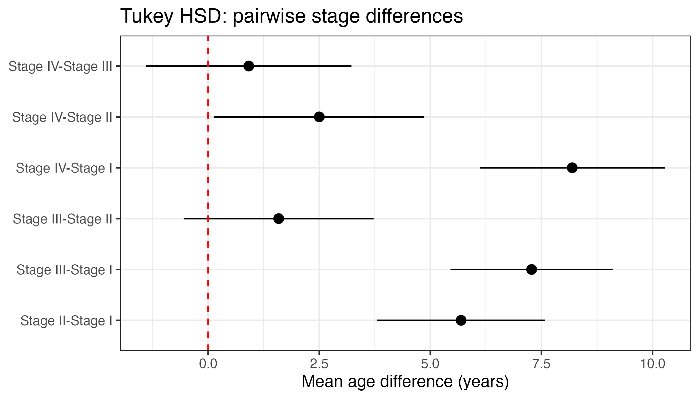

**What to look for:** Stage I patients are younger than all others.
Stages II, III and IV are similar, except IV vs II (p = 0.033).
Intervals that cross the red line mean no clear difference.

*Fix applied:* Tukey HSD in place of Duncan's test.

> **Note:** **Tukey is a little stricter than Duncan.** Pitfall: running
> many separate t-tests instead of a proper post-hoc test.

### Q18. How does the Kruskal-Wallis result compare?

> **Hint:** the rank-based alternative to ANOVA.

```r
kruskal.test(Age ~ Stage, data = stg)
```
```
Kruskal-Wallis chi-squared = 131.07, df = 3, p-value < 2.2e-16
```

**What to look for:** same conclusion as ANOVA, so the result does not
depend on the normality or equal-variance assumptions.

*Fix applied:* none, clean.

> **Note:** **Agreement between two tests builds confidence.** Pitfall:
> reporting only the test that gave the result you wanted.

### Q19. Which pairs differ? (Dunn's test)

> **Hint:** Dunn is the post-hoc test for Kruskal-Wallis. Use a
> multiple-testing correction such as Holm.

```r
dunnTest(Age ~ factor(Stage), data = stg, method = "holm")
```

| Comparison | Adjusted p |
|---|---|
| I - II | < 0.001 |
| I - III | < 0.001 |
| I - IV | < 0.001 |
| II - III | 0.133 |
| II - IV | 0.033 |
| III - IV | 0.367 |

**What to look for:** the same pattern as Tukey.

*Fix applied:* Holm correction for six comparisons.

> **Note:** **Two different methods, same answer.** That is robust
> evidence. Pitfall: using the raw `P.unadj` column instead of `P.adj`.

---

## Section 5. Relationships and categorical data

### Q20. Is age associated with TP53 expression?

> **Hint:** scatter plot with a straight-line fit.

```r
p20 <- ggplot(clin, aes(Age, TP53)) +
  geom_point(alpha = 0.15) +
  geom_smooth(method = "lm", colour = "red") +
  labs(x = "Age (years)", y = "TP53 expression")
save_fig(p20, "Q20_age_vs_TP53")
```

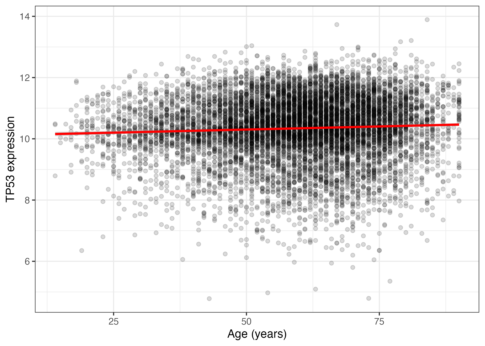

**What to look for:** an almost flat line through a wide cloud, so a very
weak relationship.

*Fix applied:* none. The 43 missing ages are dropped with a warning.

> **Note:** **A line can be statistically real and biologically
> meaningless.** Pitfall: reading the slope without looking at the
> scatter.

### Q21. Pearson or Spearman correlation?

> **Hint:** Pearson measures linear association. Spearman is rank-based and
> robust to outliers and skew.

```r
cor.test(clin $ Age, clin $ TP53, method = "pearson")
cor.test(clin $ Age, clin $ TP53, method = "spearman", exact = FALSE)
```
```
Pearson:  r = 0.055 (95% CI 0.035 to 0.075), p = 6.7e-08
Spearman: rho = 0.067, p = 5.9e-11
```

**What to look for:** both are significant but tiny. With about 9,600
samples a trivial correlation reaches significance. r = 0.055 explains
about 0.3 percent of the variance (r squared).

*Fix applied:* `exact = FALSE` because of tied ranks.

> **Note:** **Significance is not importance.** Pitfall: calling a
> correlation of 0.05 "associated" because p is small.

### Q22. Is vital status associated with gender?

> **Hint:** two categorical variables, so make a contingency table and use
> the chi-square test. Use Fisher's test if expected counts are below 5.

```r
tab22 <- table(two $ Gender, two $ Vital)
tab22
chisq.test(tab22)
cramers_v(tab22)
```

| | Alive | Dead |
|---|---|---|
| FEMALE | 3684 | 1313 |
| MALE | 3242 | 1388 |

```
X-squared = 16.14, df = 1, p = 5.9e-05
Cramer's V = 0.04 (95% CI 0.02 to 1.00)
```

**What to look for:** a significant association, but Cramer's V of 0.04 is
negligible. Men have a slightly higher proportion dead (30 percent versus
26 percent).

*Fix applied:* Yates' continuity correction is applied automatically for a
2 by 2 table.

> **Note:** **Pair every chi-square with an effect size.** Pitfall:
> concluding that gender strongly drives death from p = 6e-05.

### Q23. Does the proportion of Dead patients vary across stages?

> **Hint:** row proportions of the stage by vital-status table, then
> chi-square.

```r
tab23 <- table(stg $ Stage, stg $ Vital)
round(prop.table(tab23, 1), 3)
chisq.test(tab23)
```

| Stage | Alive | Dead |
|---|---|---|
| I | 0.879 | 0.121 |
| II | 0.735 | 0.265 |
| III | 0.637 | 0.363 |
| IV | 0.329 | 0.671 |

```
X-squared = 500.74, df = 3, p < 2.2e-16
```

```r
p23 <- stg %>% filter(Vital %in% c("Alive", "Dead")) %>%
  count(Stage, Vital) %>%
  ggplot(aes(Stage, n, fill = Vital)) +
  geom_col(position = "fill") +
  scale_y_continuous(labels = percent) +
  labs(x = NULL, y = "Proportion")
save_fig(p23, "Q23_dead_by_stage")
```

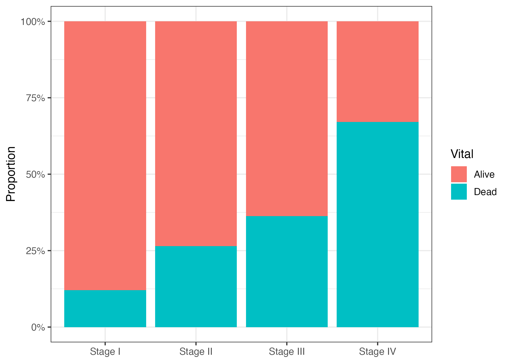

**What to look for:** a strong gradient. Mortality rises from 12 percent
in Stage I to 67 percent in Stage IV.

*Fix applied:* none, clean.

> **Note:** **Use row proportions to compare groups of different size.**
> Pitfall: comparing raw counts. Also, the chi-square test ignores follow-up
> time, so survival analysis (Q30) is the better tool.

### Q24. Are some groups too small for reliable comparisons?

> **Hint:** check group sizes and the expected counts before you trust a
> test.

```r
clin %>% count(cancer_type, sort = TRUE) %>% tail(10)
chisq.test(tab23)$expected
```

**What to look for:** the smallest cancer types are CHOL (36), DLBC (48),
UCS (57), KICH (66) and ACC (79). All expected counts in the stage table
are above 5 (the smallest is 128), so the chi-square test is valid.

*Fix applied:* none. We avoid per-cancer tests on the smallest cohorts.

> **Note:** **Small groups give unstable estimates and wide intervals.**
> Pitfall: ranking cancers by a statistic computed on 36 patients.

---

## Section 6. Report and interpret

### Q25. How do you report the age comparison by vital status?

> **Hint:** give group summaries, the test, the p-value and an effect size.

```r
two %>% group_by(Vital) %>%
  summarise(mean = mean(Age), sd = sd(Age), n = n())
```

Template (insert the SD values from your output):

> Patients who died were older at diagnosis (mean 63.5 years,
> n = 2,710) than patients who were alive (mean 57.7 years, n = 6,960).
> The difference was 5.8 years (Welch t-test, 95% CI 5.2 to 6.4,
> p < 0.001; Cohen's d = 0.41).

**What to look for:** a good sentence has direction, size, uncertainty and
the test name.

*Fix applied:* SDs are not in our printed output, so run the code above to
fill them in.

> **Note:** **Never write only "p < 0.05".** Pitfall: reporting
> significance with no direction or size.

### Q26. How do you report ANOVA and the post-hoc test?

> **Hint:** the overall test first, then which pairs differ.

> Mean age differed across stages (one-way ANOVA, F(3, 2884) = 55.97,
> p < 0.001). Tukey HSD showed that Stage I patients were younger than
> Stage II, III and IV (all adjusted p < 0.001). Stage II and IV also
> differed (adjusted p = 0.033). Because variances were unequal (Levene
> p < 0.001), we confirmed the result with Kruskal-Wallis and Dunn's test,
> which gave the same pattern.

**What to look for:** the assumption problem and the robustness check are
both stated.

*Fix applied:* none, clean.

> **Note:** **Report the checks, not only the result.** Pitfall: hiding a
> failed assumption.

### Q27. Why report an effect size and a confidence interval?

> **Hint:** compare the p-value of Q21 with its effect size.

```r
cohens_d(Age ~ Vital, data = two)
t.test(Age ~ Vital, data = two)$conf.int
```

**What to look for:** Q21 had p = 6.7e-08 but r = 0.055, a negligible
effect. Q13 had d = 0.41 and an interval of 5.2 to 6.4 years, which shows
both size and uncertainty.

*Fix applied:* none, clean.

> **Note:** **The p-value answers "is there an effect?", the effect size
> answers "how big?".** Pitfall: using a tiny p-value as evidence of a
> large effect.

### Q28. Why adjust p-values for many pairwise comparisons?

> **Hint:** each test at 0.05 has a 5 percent chance of a false alarm.
> Many tests add up.

```r
pairwise.wilcox.test(stg $ Age, stg $ Stage, p.adjust.method = "none")
pairwise.wilcox.test(stg $ Age, stg $ Stage, p.adjust.method = "holm")
```

| Pair | Raw p | Holm p |
|---|---|---|
| II vs I | 1.1e-11 | 4.5e-11 |
| III vs II | 0.0577 | 0.115 |
| IV vs II | 0.0082 | 0.025 |
| IV vs III | 0.3743 | 0.374 |

**What to look for:** with six comparisons the chance of at least one false
positive is about 26 percent (1 - 0.95 to the power 6). III vs II is
borderline raw and clearly not significant after Holm.

*Fix applied:* Holm correction.

> **Note:** **Decide the correction before looking at the results.**
> Pitfall: trying many comparisons and reporting only the significant ones.

---

## Section 7. Survival analysis

### Q29. Do we have follow-up time and event status?

> **Hint:** you need a time column and an event (0/1) column. `Vital`
> alone is not enough.

```r
summary(clin $ OS.time)
table(clin $ OS, useNA = "ifany")
surv <- clin %>% filter(!is.na(OS.time), !is.na(OS), OS.time > 0)
```
```
OS.time: median 722 days, mean 1024, max 9634, 33 missing
OS: 6962 censored (0), 2710 events (1)
```

**What to look for:** yes. `OS.time` is follow-up in days and `OS` marks
death (1) or censoring (0). Most patients are censored.

*Fix applied:* we drop rows with missing time and keep only `OS.time > 0`.

> **Note:** **Censoring is the whole reason for survival methods.** A
> patient still alive at last contact is not a "survivor forever".
> Pitfall: treating censored patients as non-events in a simple proportion.

### Q30. How does survival differ between groups?

> **Hint:** Kaplan-Meier curves and the log-rank test compare groups. A Cox
> model adjusts for other variables.

Overall curve:

```r
fit_all <- survfit(Surv(OS.time, OS) ~ 1, data = surv)
p30a <- ggsurvplot(fit_all, data = surv, conf.int = TRUE,
                   xlab = "Days", ylab = "Overall survival")
save_fig(p30a$plot, "Q30a_KM_overall")
```

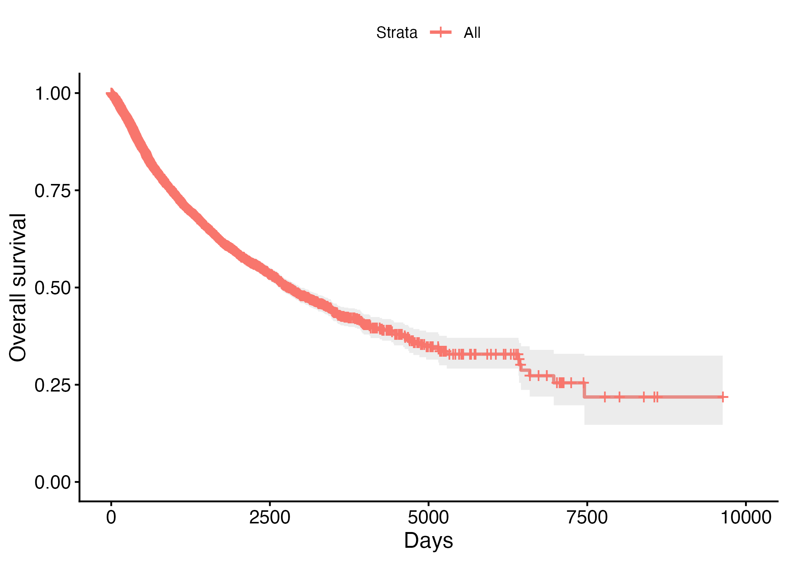

By gender, with log-rank test:

```r
fit_g <- survfit(Surv(OS.time, OS) ~ Gender, data = surv)
p30b <- ggsurvplot(fit_g, data = surv, pval = TRUE, risk.table = TRUE,
                   xlab = "Days", ylab = "Overall survival")
save_fig(p30b$plot, "Q30b_KM_gender")
survdiff(Surv(OS.time, OS) ~ Gender, data = surv)
```

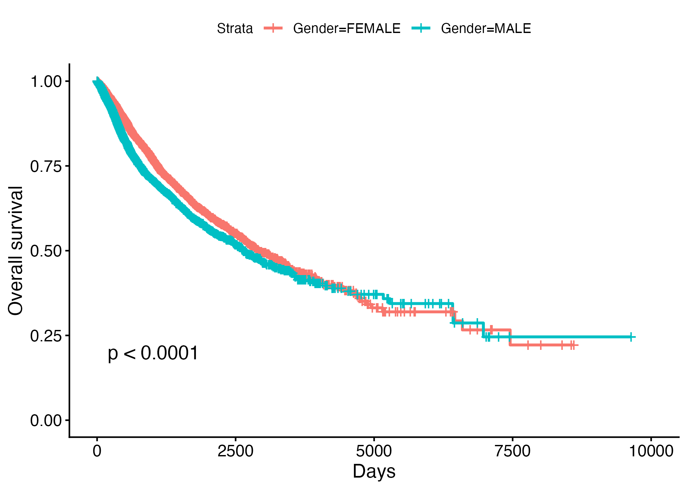

```
Gender=FEMALE  N 4943  Observed 1311  Expected 1453
Gender=MALE    N 4603  Observed 1379  Expected 1237
Chisq = 30.1 on 1 df, p = 4e-08
```

By age group:

```r
surv2 <- surv %>% filter(!is.na(Age_Group))
fit_a <- survfit(Surv(OS.time, OS) ~ Age_Group, data = surv2)
p30c <- ggsurvplot(fit_a, data = surv2, pval = TRUE,
                   xlab = "Days", ylab = "Overall survival")
save_fig(p30c$plot, "Q30c_KM_agegroup")
```

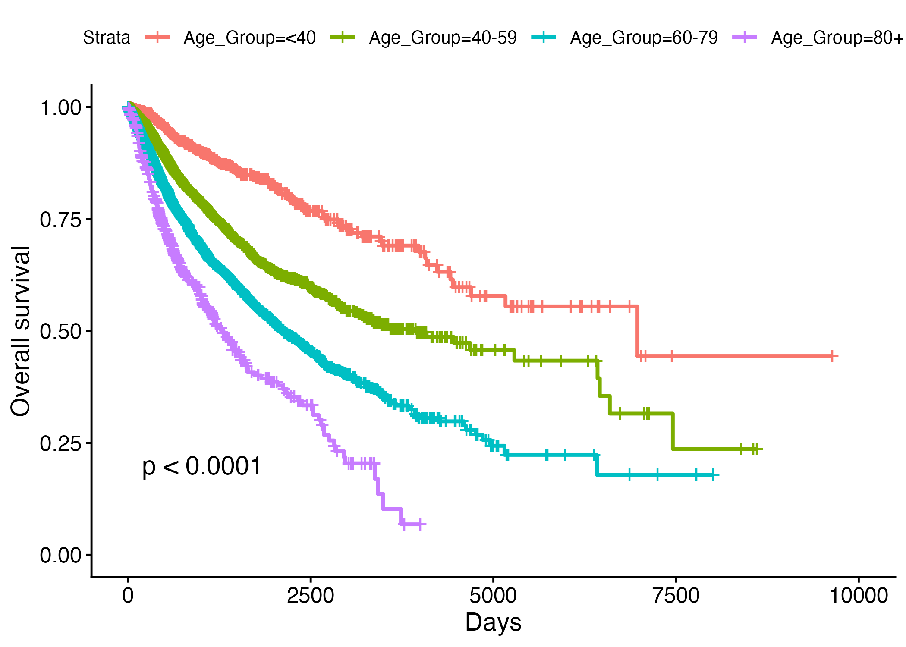

Adjusted effect with a Cox model:

```r
cox <- coxph(Surv(OS.time, OS) ~ Age + Gender, data = surv)
summary(cox)
tidy(cox, exponentiate = TRUE, conf.int = TRUE)
```

| Term | Hazard ratio | 95% CI | p |
|---|---|---|---|
| Age (per year) | 1.031 | 1.028 to 1.034 | < 2e-16 |
| Male vs female | 1.224 | 1.135 to 1.321 | 1.7e-07 |

Concordance = 0.627. Check the proportional-hazards assumption:

```r
cox.zph(cox)
```
```
        chisq df          p
Age      3.24  1      0.072
Gender  26.41  1  0.00000028
GLOBAL  29.97  2  0.00000031
```

**What to look for:**
- Each extra year of age raises the hazard of death by about 3 percent.
  Men have about 22 percent higher hazard than women, after adjusting for
  age.
- The proportional-hazards check fails for gender (p = 2.8e-07). The single
  hazard ratio is then an average over time and must be interpreted with
  caution. Age is borderline (p = 0.072).
- Pooling 32 cancer types is a limitation. A better model uses
  `strata(cancer_type)`.

*Fix applied:* we report the failed assumption instead of hiding it.

> **Note:** **A hazard ratio is not a risk ratio, and it assumes constant
> proportionality over time.** Pitfall: reporting the hazard ratio without
> running `cox.zph`. A concordance of 0.627 means modest prediction, since
> 0.5 is chance.

---

## Decision guide: which test?

| Question | Data | Check | Test |
|---|---|---|---|
| 2 groups, numeric | roughly normal or large n | equal variance | Welch t-test |
| 2 groups, numeric | skewed or ordinal | none | Wilcoxon rank-sum |
| 3+ groups, numeric | normal residuals, equal variance | Levene | ANOVA + Tukey |
| 3+ groups, numeric | skewed or unequal variance | none | Kruskal-Wallis + Dunn (Holm) |
| 2 numeric variables | linear, no outliers | scatter | Pearson |
| 2 numeric variables | skewed or monotonic | scatter | Spearman |
| 2 categorical variables | expected counts at least 5 | expected table | Chi-square + Cramer's V |
| 2 categorical variables | expected counts below 5 | expected table | Fisher's exact |
| Time to event, groups | censored data | none | Kaplan-Meier + log-rank |
| Time to event, adjusted | censored data | `cox.zph` | Cox model |

## Common mistakes to avoid

1. Treating a small p-value as proof of a large effect (Q21, Q27).
2. Using ANOVA when variances differ, with no back-up test (Q16, Q18).
3. Running many comparisons without correction (Q28).
4. Building a survival curve from vital status alone (Q29).
5. Ignoring a failed proportional-hazards check (Q30).
6. Reading a non-significant result as "no effect" (Q14).
7. Counting rows as patients without checking uniqueness (Q4).

## Practice exercises

1. **Another gene.** Repeat Q14 for KRAS, SMAD4 and BIRC5. Which, if any,
   differs between Alive and Dead? Correct the three p-values with Holm.
2. **Another test.** Compare TP53 expression across the four stages with
   Kruskal-Wallis and Dunn's test. Plot it with `ggboxplot`.
3. **Stratified survival.** Fit `coxph(Surv(OS.time, OS) ~ Age + Gender +
   strata(cancer_type))` and compare the gender hazard ratio with Q30.
4. **One cancer.** Choose one cancer type with at least 300 patients and
   repeat the Kaplan-Meier curve by gender. Does the result match the
   pooled analysis?

---

## 🧠 Quiz

Test yourself. Try each question before opening the answer.

### Basic (1-7)

**Q1 - Unique IDs.** `sum(duplicated(raw$patient_id))` returns 0. What does
this tell you?

<details><summary>Show answer</summary>

No patient appears twice, so each row is an independent patient. This
supports the independence assumption of most tests.

</details>

**Q2 - Mean versus median.** The mean age is 59.3 and the median is 61.
What does this suggest?

<details><summary>Show answer</summary>

A mild left skew: a tail of young patients pulls the mean below the median.
The difference is small, so the distribution is close to symmetric.

</details>

**Q3 - Two-group test.** You want to compare age between `Alive` and
`Dead`. The variances look different and the groups have unequal sizes.
Which test do you pick?

<details><summary>Show answer</summary>

Welch's t-test, `t.test(Age ~ Vital)`. It does not assume equal variance
and is the R default. The Student version with `var.equal = TRUE` would be
wrong here.

</details>

**Q4 - Missing values.** `Redaction` has 9,654 missing values out of 9,672
rows. Should you test it?

<details><summary>Show answer</summary>

No. Only 18 rows have data, so any test would describe a tiny and possibly
biased subset.

</details>

**Q5 - Outliers.** The boxplot flags ages 14 to 22 as outliers. Do you
delete them?

<details><summary>Show answer</summary>

No. They are plausible young patients, not typing errors. Remove a value
only if you can show it is impossible.

</details>

**Q6 - Q-Q plot.** What does a Q-Q plot whose points follow the diagonal
line show?

<details><summary>Show answer</summary>

The data are approximately normal. Points curving away at the ends indicate
heavy tails or skew.

</details>

**Q7 - Correlation.** What is the difference between Pearson and Spearman?

<details><summary>Show answer</summary>

Pearson measures linear association between the raw values. Spearman ranks
the values first, so it measures any monotonic trend and is less sensitive
to outliers and skew.

</details>

### Intermediate (8-14)

**Q8 - Shapiro-Wilk.** With n = 6,960, Shapiro-Wilk gives p = 6e-22. Does
this prove that a t-test is invalid?

<details><summary>Show answer</summary>

No. With thousands of samples Shapiro rejects even tiny departures from
normality. Read the Q-Q plot too. With large groups the t-test is robust,
and running Wilcoxon as a check is good practice.

</details>

**Q9 - Cohen's d.** d = -0.41 for age by vital status. How do you
interpret it?

<details><summary>Show answer</summary>

A small-to-moderate difference (about 0.4 standard deviations). The sign
shows that the first group (Alive) has the lower mean. In practice, Dead
patients were about 5.8 years older.

</details>

**Q10 - Non-significant result.** Q14 gave p = 0.86 for TP53. Can you say
"TP53 has no effect on survival"?

<details><summary>Show answer</summary>

No. A non-significant test means no evidence was found. Our test compared
RNA levels by vital status only. It ignored follow-up time and cancer type,
so it cannot say anything about survival.

</details>

**Q11 - ANOVA gate.** The ANOVA is significant (F = 55.97). Which stages
differ?

<details><summary>Show answer</summary>

ANOVA does not say. You need a post-hoc test such as Tukey HSD. It showed
that Stage I differs from II, III and IV, and that IV differs from II.

</details>

**Q12 - Failed assumption.** Levene's test gives p < 0.001. What do you do?

<details><summary>Show answer</summary>

Equal variance is violated. Confirm with Kruskal-Wallis and Dunn's test, or
use Welch's ANOVA (`oneway.test(..., var.equal = FALSE)`). Report the
check.

</details>

**Q13 - Tiny correlation.** r = 0.055, p = 6.7e-08. Is age an important
predictor of TP53?

<details><summary>Show answer</summary>

No. The p-value is small only because n is about 9,600. r squared is 0.003,
so age explains about 0.3 percent of the variance.

</details>

**Q14 - Chi-square versus Fisher.** When do you prefer Fisher's exact test?

<details><summary>Show answer</summary>

When expected counts are below 5 in a 2 by 2 table, usually from small
samples. Check with `chisq.test(tab)$expected`.

</details>

### Advanced (15-20)

**Q15 - Multiple testing.** You run six pairwise tests at 0.05. What is the
chance of at least one false positive?

<details><summary>Show answer</summary>

About 26 percent, from 1 - 0.95 to the power 6. Use Holm or Bonferroni to
control it.

</details>

**Q16 - Censoring.** A patient is alive at 3,000 days, the last follow-up.
How is he or she treated in a Kaplan-Meier analysis?

<details><summary>Show answer</summary>

As censored (`OS = 0`). The patient contributes to the at-risk count up to
3,000 days, then leaves the curve. They are not counted as a survivor
forever and not as a death.

</details>

**Q17 - Hazard ratio.** Male HR = 1.224 (95% CI 1.135 to 1.321). Interpret
it.

<details><summary>Show answer</summary>

At any moment, men have about 22 percent higher hazard of death than women,
adjusted for age. The interval excludes 1, so the effect is statistically
significant. An HR is not the same as a risk ratio.

</details>

**Q18 - Proportional hazards.** `cox.zph` gives p = 2.8e-07 for gender.
What does that mean?

<details><summary>Show answer</summary>

The proportional-hazards assumption fails: the gender effect changes over
time. The single HR is then an average and should be interpreted with
caution. Options: stratify by cancer type, split follow-up time, or use
restricted mean survival time.

</details>

**Q19 - Pooled cancers.** Why is a pan-cancer Cox model on age and gender
questionable?

<details><summary>Show answer</summary>

Cancer types differ massively in baseline survival and in age and gender
mix. Pooling confounds the results. Use `strata(cancer_type)` or analyse
one cancer at a time.

</details>

**Q20 - Wrong design.** A student plots a survival curve using only
`vital_status`. What is missing?

<details><summary>Show answer</summary>

Follow-up time. A curve needs time-to-event and an event indicator
(`OS.time` and `OS`). `vital_status` alone cannot show when events
happened or who was censored.

</details>

### Scoring guide

| Level | Questions | Points each | Subtotal |
|---|---|---|---|
| Basic | Q1-Q7 | 1 | 7 |
| Intermediate | Q8-Q14 | 2 | 14 |
| Advanced | Q15-Q20 | 3 | 18 |
| **Total** | **20** | | **39** |

| Score | Level | What to do next |
|---|---|---|
| 0-15 | Starting out | Re-read Sections 1 to 3 and rerun the code blocks. |
| 16-27 | Solid | Revisit the questions you missed, especially assumptions (Q12 to Q16). |
| 28-35 | Strong | Try the practice exercises on a different cancer type. |
| 36-39 | Excellent | You are ready to design your own analysis from a research question. |

---

## Recommended workflow (summary)

1. **Inspect** the data: size, types, missing values, unique IDs (Q1-Q5).
2. **Describe** each variable and plot it (Q6-Q10).
3. **Check assumptions**: normality on residuals or Q-Q plots, equal
   variance, expected counts (Q12, Q16, Q24).
4. **Choose the test** with the decision guide, run it and a robust backup
   (Q13, Q15-Q19).
5. **Report** the effect size, the confidence interval and the corrected
   p-value, not the p-value alone (Q25-Q28).
6. **Use survival methods** whenever time to event and censoring matter,
   and check the proportional-hazards assumption (Q29-Q30).

## Reproducibility

Print your session information at the end of every analysis:

```r
sessionInfo()
```

Save it together with the figures in `figures2/` so that others can
reproduce your results.

## Data and ethics

- TCGA data are public and de-identified. Do not try to re-identify
  patients.
- TCGA is not a random sample of the population (see Q7), so do not
  generalise prevalence or risk figures beyond this cohort.
- Observational associations (age, gender, stage and survival) do not show
  causation.

## Acknowledgements

Data: The Cancer Genome Atlas (TCGA) Pan-Cancer clinical resource.
Packages: tidyverse, rstatix, effectsize, car, FSA, broom, survival,
survminer, ggpubr, scales, patchwork, ggsignif.

