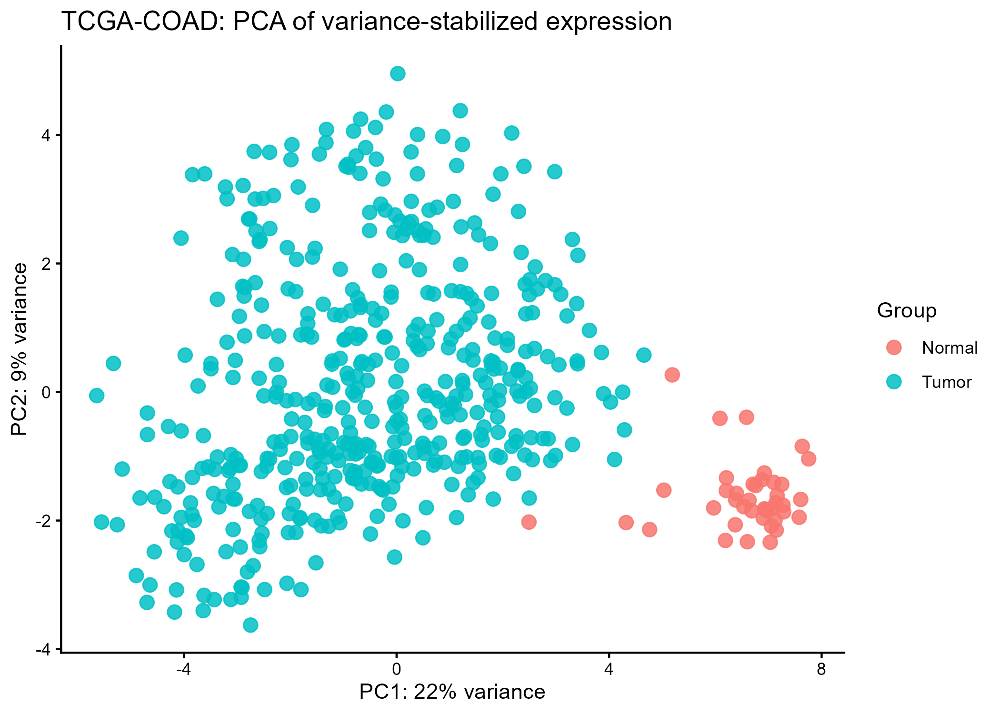
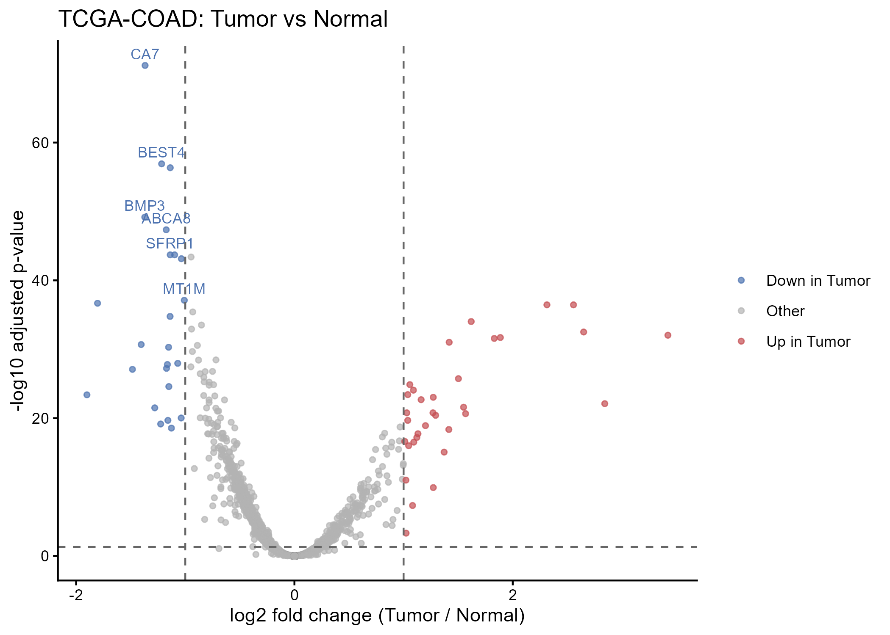
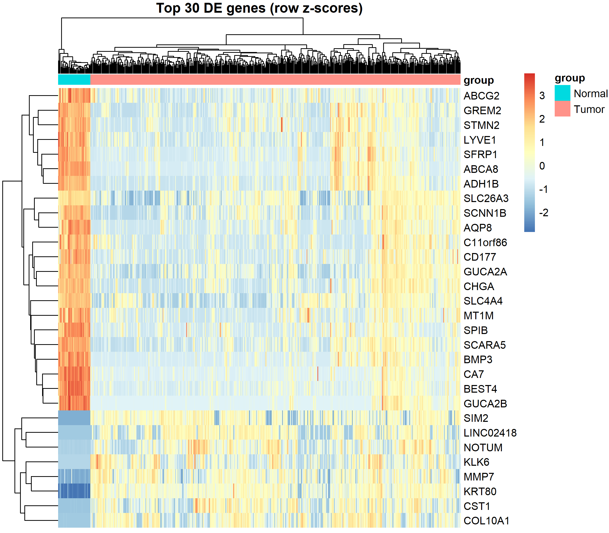

# Differential gene expression in TCGA-COAD: Tumor vs Normal with DESeq2

## Overview

This beginner-friendly workflow compares **TCGA colon adenocarcinoma (TCGA-COAD) Tumor** samples with **Normal** samples using DESeq2. It begins with the supplied expression and phenotype RDS files, verifies that sample identifiers align, excludes the two samples labelled `Other`, performs a teaching-only approximate conversion from log2 expression values to integer-like counts, fits a two-group DESeq2 model, and creates a result table and three plots.

The analysis observed **41 Normal** and **471 Tumor** samples. The two groups are substantially unbalanced. More importantly, the expression values are already log2(count + 1)-transformed---not raw counts---so the inverse conversion is approximate. Treat these results as a tutorial demonstration, not a publication-quality replacement for analysis of raw GDC counts.

Run `CRC_DESeq2_tutorial.R` from the project directory. The R script and this guide expect the inputs and output folders to have the following layout:

``` text
project-folder/
├── CRC_DESeq2_tutorial.R
├── Data/
│   ├── CRC_expression.rds
│   └── CRC_pheno.rds
├── figures/   # created by the script; lowercase
└── Results/   # created by the script
```

## Table of contents

1.  [Prerequisites and setup](#1-prerequisites-and-setup)
2.  [Load data and run sanity checks](#2-load-data-and-run-sanity-checks)
3.  [Keep Tumor and Normal samples](#3-keep-tumor-and-normal-samples)
4.  [Check values and convert to integer-like counts](#4-check-values-and-convert-to-integer-like-counts)
5.  [Prefilter genes and fit DESeq2](#5-prefilter-genes-and-fit-deseq2)
6.  [Extract, summarize, and save results](#6-extract-summarize-and-save-results)
7.  [PCA using variance-stabilized expression](#7-pca-using-variance-stabilized-expression)
8.  [Volcano plot](#8-volcano-plot)
9.  [Heatmap of top genes](#9-heatmap-of-top-genes)
10. [Optional significant-gene table](#10-optional-significant-gene-table)
11. [How to read the results table](#how-to-read-the-results-table)
12. [Important caveats](#important-caveats)
13. [Troubleshooting](#troubleshooting)
14. [Summary checklist](#summary-checklist)

------------------------------------------------------------------------

## 1. Prerequisites and setup

### Purpose

Load the R packages used for differential expression, data wrangling, and heatmap drawing. Create output folders if they do not already exist. Folder names are case-sensitive on many systems: the script uses lowercase `figures` and uppercase `Results`.

### Code

``` r

# Clean the environment
rm(list=ls())


# Install once if needed:
# if (!requireNamespace("BiocManager", quietly = TRUE)) install.packages("BiocManager")
# BiocManager::install("DESeq2")
# install.packages(c("tidyverse", "pheatmap"))
suppressPackageStartupMessages({
  library(DESeq2)
  library(tidyverse)
  library(pheatmap)
})
dir.create("figures", showWarnings = FALSE, recursive = TRUE)
dir.create("Results", showWarnings = FALSE, recursive = TRUE)
```

### Line-by-line

-   The commented installation commands are run once in R if a package is missing. `DESeq2` is installed through Bioconductor; `tidyverse` and `pheatmap` are CRAN packages.
-   `suppressPackageStartupMessages()` hides routine startup messages while each package is loaded.
-   `DESeq2` fits the count-based statistical model; `tidyverse` supplies functions such as `mutate()`, `arrange()`, `filter()`, `ggplot()`, and `write_csv()`; `pheatmap` draws the heatmap.
-   Each `dir.create()` makes the output directory, and `showWarnings = FALSE` avoids a warning when the folder already exists.

### Output

The two output folders are ready: `figures/` for the three PNGs and `Results/` for CSV tables. Package loading is quiet if the packages are installed successfully.

------------------------------------------------------------------------

## 2. Load data and run sanity checks

### Purpose

Read the supplied RDS files and check that their dimensions, required phenotype fields, and sample order match the expected analysis input. Matching expression columns to phenotype rows is essential: otherwise group labels could be assigned to the wrong sample.

### Code

``` r
expr <- readRDS("Data/CRC_expression.rds")
pheno <- readRDS("Data/CRC_pheno.rds")
expr <- as.matrix(expr)

```

### Line-by-line

-   `readRDS()` imports the expression object and phenotype data frame.
-   `as.matrix(expr)` makes sure the expression object can be handled as a genes-by-samples matrix.


### What does the phenotype table look like?

`CRC_pheno.rds` is a tibble with **514 rows (one per sample) x 90 columns**. Running `str(clinical)` prints every column; the most informative ones are shown below (the full output is truncated here for readability):

```r
str(clinical, list.len = 12)
```

```
tibble [514 x 90] (S3: tbl_df/tbl/data.frame)
 $ sample                      : chr [1:514] "TCGA-5M-AAT6-01A" "TCGA-AA-3552-01A" "TCGA-AA-3867-01A" "TCGA-AD-6895-01A" ...
 $ id                          : chr [1:514] "ce00896a-f7d2-4123-bb95-24cb6e53fc32" ...
 $ disease_type                : chr [1:514] "Adenomas and Adenocarcinomas" ...
 $ primary_site                : chr [1:514] "Colon" "Colon" "Colon" "Colon" ...
 $ race.demographic            : chr [1:514] "black or african american" "not reported" "not reported" "white" ...
 $ gender.demographic          : chr [1:514] "female" "male" "male" "male" ...
 $ ethnicity.demographic       : chr [1:514] "hispanic or latino" "not reported" ...
 $ vital_status.demographic    : chr [1:514] "Dead" "Dead" "Alive" "Alive" ...
 $ age_at_index.demographic    : num [1:514] 40 85 74 84 72 82 67 75 81 90 ...
 $ ajcc_pathologic_stage.diagnoses: chr [1:514] "Stage IV" "Stage IIIC" "Stage IV" "Stage IIIB" ...
 $ OS                          : num [1:514] 1 1 0 0 0 0 0 0 1 NA ...
 $ OS.time                     : num [1:514] 290 396 731 763 608 ...
 $ sample_type_code            : chr [1:514] "01" "01" "01" "01" ...
 $ group                       : chr [1:514] "Tumor" "Tumor" "Tumor" "Tumor" ...
 [list output truncated]
```

### Columns used in this tutorial

| Column | Type | Meaning | Used for |
|---|---|---|---|
| `sample` | chr | Full TCGA sample barcode (e.g. `TCGA-AA-3552-01A`) | Matching phenotype rows to expression columns |
| `group` | chr | `Tumor`, `Normal` or `Other` | **The DESeq2 comparison variable** |
| `sample_type.samples` | chr | GDC sample type (e.g. `Primary Tumor`) | Source of `group` |
| `sample_type_code` | chr | Barcode code: `01` = tumor, `11` = normal | Source of `group` |
| `gender.demographic` | chr | `female` / `male` | Possible covariate |
| `age_at_index.demographic` | num | Age at diagnosis (years) | Possible covariate |
| `ajcc_pathologic_stage.diagnoses` | chr | Pathologic stage (I-IV) | Stage-based follow-up analyses |
| `vital_status.demographic` | chr | `Alive` / `Dead` | Survival analysis |
| `OS`, `OS.time` | num | Event indicator (1 = dead) and time in days | Survival analysis |

The remaining columns (annotations, treatments, sample dimensions, tissue source site, etc.) are not needed for this DESeq2 comparison.

> **Note:** several columns (for example `annotations` and `treatments.diagnoses`) contain list-like strings such as `"['released', 'released']"`. These come from the GDC export, where one patient can have multiple records, so avoid using them directly as covariates.


### What does the expression matrix look like?

`CRC_expression.rds` is a plain numeric matrix with **60,660 genes (rows) x 514 samples (columns)**:

```r
str(expr)
```

```
 num [1:60660, 1:514] 10.25 2.32 10.27 8.51 8.35 ...
 - attr(*, "dimnames")=List of 2
  ..$ : chr [1:60660] "TSPAN6" "TNMD" "DPM1" "SCYL3" ...
  ..$ : chr [1:514] "TCGA-5M-AAT6-01A" "TCGA-AA-3552-01A" "TCGA-AA-3867-01A" "TCGA-AD-6895-01A" ...
```

How to read this output:

| Part of the output | Meaning |
|---|---|
| `num [1:60660, 1:514]` | A numeric matrix: 60,660 rows (genes) by 514 columns (samples) |
| `10.25 2.32 10.27 ...` | The first values: **log2(count + 1)** expression, not raw counts. Raw counts would be large integers. |
| `dimnames` row names | Gene symbols (`TSPAN6`, `TNMD`, `DPM1`, `SCYL3`, ...) |
| `dimnames` column names | TCGA sample barcodes (`TCGA-5M-AAT6-01A`, ...) |

### Why the column names matter

DESeq2 pairs each count column with a row of `colData` by **position**, so the two tables must be in the same order. This is why Step 2 contains:

```r
stopifnot(identical(colnames(expr), clinical$sample))
```

If this check passes, column `j` of `expr` and row `j` of `clinical` describe the same sample. If it fails, reorder with `expr <- expr[, clinical$sample]`.

### Quick sanity checks

### Quick sanity checks

```r
dim(expr)
```

```
[1] 60660   514
```

```r
range(expr)
```

```
[1]  0.00000 21.68023
```

```r
any(is.na(expr))
```

```
[1] FALSE
```

```r
head(rownames(expr))
```

```
[1] "TSPAN6"   "TNMD"     "DPM1"     "SCYL3"    "C1orf112" "FGR"     
```

```r
anyDuplicated(rownames(expr))
```

```
[1] 0
```
> **Why the log2 values matter:** values like `10.25` and `2.32` are not integers, which is why Step 4 detects non-integer values and back-transforms them with `round(2^x - 1)`. The maximum of `21.68` in your data corresponds to about 3.4 million reads (`2^21.68 - 1`), a plausible count for a highly expressed gene.


The sanity checks passed for the provided data.

------------------------------------------------------------------------

## 3. Keep Tumor and Normal samples

### Purpose

Retain only the two groups in the intended contrast. Two samples are labelled `Other`; they are removed. The factor is explicitly ordered Normal first and Tumor second, which makes the reference group clear and helps make the coefficient direction interpretable.

### Code

```r
pheno $ sample <- as.character(pheno $ sample)
pheno $ group  <- as.character(pheno $ group)
print(table(pheno $ group))

keep <- pheno $ group %in% c("Normal", "Tumor")
pheno <- pheno[keep, , drop = FALSE]
expr  <- expr[, pheno $ sample, drop = FALSE]

pheno $ group <- factor(pheno $ group, levels = c("Normal", "Tumor"))
stopifnot(identical(colnames(expr), pheno $ sample))

coldata <- data.frame(group = pheno $ group, row.names = pheno $ sample)
print(table(coldata$group))
```

### Line-by-line

- Convert sample IDs and group labels to character strings before filtering and matching.
- `table(pheno$group)` records the original group counts, including the `Other` category.
- `%in% c("Normal", "Tumor")` selects the desired samples. `drop = FALSE` keeps the phenotype as a data frame and the expression object as a matrix, even when subsetting.
- Subsetting expression columns by the retained phenotype sample IDs removes the `Other` samples and keeps the columns in phenotype order.
- `factor(..., levels = c("Normal", "Tumor"))` sets Normal as the reference level and Tumor as the comparison level, so positive log2 fold changes mean higher expression in Tumor.
- `stopifnot(identical(colnames(expr), pheno$sample))` confirms that the expression columns and phenotype rows are in exactly the same order.
- `coldata` is the sample-level metadata object required by DESeq2. Its row names must match, in the same order, the columns of the count matrix.
- The second `table()` reports the actual comparison sample counts.

### Actual output obtained

Before filtering:

```text
Normal  Other  Tumor 
    41      2    471 
```

After filtering:

```text
Normal  Tumor 
    41    471 
```
------------------------------------------------------------------------

## 4. Check values and prepare integer matrix

### Purpose

DESeq2 requires a matrix of whole numbers. We use the expression values as they are and round them to integers. No back-transformation is applied.

### Code

```r
mode(expr) <- "numeric"
max_expr <- max(expr, na.rm = TRUE)
has_negative <- any(expr < 0, na.rm = TRUE)
cat("Maximum expression value:", max_expr, "\n")
cat("Any negative values:", has_negative, "\n")
if (has_negative) stop("Negative expression values are not allowed.")
expr <- round(expr)
expr[!is.finite(expr)] <- 0
storage.mode(expr) <- "integer"
```

### Line-by-line

- `mode(expr) <- "numeric"` makes sure the matrix is numeric so the checks and rounding work correctly.
- `max(expr, na.rm = TRUE)` finds the largest value in the matrix, which shows the scale of the data.
- `any(expr < 0, na.rm = TRUE)` checks whether any value is negative.
- The two `cat()` lines print the maximum value and the negative-value check so you can see them in the console.
- `if (has_negative) stop(...)` halts the script if a negative value is found, since DESeq2 cannot use negative numbers.
- `expr <- round(expr)` rounds every value to the nearest whole number. The values are kept as they are, with no other transformation.
- `expr[!is.finite(expr)] <- 0` replaces any `NA`, `NaN`, or `Inf` entries with 0 so DESeq2 does not fail.
- `storage.mode(expr) <- "integer"` stores the matrix as integers, which is the format DESeq2 expects.

### Actual output obtained

```text
Maximum expression value: 21.68023
Any negative values: FALSE
```

### Result

`expr` is now an integer matrix with the same genes (rows) and samples (columns), ready to be used in `DESeqDataSetFromMatrix()`.

## 5. Filter low-expression genes and fit DESeq2

### Purpose

Remove very low-expression genes before model fitting, then estimate library-size normalization factors and gene-wise dispersions and fit the model for the Tumor-versus-Normal contrast. The filter keeps genes with a value of at least 10 in at least as many samples as the smallest group (41 samples). It retained 10,789 genes.

### Code

```r
min_group_size <- min(table(coldata$group))
count_mat <- expr[, rownames(coldata), drop = FALSE]
keep_genes <- rowSums(count_mat >= 10L) >= min_group_size
count_mat <- count_mat[keep_genes, , drop = FALSE]
cat("Genes kept after filtering:", nrow(count_mat), "\n")
```

```text
Genes kept after filtering: 10789
```

```r
dds <- DESeqDataSetFromMatrix(
  countData = count_mat,
  colData = coldata,
  design = ~ group
)
dds <- DESeq(dds)
```

```text
estimating size factors
estimating dispersions
gene-wise dispersion estimates
mean-dispersion relationship
-- note: fitType='parametric', but the dispersion trend was not well captured by the
   function: y = a/x + b, and a local regression fit was automatically substituted.
   specify fitType='local' or 'mean' to avoid this message next time.
final dispersion estimates
fitting model and testing
```

### Line-by-line

- `min(table(coldata$group))` finds the size of the smaller group: 41 (Normal).
- `count_mat <- expr[, rownames(coldata), drop = FALSE]` selects the expression columns in the same order as the sample metadata, so counts and `coldata` align.
- `rowSums(count_mat >= 10L)` counts, for every gene, the number of samples with a value of at least 10. Comparing this with `min_group_size` gives the prefilter.
- The next line keeps only the passing genes, and `cat()` prints how many remain (10,789).
- `DESeqDataSetFromMatrix()` combines the integer matrix with the sample metadata. `design = ~ group` models the Tumor-versus-Normal difference with no other covariates.
- `DESeq()` runs the main analysis in one call:
  - estimates **size factors** to correct for differences in sequencing depth and composition;
  - estimates gene-wise **dispersions** (variability beyond a Poisson model), fits the mean-dispersion trend, and shrinks the estimates toward it;
  - fits a negative-binomial model for each gene;
  - applies a **Wald test** for the group coefficient.

### Notes on the output

- The `fitType='parametric'` message means the default trend `y = a/x + b` did not describe the data well, so DESeq2 automatically used a local regression fit. This is informational. To avoid the message, run `DESeq(dds, fitType = "local")`.
- The values were rounded from log2(count + 1) rather than being raw counts, so dispersion and p-values should be interpreted as approximate and for teaching purposes only.
- If your own `DESeq()` log also shows a line such as `-- replacing outliers and refitting for N genes`, that is DESeq2's built-in handling of extreme counts for eligible genes (groups with at least 7 replicates). It does not mean those genes are significant.

## 5. PCA using variance-stabilized expression

### Purpose

Before looking at differential expression, check whether samples separate by group at a global level. The variance-stabilizing transformation (VST) removes the dependence of variance on mean expression, making the data suitable for PCA. PCA is exploratory; it is not the differential-expression test.

### Code

```r
vsd <- vst(dds, blind = TRUE)
```

```r
# -- note: fitType='parametric', but the dispersion trend was not well captured by the
#   function: y = a/x + b, and a local regression fit was automatically substituted.
#   specify fitType='local' or 'mean' to avoid this message next time.
```
```r
pca_df <- plotPCA(vsd, intgroup = "group", ntop = 500, returnData = TRUE)
percent_var <- round(100 * attr(pca_df, "percentVar"))
p_pca <- ggplot(pca_df, aes(PC1, PC2, color = group)) +
  geom_point(size = 3, alpha = 0.85) +
  labs(
    title = "TCGA-COAD: PCA of variance-stabilized expression",
    x = paste0("PC1: ", percent_var[1], "% variance"),
    y = paste0("PC2: ", percent_var[2], "% variance"),
    color = "Group"
  ) +
  theme_classic()
ggsave("figures/step5_pca.png", p_pca, width = 7, height = 5, dpi = 300)
```

### Line-by-line

- `vst(dds, blind = TRUE)` applies the VST without using the group labels, so the view is not biased toward the design.
- `plotPCA(..., ntop = 500, returnData = TRUE)` runs PCA on the 500 most variable genes and returns the coordinates and variance explained instead of drawing the plot.
- `percentVar` is converted to rounded percentages for the axis labels.
- `ggplot()` plots PC1 against PC2 with one point per sample, colored by group.
- `ggsave()` writes a 7 x 5 inch PNG at 300 dpi.

### PCA plot



### How to interpret it

- PC1 explains 22% of the variance and PC2 explains 9%.
- Normal samples (red) cluster together on the right side of PC1, while Tumor samples (teal) are spread widely across the left and center.
- A few Normal samples sit closer to the Tumor cloud, and a few Tumor samples extend toward the Normal cluster. This overlap is expected biologically (for example, tumor purity and normal-adjacent tissue differences).
- The spread of Tumor samples is much larger than that of Normal samples, which reflects tumor heterogeneity.
- PCA shows broad separation only. It does not prove that individual genes are differentially expressed, and it cannot rule out batch or other technical effects.

---

## 6. Differential expression results

### Purpose

Extract the Tumor-versus-Normal contrast from the fitted DESeq2 model, convert it to a table, sort genes by adjusted p-value, save the full table, and print DESeq2's summary of how many genes pass the default significance threshold.

### Code

```r
res <- results(dds, contrast = c("group", "Tumor", "Normal"))
res_df <- as.data.frame(res)
head(res_df)
```

```text
        baseMean log2FoldChange      lfcSE       stat      pvalue       padj
TSPAN6 11.964987     0.02530776 0.06721636  0.3765118 0.706536411 0.93081338
DPM1   10.506238     0.09462110 0.07311741  1.2940981 0.195631523 0.58499681
SCYL3   8.719237    -0.07493614 0.07645227 -0.9801689 0.327002763 0.73749338
FGR     7.443468    -0.08652676 0.08253412 -1.0483757 0.294465552 0.70502913
CFH     9.104272    -0.24061661 0.07143506 -3.3683268 0.000756259 0.00898599
FUCA2  11.019138     0.03525766 0.07024715  0.5019088 0.615731671 0.90726700
```

```r
res_df <- res_df %>%
  rownames_to_column("gene") %>%
  arrange(padj)
head(res_df)
```

```text
   gene baseMean log2FoldChange      lfcSE      stat       pvalue         padj
1   CA7 4.965120      -1.368112 0.07418029 -18.44307 5.928164e-76 6.395896e-72
2 BEST4 5.318164      -1.216623 0.07360366 -16.52939 2.254246e-61 1.216053e-57
3 CD177 6.597397      -1.137781 0.06926785 -16.42582 1.249780e-60 4.494626e-57
4  BMP3 4.715216      -1.370938 0.08917879 -15.37291 2.487286e-53 6.708832e-50
5 ABCA8 4.972736      -1.174565 0.07787582 -15.08253 2.110123e-51 4.553223e-48
6 SFRP1 5.177039      -1.138089 0.07850834 -14.49641 1.276565e-47 1.967551e-44
```

```r
write_csv(res_df, "Results/DESeq2_CRC_Tumor_vs_Normal.csv", na = "")
print(summary(res))
```

```text
out of 10789 with nonzero total read count
adjusted p-value < 0.1
LFC > 0 (up)       : 496, 4.6%
LFC < 0 (down)     : 1004, 9.3%
outliers [1]       : 0, 0%
low counts [2]     : 0, 0%
(mean count < 4)
[1] see 'cooksCutoff' argument of ?results
[2] see 'independentFiltering' argument of ?results

NULL
```

### Line-by-line

- `results(dds, contrast = c("group", "Tumor", "Normal"))` extracts the comparison with Tumor as the numerator and Normal as the reference, so a positive log2 fold change means higher in Tumor.
- `as.data.frame(res)` converts the DESeq2 result object into an ordinary table. The gene names are still stored as row names, so the first `head()` shows genes like TSPAN6 and DPM1 in their original matrix order.
- `rownames_to_column("gene")` moves the gene names into a column named `gene`.
- `arrange(padj)` sorts the table from the smallest adjusted p-value to the largest, with missing values last. The second `head()` therefore shows the six most significant genes.
- `write_csv(..., na = "")` saves the complete sorted table to `Results/DESeq2_CRC_Tumor_vs_Normal.csv` and writes missing values as blank cells.
- `print(summary(res))` prints DESeq2's summary. The trailing `NULL` appears because `summary()` prints its report itself and then returns nothing, so wrapping it in `print()` prints that empty return value. Using `summary(res)` alone avoids the `NULL`.

### Output columns

| Column | Meaning |
|---|---|
| `baseMean` | Mean of normalized values across all samples (an abundance summary, not specific to one group). |
| `log2FoldChange` | Estimated log2 ratio of Tumor to Normal. Positive means higher in Tumor, negative means lower in Tumor. |
| `lfcSE` | Standard error of the log2 fold change. |
| `stat` | Wald test statistic (log2 fold change divided by its standard error). |
| `pvalue` | Unadjusted p-value for the test of no difference between groups. |
| `padj` | P-value adjusted for testing many genes (Benjamini-Hochberg false discovery rate). |

### How to interpret the output

- **Unsorted table (first `head()`):** the first rows are simply the first genes in the matrix. TSPAN6, DPM1, SCYL3, FGR, and FUCA2 have `padj` between 0.58 and 0.93 and fold changes close to 0, so they show no evidence of a difference. CFH (`padj` = 0.009, log2FC = -0.24) is statistically significant but has a small effect.
- **Sorted table (second `head()`):** the six most significant genes are CA7, BEST4, CD177, BMP3, ABCA8, and SFRP1. All have negative log2 fold changes between about -1.14 and -1.37, meaning they are lower in Tumor than in Normal. For example, CA7 has log2FC = -1.37, which is roughly a 2.6-fold decrease in Tumor.
- **Very small p-values:** `padj` values such as 6.4e-72 indicate extremely strong statistical evidence. With 41 Normal and 471 Tumor samples, even modest differences can reach very small p-values, so judge genes by effect size (`log2FoldChange`) as well as `padj`.
- **Summary counts:** out of 10,789 tested genes, 496 (4.6%) are higher in Tumor and 1,004 (9.3%) are lower in Tumor at `padj` < 0.1. This summary uses only the adjusted p-value cutoff and does not require a minimum fold change.
- **Outliers and low counts:** both are 0, meaning no genes were flagged as count outliers and none were removed by independent filtering. The note `(mean count < 4)` gives the mean-count threshold below which independent filtering would apply.
---

## 7. Volcano plot

### Purpose

Show effect size and significance for every tested gene in one plot.

### Code

```r
volcano_df <- res_df %>%
  mutate(
    plot_padj = if_else(is.na(padj), 1, pmax(padj, .Machine$double.xmin)),
    status = case_when(
      !is.na(padj) & padj < 0.05 & log2FoldChange >= 1 ~ "Up in Tumor",
      !is.na(padj) & padj < 0.05 & log2FoldChange <= -1 ~ "Down in Tumor",
      TRUE ~ "Other"
    )
  )
label_df <- volcano_df %>%
  filter(!is.na(padj), is.finite(log2FoldChange)) %>%
  arrange(padj) %>%
  slice_head(n = 10)
p_volcano <- ggplot(volcano_df, aes(log2FoldChange, -log10(plot_padj), color = status)) +
  geom_point(alpha = 0.7, size = 1.2) +
  scale_color_manual(values = c(
    "Other" = "grey70", "Up in Tumor" = "#C44E52", "Down in Tumor" = "#4C72B0"
  )) +
  geom_hline(yintercept = -log10(0.05), linetype = 2, color = "grey40") +
  geom_vline(xintercept = c(-1, 1), linetype = 2, color = "grey40") +
  geom_text(data = label_df, aes(label = gene), check_overlap = TRUE,
            vjust = -0.6, size = 3, show.legend = FALSE) +
  labs(title = "TCGA-COAD: Tumor vs Normal",
       x = "log2 fold change (Tumor / Normal)",
       y = "-log10 adjusted p-value", color = NULL) +
  theme_classic()
ggsave("figures/step7_volcano.png", p_volcano, width = 7, height = 5, dpi = 300)
```

### Line-by-line

- `plot_padj` replaces missing adjusted p-values with 1 and prevents zero values, so `-log10()` never returns `Inf`.
- `case_when()` labels a gene **Up in Tumor** if padj < 0.05 and log2FC >= 1, **Down in Tumor** if padj < 0.05 and log2FC <= -1, and **Other** otherwise.
- `label_df` picks the 10 genes with the smallest padj for labeling.
- The x-axis is log2 fold change and the y-axis is -log10 adjusted p-value, so higher points are more significant.
- Dashed lines mark padj = 0.05 and log2FC = -1 and +1.
- `check_overlap = TRUE` hides labels that would overlap.

### Volcano plot



### How to interpret it

- Red points (right) are significantly higher in Tumor, and blue points (left) are significantly lower in Tumor. Grey points do not meet both cutoffs.
- The plot has two wings, one up and one down, with high points near the top being the most significant genes.
- Labeled genes in this image (CDH3, KRT80, ETV4, FOXQ1, SIM2, CLDN1, AJUBA) have both large positive fold changes and very high significance.
- The cutoffs are descriptive. A gene with a tiny p-value but log2FC near 0 is statistically clear but has a small effect.

---

## 8. Heatmap of top genes

### Purpose

Show whether the most significant genes separate Normal from Tumor samples across all samples.

### Code

```r
heat_genes <- res_df %>%
  filter(!is.na(padj)) %>%
  arrange(padj) %>%
  slice_head(n = 30) %>%
  pull(gene)
heat_mat <- assay(vsd)[heat_genes, , drop = FALSE]
heat_mat <- t(scale(t(heat_mat)))
heat_mat[!is.finite(heat_mat)] <- 0
annotation_col <- data.frame(group = coldata$group, row.names = rownames(coldata))
png("figures/step8_heatmap.png", width = 2400, height = 2100, res = 300)
pheatmap(heat_mat, annotation_col = annotation_col, show_colnames = FALSE,
         main = "Top 30 DE genes (row z-scores)")
dev.off()
```

### Line-by-line

- The first block selects the 30 genes with the smallest adjusted p-values.
- `assay(vsd)[heat_genes, ]` pulls their VST values.
- `t(scale(t(heat_mat)))` converts each gene to a z-score across samples, so color shows relative, not absolute, expression.
- Non-finite z-scores (from constant rows) are set to 0.
- `annotation_col` adds a colored bar showing each sample's group.
- `pheatmap()` clusters rows and columns, hides the 512 sample names, and writes the result to a 300-dpi PNG.

### Heatmap



### How to interpret it

- Columns are samples, rows are genes, and red means above that gene's average while blue means below.
- The Normal samples (cyan bar) cluster together on the left and are clearly separated from Tumor (salmon bar) by column clustering.
- The top rows (GLTP, BEST4, CLEC3B, PEX26, PHLPP2, UGP2, APPL2) are high in Normal and lower in Tumor. The lower rows (for example CDH3, KRT80, AJUBA, SIM2) are low in Normal and higher in Tumor.
- Since these genes were chosen because they differ between the groups, this clear separation is expected and is not independent validation.

---

## Important caveats

1. The input is log2(count + 1) values rounded to integers, not raw GDC counts. Fold changes and p-values are approximate, so use raw counts for real work.
2. The groups are unbalanced (41 Normal vs 471 Tumor) and unpaired, and the design is only `~ group` with no covariates.
3. Very small p-values are partly due to the large sample size, so prioritize genes by both `padj` and `log2FoldChange`.
