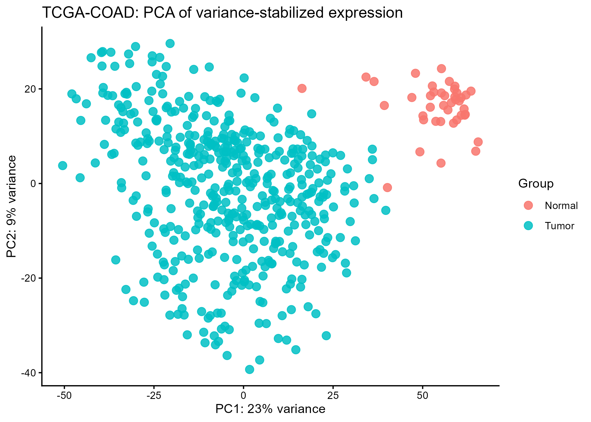
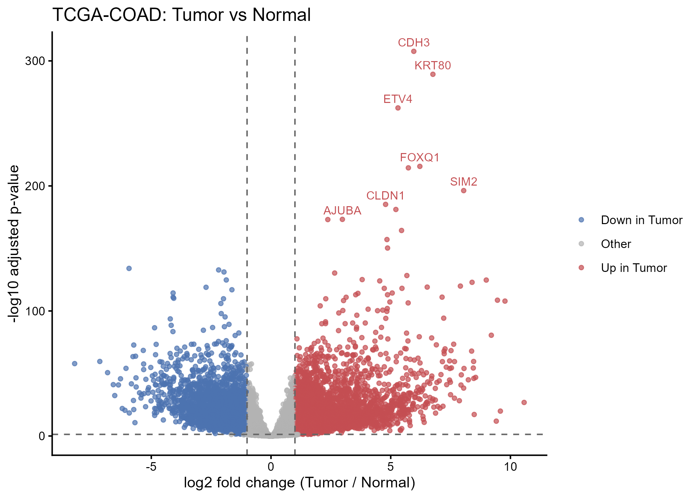
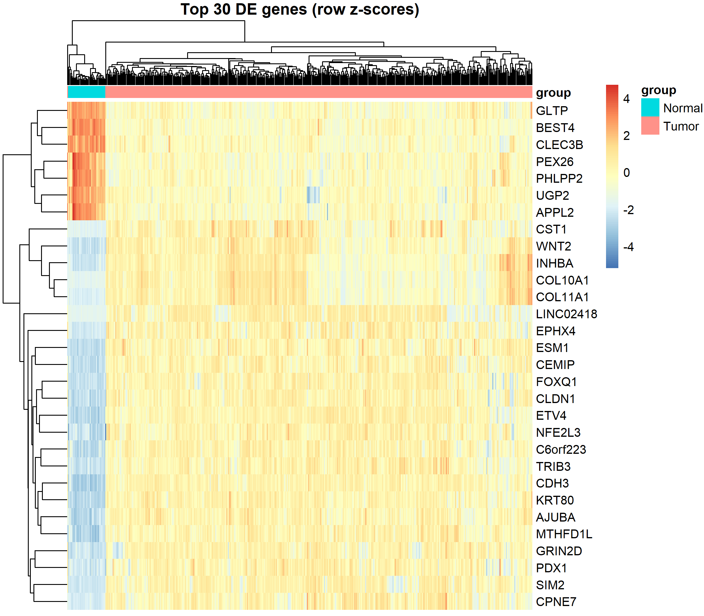

# Differential gene expression in TCGA-COAD: Tumor vs Normal with DESeq2

## Overview

This beginner-friendly workflow compares **TCGA colon adenocarcinoma (TCGA-COAD) Tumor** samples with **Normal** samples using DESeq2. It begins with the supplied expression and phenotype RDS files, verifies that sample identifiers align, excludes the two samples labelled `Other`, performs a teaching-only approximate conversion from log2 expression values to integer-like counts, fits a two-group DESeq2 model, and creates a result table and three plots.

The analysis observed **41 Normal** and **471 Tumor** samples. The two groups are substantially unbalanced. More importantly, the expression values are already log2(count + 1)-transformed---not raw counts---so the inverse conversion is approximate. Treat these results as a tutorial demonstration, not a publication-quality replacement for analysis of raw GDC counts.

Run `CRC_DESeq2_tutorial.R` from the project directory. The R script and this guide expect the inputs and output folders to have the following layout:

``` text
project-folder/
├── CRC_DESeq2_tutorial.R
├── Data/
│   ├── CRC_expression.rds
│   └── CRC_pheno.rds
├── figures/   # created by the script; lowercase
└── Results/   # created by the script
```

## Table of contents

1.  [Prerequisites and setup](#1-prerequisites-and-setup)
2.  [Load data and run sanity checks](#2-load-data-and-run-sanity-checks)
3.  [Keep Tumor and Normal samples](#3-keep-tumor-and-normal-samples)
4.  [Check values and convert to integer-like counts](#4-check-values-and-convert-to-integer-like-counts)
5.  [Prefilter genes and fit DESeq2](#5-prefilter-genes-and-fit-deseq2)
6.  [Extract, summarize, and save results](#6-extract-summarize-and-save-results)
7.  [PCA using variance-stabilized expression](#7-pca-using-variance-stabilized-expression)
8.  [Volcano plot](#8-volcano-plot)
9.  [Heatmap of top genes](#9-heatmap-of-top-genes)
10. [Optional significant-gene table](#10-optional-significant-gene-table)
11. [How to read the results table](#how-to-read-the-results-table)
12. [Important caveats](#important-caveats)
13. [Troubleshooting](#troubleshooting)
14. [Summary checklist](#summary-checklist)

------------------------------------------------------------------------

## 1. Prerequisites and setup

### Purpose

Load the R packages used for differential expression, data wrangling, and heatmap drawing. Create output folders if they do not already exist. Folder names are case-sensitive on many systems: the script uses lowercase `figures` and uppercase `Results`.

### Code

``` r

# Clean the environment
rm(list=ls())


# Install once if needed:
# if (!requireNamespace("BiocManager", quietly = TRUE)) install.packages("BiocManager")
# BiocManager::install("DESeq2")
# install.packages(c("tidyverse", "pheatmap"))
suppressPackageStartupMessages({
  library(DESeq2)
  library(tidyverse)
  library(pheatmap)
})
dir.create("figures", showWarnings = FALSE, recursive = TRUE)
dir.create("Results", showWarnings = FALSE, recursive = TRUE)
```

### Line-by-line

-   The commented installation commands are run once in R if a package is missing. `DESeq2` is installed through Bioconductor; `tidyverse` and `pheatmap` are CRAN packages.
-   `suppressPackageStartupMessages()` hides routine startup messages while each package is loaded.
-   `DESeq2` fits the count-based statistical model; `tidyverse` supplies functions such as `mutate()`, `arrange()`, `filter()`, `ggplot()`, and `write_csv()`; `pheatmap` draws the heatmap.
-   Each `dir.create()` makes the output directory, and `showWarnings = FALSE` avoids a warning when the folder already exists.

### Output

The two output folders are ready: `figures/` for the three PNGs and `Results/` for CSV tables. Package loading is quiet if the packages are installed successfully.

------------------------------------------------------------------------

## 2. Load data and run sanity checks

### Purpose

Read the supplied RDS files and check that their dimensions, required phenotype fields, and sample order match the expected analysis input. Matching expression columns to phenotype rows is essential: otherwise group labels could be assigned to the wrong sample.

### Code

``` r
expr <- readRDS("Data/CRC_expression.rds")
pheno <- readRDS("Data/CRC_pheno.rds")
expr <- as.matrix(expr)

```

### Line-by-line

-   `readRDS()` imports the expression object and phenotype data frame.
-   `as.matrix(expr)` makes sure the expression object can be handled as a genes-by-samples matrix.


### What does the phenotype table look like?

`CRC_pheno.rds` is a tibble with **514 rows (one per sample) x 90 columns**. Running `str(clinical)` prints every column; the most informative ones are shown below (the full output is truncated here for readability):

```r
str(clinical, list.len = 12)
```

```
tibble [514 x 90] (S3: tbl_df/tbl/data.frame)
 $ sample                      : chr [1:514] "TCGA-5M-AAT6-01A" "TCGA-AA-3552-01A" "TCGA-AA-3867-01A" "TCGA-AD-6895-01A" ...
 $ id                          : chr [1:514] "ce00896a-f7d2-4123-bb95-24cb6e53fc32" ...
 $ disease_type                : chr [1:514] "Adenomas and Adenocarcinomas" ...
 $ primary_site                : chr [1:514] "Colon" "Colon" "Colon" "Colon" ...
 $ race.demographic            : chr [1:514] "black or african american" "not reported" "not reported" "white" ...
 $ gender.demographic          : chr [1:514] "female" "male" "male" "male" ...
 $ ethnicity.demographic       : chr [1:514] "hispanic or latino" "not reported" ...
 $ vital_status.demographic    : chr [1:514] "Dead" "Dead" "Alive" "Alive" ...
 $ age_at_index.demographic    : num [1:514] 40 85 74 84 72 82 67 75 81 90 ...
 $ ajcc_pathologic_stage.diagnoses: chr [1:514] "Stage IV" "Stage IIIC" "Stage IV" "Stage IIIB" ...
 $ OS                          : num [1:514] 1 1 0 0 0 0 0 0 1 NA ...
 $ OS.time                     : num [1:514] 290 396 731 763 608 ...
 $ sample_type_code            : chr [1:514] "01" "01" "01" "01" ...
 $ group                       : chr [1:514] "Tumor" "Tumor" "Tumor" "Tumor" ...
 [list output truncated]
```

### Columns used in this tutorial

| Column | Type | Meaning | Used for |
|---|---|---|---|
| `sample` | chr | Full TCGA sample barcode (e.g. `TCGA-AA-3552-01A`) | Matching phenotype rows to expression columns |
| `group` | chr | `Tumor`, `Normal` or `Other` | **The DESeq2 comparison variable** |
| `sample_type.samples` | chr | GDC sample type (e.g. `Primary Tumor`) | Source of `group` |
| `sample_type_code` | chr | Barcode code: `01` = tumor, `11` = normal | Source of `group` |
| `gender.demographic` | chr | `female` / `male` | Possible covariate |
| `age_at_index.demographic` | num | Age at diagnosis (years) | Possible covariate |
| `ajcc_pathologic_stage.diagnoses` | chr | Pathologic stage (I-IV) | Stage-based follow-up analyses |
| `vital_status.demographic` | chr | `Alive` / `Dead` | Survival analysis |
| `OS`, `OS.time` | num | Event indicator (1 = dead) and time in days | Survival analysis |

The remaining columns (annotations, treatments, sample dimensions, tissue source site, etc.) are not needed for this DESeq2 comparison.

> **Note:** several columns (for example `annotations` and `treatments.diagnoses`) contain list-like strings such as `"['released', 'released']"`. These come from the GDC export, where one patient can have multiple records, so avoid using them directly as covariates.


### What does the expression matrix look like?

`CRC_expression.rds` is a plain numeric matrix with **60,660 genes (rows) x 514 samples (columns)**:

```r
str(expr)
```

```
 num [1:60660, 1:514] 10.25 2.32 10.27 8.51 8.35 ...
 - attr(*, "dimnames")=List of 2
  ..$ : chr [1:60660] "TSPAN6" "TNMD" "DPM1" "SCYL3" ...
  ..$ : chr [1:514] "TCGA-5M-AAT6-01A" "TCGA-AA-3552-01A" "TCGA-AA-3867-01A" "TCGA-AD-6895-01A" ...
```

How to read this output:

| Part of the output | Meaning |
|---|---|
| `num [1:60660, 1:514]` | A numeric matrix: 60,660 rows (genes) by 514 columns (samples) |
| `10.25 2.32 10.27 ...` | The first values: **log2(count + 1)** expression, not raw counts. Raw counts would be large integers. |
| `dimnames` row names | Gene symbols (`TSPAN6`, `TNMD`, `DPM1`, `SCYL3`, ...) |
| `dimnames` column names | TCGA sample barcodes (`TCGA-5M-AAT6-01A`, ...) |

### Why the column names matter

DESeq2 pairs each count column with a row of `colData` by **position**, so the two tables must be in the same order. This is why Step 2 contains:

```r
stopifnot(identical(colnames(expr), clinical$sample))
```

If this check passes, column `j` of `expr` and row `j` of `clinical` describe the same sample. If it fails, reorder with `expr <- expr[, clinical$sample]`.

### Quick sanity checks

### Quick sanity checks

```r
dim(expr)
```

```
[1] 60660   514
```

```r
range(expr)
```

```
[1]  0.00000 21.68023
```

```r
any(is.na(expr))
```

```
[1] FALSE
```

```r
head(rownames(expr))
```

```
[1] "TSPAN6"   "TNMD"     "DPM1"     "SCYL3"    "C1orf112" "FGR"     
```

```r
anyDuplicated(rownames(expr))
```

```
[1] 0
```
> **Why the log2 values matter:** values like `10.25` and `2.32` are not integers, which is why Step 4 detects non-integer values and back-transforms them with `round(2^x - 1)`. The maximum of `21.68` in your data corresponds to about 3.4 million reads (`2^21.68 - 1`), a plausible count for a highly expressed gene.


The sanity checks passed for the provided data.

------------------------------------------------------------------------

## 3. Keep Tumor and Normal samples

### Purpose

Retain only the two groups in the intended contrast. Two samples are labelled `Other`; they are removed. The factor is explicitly ordered Normal first and Tumor second, which makes the reference group clear and helps make the coefficient direction interpretable.

### Code

```r
pheno $ sample <- as.character(pheno $ sample)
pheno $ group  <- as.character(pheno $ group)
print(table(pheno $ group))

keep <- pheno $ group %in% c("Normal", "Tumor")
pheno <- pheno[keep, , drop = FALSE]
expr  <- expr[, pheno $ sample, drop = FALSE]

pheno $ group <- factor(pheno $ group, levels = c("Normal", "Tumor"))
stopifnot(identical(colnames(expr), pheno $ sample))

coldata <- data.frame(group = pheno $ group, row.names = pheno $ sample)
print(table(coldata$group))
```

### Line-by-line

- Convert sample IDs and group labels to character strings before filtering and matching.
- `table(pheno$group)` records the original group counts, including the `Other` category.
- `%in% c("Normal", "Tumor")` selects the desired samples. `drop = FALSE` keeps the phenotype as a data frame and the expression object as a matrix, even when subsetting.
- Subsetting expression columns by the retained phenotype sample IDs removes the `Other` samples and keeps the columns in phenotype order.
- `factor(..., levels = c("Normal", "Tumor"))` sets Normal as the reference level and Tumor as the comparison level, so positive log2 fold changes mean higher expression in Tumor.
- `stopifnot(identical(colnames(expr), pheno$sample))` confirms that the expression columns and phenotype rows are in exactly the same order.
- `coldata` is the sample-level metadata object required by DESeq2. Its row names must match, in the same order, the columns of the count matrix.
- The second `table()` reports the actual comparison sample counts.

### Actual output obtained

Before filtering:

```text
Normal  Other  Tumor 
    41      2    471 
```

After filtering:

```text
Normal  Tumor 
    41    471 
```
------------------------------------------------------------------------

## 4. Check values and prepare integer matrix

### Purpose

DESeq2 requires a matrix of whole numbers. We use the expression values as they are and round them to integers. No back-transformation is applied.

### Code

```r
mode(expr) <- "numeric"
max_expr <- max(expr, na.rm = TRUE)
has_negative <- any(expr < 0, na.rm = TRUE)
cat("Maximum expression value:", max_expr, "\n")
cat("Any negative values:", has_negative, "\n")
if (has_negative) stop("Negative expression values are not allowed.")
expr <- round(expr)
expr[!is.finite(expr)] <- 0
storage.mode(expr) <- "integer"
```

### Line-by-line

- `mode(expr) <- "numeric"` makes sure the matrix is numeric so the checks and rounding work correctly.
- `max(expr, na.rm = TRUE)` finds the largest value in the matrix, which shows the scale of the data.
- `any(expr < 0, na.rm = TRUE)` checks whether any value is negative.
- The two `cat()` lines print the maximum value and the negative-value check so you can see them in the console.
- `if (has_negative) stop(...)` halts the script if a negative value is found, since DESeq2 cannot use negative numbers.
- `expr <- round(expr)` rounds every value to the nearest whole number. The values are kept as they are, with no other transformation.
- `expr[!is.finite(expr)] <- 0` replaces any `NA`, `NaN`, or `Inf` entries with 0 so DESeq2 does not fail.
- `storage.mode(expr) <- "integer"` stores the matrix as integers, which is the format DESeq2 expects.

### Actual output obtained

```text
Maximum expression value: 21.68023
Any negative values: FALSE
```

### Result

`expr` is now an integer matrix with the same genes (rows) and samples (columns), ready to be used in `DESeqDataSetFromMatrix()`.

## 5. Prefilter genes and fit DESeq2

### Purpose

Remove very low-expression genes before model fitting, then estimate library-size normalization factors and gene-wise dispersion and test the Tumor-versus-Normal contrast. The filter used here keeps genes with a count of at least 10 in at least the size of the smallest group (41 samples). It retained 24,175 genes.

### Code

``` r
min_group_size <- min(table(coldata$group))
count_mat <- expr[, rownames(coldata), drop = FALSE]
keep_genes <- rowSums(count_mat >= 10L) >= min_group_size
count_mat <- count_mat[keep_genes, , drop = FALSE]
cat("Genes kept after filtering:", nrow(count_mat), "\n")
```

``` r
Genes kept after filtering: 10789 
```

``` r
dds <- DESeqDataSetFromMatrix(
  countData = count_mat,
  colData = coldata,
  design = ~ group
)
dds <- DESeq(dds)
```

``` r
# estimating size factors
# estimating dispersions
# gene-wise dispersion estimates
# mean-dispersion relationship
# -- note: fitType='parametric', but the dispersion trend was not well captured by the
#   function: y = a/x + b, and a local regression fit was automatically substituted.
#   specify fitType='local' or 'mean' to avoid this message next time.
# final dispersion estimates
# fitting model and testing
```
### Line-by-line

-   `min(table(coldata$group))` calculates the size of the smaller group: 41.
-   `count_mat` aligns the selected expression columns to the sample metadata row names.
-   `rowSums(count_mat >= 10L)` counts, for every gene, the number of samples with at least 10 counts. The comparison with `min_group_size` applies the prefilter.
-   The next line keeps only passing rows and prints the resulting number of genes.
-   `DESeqDataSetFromMatrix()` combines the integer-like count matrix with sample metadata. `design = ~ group` models group differences without other covariates.
-   `DESeq()` performs the main analysis. Broadly, DESeq2 estimates **size factors** to account for differences in sequencing depth/composition; estimates gene-wise **dispersion** (biological variability beyond a Poisson model) and moderates estimates across genes; fits a negative-binomial model; and uses a **Wald test** for the group contrast by default.
-   DESeq2 can detect extreme count outliers and replace counts for eligible genes before refitting/testing, which is one of the safeguards involved in the reported run. The log reported outlier replacement for 1,802 genes. This is not a statement that all those genes are statistically significant.

------------------------------------------------------------------------

## 6. Extract, summarize, and save results

### Purpose

Request the explicit Tumor-versus-Normal contrast, order the gene table by adjusted p-value, save the complete results, and print DESeq2's standard summary of significance and filtering.

### Code

``` r
res <- results(dds, contrast = c("group", "Tumor", "Normal"))
res_df <- as.data.frame(res) %>%
  rownames_to_column("gene") %>%
  arrange(padj)
write_csv(res_df, "Results/DESeq2_CRC_Tumor_vs_Normal.csv", na = "")
print(summary(res))
```

### Line-by-line

-   `results(..., contrast = c("group", "Tumor", "Normal"))` computes the requested comparison with Tumor as the numerator and Normal as the reference.
-   `as.data.frame()` converts the DESeq2 result object to a data frame; `rownames_to_column("gene")` preserves gene identifiers as a named column; `arrange(padj)` sorts from the smallest adjusted p-value upward, with missing values at the end.
-   `write_csv()` writes the complete result table to `Results/DESeq2_CRC_Tumor_vs_Normal.csv`; `na = ""` exports missing values as blank cells.
-   `summary(res)` reports counts passing a default adjusted-p-value threshold of 0.1 and other diagnostic categories. This threshold is the summary default; it is not the volcano plot's stricter display rule.

### Actual `summary(res)` output obtained

``` text
out of 24175 with nonzero total read count
adjusted p-value < 0.1
LFC > 0 (up)       : 11314, 47%
LFC < 0 (down)     : 7590, 31%
outliers [1]       : 0, 0%
low counts [2]     : 0, 0%
```

`[1]` indicates genes flagged as outliers in the summary; `[2]` indicates genes not tested because the mean normalized count was below 2. These summary counts use padj \< 0.1 and do not also require an absolute fold change of at least 1.

------------------------------------------------------------------------

## 7. PCA using variance-stabilized expression

### Purpose

Visualize sample-level similarity after variance stabilization. The variance-stabilizing transformation (VST) reduces the dependence of variability on mean abundance, making the data more suitable for PCA visualization. The plotted 500 most variable genes summarize broad sample patterns; PCA is not the differential-expression test.

### Code

``` r
vsd <- vst(dds, blind = TRUE)
pca_df <- plotPCA(vsd, intgroup = "group", ntop = 500, returnData = TRUE)
percent_var <- round(100 * attr(pca_df, "percentVar"))
p_pca <- ggplot(pca_df, aes(PC1, PC2, color = group)) +
  geom_point(size = 3, alpha = 0.85) +
  labs(
    title = "TCGA-COAD: PCA of variance-stabilized expression",
    x = paste0("PC1: ", percent_var[1], "% variance"),
    y = paste0("PC2: ", percent_var[2], "% variance"),
    color = "Group"
  ) +
  theme_classic()
ggsave("figures/step7_pca.png", p_pca, width = 7, height = 5, dpi = 300)
```

### Line-by-line

-   `vst(dds, blind = TRUE)` computes a VST that does not use the group design to choose the transformation; this is useful for an exploratory, group-unbiased view.
-   `plotPCA(..., intgroup = "group")` calculates principal components using the group label for coloring. `ntop = 500` uses up to the 500 most variable genes, and `returnData = TRUE` returns plotting coordinates and variance information.
-   `percentVar` reports the fraction of variation explained by each displayed component, converted to percentages and rounded.
-   `ggplot()` maps PC1 and PC2 to axes and group to color; `geom_point()` draws one dot per sample. Axis labels include explained variance.
-   `ggsave()` writes a 7 × 5 inch PNG at 300 dpi to the requested lowercase folder.

### Actual output

The script creates `figures/step7_pca.png` after a successful run. No PCA coordinates or variance percentages are specified here because they were not provided as captured console output.

### PCA plot



### How to interpret it

Each point is one sample. Points close together have more similar profiles across the genes used for PCA. Separation between Normal and Tumor may indicate broad expression differences; overlap does not negate gene-level differences. Also inspect whether an apparent pattern might reflect technical effects, batch, or the unequal group sizes rather than the biological contrast alone.

------------------------------------------------------------------------

## 8. Volcano plot

### Purpose

Display estimated effect size and statistical evidence for every tested gene. Color categories use both thresholds: adjusted p-value below 0.05 and absolute log2 fold change of at least 1. The direction is defined as Tumor relative to Normal.

### Code

``` r
volcano_df <- res_df %>%
  mutate(
    plot_padj = if_else(is.na(padj), 1, pmax(padj, .Machine$double.xmin)),
    status = case_when(
      !is.na(padj) & padj < 0.05 & log2FoldChange >= 1 ~ "Up in Tumor",
      !is.na(padj) & padj < 0.05 & log2FoldChange <= -1 ~ "Down in Tumor",
      TRUE ~ "Other"
    )
  )
label_df <- volcano_df %>%
  filter(!is.na(padj), is.finite(log2FoldChange)) %>%
  arrange(padj) %>%
  slice_head(n = 10)
p_volcano <- ggplot(volcano_df, aes(log2FoldChange, -log10(plot_padj), color = status)) +
  geom_point(alpha = 0.7, size = 1.2) +
  scale_color_manual(values = c(
    "Other" = "grey70", "Up in Tumor" = "#C44E52", "Down in Tumor" = "#4C72B0"
  )) +
  geom_hline(yintercept = -log10(0.05), linetype = 2, color = "grey40") +
  geom_vline(xintercept = c(-1, 1), linetype = 2, color = "grey40") +
  geom_text(data = label_df, aes(label = gene), check_overlap = TRUE,
            vjust = -0.6, size = 3, show.legend = FALSE) +
  labs(title = "TCGA-COAD: Tumor vs Normal",
       x = "log2 fold change (Tumor / Normal)",
       y = "-log10 adjusted p-value", color = NULL) +
  theme_classic()
ggsave("figures/step8_volcano.png", p_volcano, width = 7, height = 5, dpi = 300)
```

### Line-by-line

-   `plot_padj` protects the y-axis calculation from missing adjusted p-values and zero values, for which `-log10()` would be undefined or infinite. A missing padj is plotted at the bottom as 1 but remains in category `Other`.
-   `case_when()` classifies genes with padj \< 0.05 and log2 fold change \>= 1 as **Up in Tumor**; genes with padj \< 0.05 and log2 fold change \<= -1 as **Down in Tumor**; every other result is **Other**.
-   `label_df` selects up to ten genes with finite effect estimates and available adjusted p-values, ordered by smallest padj.
-   The x-axis shows log2 fold change; the y-axis is negative log10 adjusted p-value. Higher points have smaller adjusted p-values, and larger absolute x-values indicate larger estimated effects.
-   `scale_color_manual()` assigns grey to Other, muted red to Up in Tumor, and blue to Down in Tumor.
-   The horizontal dashed line marks padj = 0.05. Vertical dashed lines show log2 fold changes of -1 and +1.
-   `geom_text(..., check_overlap = TRUE)` attempts to annotate the top ten ranked genes while suppressing text collisions.
-   `ggsave()` saves the 300-dpi plot to `figures/step8_volcano.png`.

### Actual output

The script creates `figures/step8_volcano.png` after a successful run. The supplied summary output does not report the number of genes passing the volcano thresholds.

### Volcano plot



### How to interpret it

A point to the right has a positive fold change and is higher in Tumor; a point to the left is lower in Tumor. Red and blue points meet both the chosen adjusted-p-value and fold-change cutoffs. A high point near zero fold change can be statistically convincing but have a smaller effect; a large effect near the bottom may be uncertain. These visual cutoffs are descriptive criteria, not proof of clinical or biological importance.

------------------------------------------------------------------------

## 9. Heatmap of top genes

### Purpose

Show relative expression patterns for the 30 genes with the smallest available adjusted p-values. Each gene is z-scored across samples so the color emphasizes within-gene relative patterns; columns are annotated by group and sample names are hidden to keep the plot readable.

### Code

``` r
heat_genes <- res_df %>%
  filter(!is.na(padj)) %>%
  arrange(padj) %>%
  slice_head(n = 30) %>%
  pull(gene)
if (length(heat_genes) > 0L) {
  heat_mat <- assay(vsd)[heat_genes, , drop = FALSE]
  heat_mat <- t(scale(t(heat_mat)))
  heat_mat[!is.finite(heat_mat)] <- 0
  annotation_col <- data.frame(group = coldata$group, row.names = rownames(coldata))
  png("figures/step9_heatmap.png", width = 2400, height = 2100, res = 300)
  heatmap_plot <- pheatmap(
    heat_mat, annotation_col = annotation_col, show_colnames = FALSE,
    main = "Top 30 DE genes (row z-scores)", silent = TRUE
  )
  grid::grid.newpage()
  grid::grid.draw(heatmap_plot$gtable)
  dev.off()
}
```

### Line-by-line

-   `filter(!is.na(padj))`, `arrange(padj)`, and `slice_head(n = 30)` choose up to the 30 most significant genes with available adjusted p-values.
-   `pull(gene)` extracts their identifiers. If no gene is eligible, the full script skips the plot with a warning.
-   `assay(vsd)` extracts variance-stabilized values; it is used here for visualization, not for the DESeq2 statistical test.
-   `t(scale(t(heat_mat)))` centers and scales each gene across samples (row-wise z-scores). Non-finite z-scores, for example from a constant row, are set to zero.
-   `annotation_col` supplies one group label per sample column.
-   `png()` opens a 2400 × 2100 pixel image device at 300 dpi. `pheatmap()` draws the heatmap with group annotation and hidden sample labels; `silent = TRUE` returns the plot object rather than drawing it directly.
-   `grid.newpage()` and `grid.draw()` draw the returned heatmap, and `dev.off()` closes the PNG file.

### Actual output

The script creates `figures/step9_heatmap.png` if at least one gene has an available adjusted p-value.

### Heatmap



### How to interpret it

Rows are genes and columns are samples. The row z-score indicates whether that sample's expression for a particular gene is relatively above or below that gene's across-sample average; it is not an absolute count or fold change. The group annotation helps compare patterns across Normal and Tumor. Because genes were selected using this same dataset, the heatmap is descriptive rather than independent validation.

------------------------------------------------------------------------

## 10. Optional significant-gene table

### Purpose

Save a focused subset of genes meeting both a multiple-testing criterion and an effect-size cutoff. This extra output complements, but does not replace, the complete results CSV.

### Code

``` r
significant_df <- res_df %>%
  filter(!is.na(padj), padj < 0.05, abs(log2FoldChange) >= 1)
write_csv(significant_df, "Results/DESeq2_CRC_significant_genes.csv", na = "")
cat("Significant genes saved:", nrow(significant_df), "\n")
```

### Line-by-line

-   Keep only genes with a non-missing adjusted p-value below 0.05 and an absolute log2 fold change of at least 1.
-   Write those rows to a separate CSV and print the number saved. The precise row count was not supplied as an observed output, so it is not assumed here.

### Output

`Results/DESeq2_CRC_significant_genes.csv` is created by the script; it may contain zero or more genes.

------------------------------------------------------------------------

## How to read the results table {#how-to-read-the-results-table}

The complete file is `Results/DESeq2_CRC_Tumor_vs_Normal.csv`. One row represents one gene.

| Column           | Meaning                                                                                                                                                                                                                                                            |
|------------------------------------|------------------------------------|
| `gene`           | Gene identifier carried in the expression matrix row names.                                                                                                                                                                                                        |
| `baseMean`       | Mean of normalized counts across all samples; it is an abundance summary, not a group-specific mean.                                                                                                                                                               |
| `log2FoldChange` | Estimated log2 ratio for Tumor relative to Normal. **Positive means higher in Tumor; negative means lower in Tumor.** A value of +1 corresponds to an estimated two-fold increase; -1 corresponds to half the Normal level, subject to the model and data caveats. |
| `lfcSE`          | Standard error of the estimated log2 fold change; smaller values generally indicate greater precision.                                                                                                                                                             |
| `stat`           | Wald test statistic, approximately the estimated fold change divided by its standard error.                                                                                                                                                                        |
| `pvalue`         | Unadjusted p-value for the test of no group difference for that gene.                                                                                                                                                                                              |
| `padj`           | P-value adjusted for testing many genes, using DESeq2's default Benjamini--Hochberg procedure. This helps control the false discovery rate.                                                                                                                        |

Genes can have missing values, including adjusted p-values, for reasons such as filtering or insufficient information. Review the column values and diagnostics rather than treating blank entries as evidence of no effect.

## Important caveats {#important-caveats}

1.  **The input is not raw count data.** Xena expression values are log2(count + 1). `round(2^x - 1)` is a rough inverse with rounding and cannot recover original raw GDC counts, upstream processing, or count uncertainty. For publication-quality DESeq2, obtain and analyze raw GDC counts with a documented pipeline. Do not present this back-transformed exercise as equivalent to raw-count analysis.
2.  **The groups are highly unbalanced:** 41 Normal samples versus 471 Tumor samples. This affects precision and interpretation, and warrants careful review of the Normal sample composition and QC.
3.  **No batch or other covariates are modeled.** The design is only `~ group`; technical batches, clinical covariates, or other confounders are not adjusted for in this script.
4.  **The comparison is unpaired.** Tumor and Normal samples are treated as independent groups; this design does not account for within-patient pairing.
5.  The chosen log2 fold-change and adjusted-p-value cutoffs are useful filters, not universal definitions of meaningful biology. Validate findings independently and consider biological context.
6.  PCA and heatmap use VST values for visualization; the inferential model uses the integer-like matrix supplied to DESeq2. The plots do not validate the assumptions or restore the original counts.

## Troubleshooting {#troubleshooting}

| Symptom                                                       | Likely reason                                                                                         | What to check / do                                                                                                                                     |
|------------------------|------------------------|------------------------|
| `identical(colnames(expr), as.character(pheno$sample))` fails | Sample names differ, are reordered, or were stored differently in the two RDS files.                  | Compare a few IDs and investigate the correct mapping. Do not simply remove the check or pair samples by row position without confirming identity.     |
| `cannot open ... Data/CRC_expression.rds`                     | The working directory is not the project root, or the `Data/` path/file name differs.                 | In R, check `getwd()` and list files. Run the script from the folder containing `Data/`, and verify spelling/capitalization.                           |
| Figure or CSV is not written / "cannot open file"             | Output-folder case differs, or the working directory is unexpected.                                   | Use `figures/` exactly for PNGs and `Results/` for CSVs. Confirm both are being created under the project directory.                                   |
| `vst()` errors or reports too few genes                       | The count matrix may have too few rows, invalid/non-finite values, or an unexpected sample alignment. | Check dimensions, integer/non-negative counts, and prefilter output. The supplied run retained 24,175 genes.                                           |
| DESeq2 says counts must be integer or non-negative            | Counts were not converted as intended or there are invalid values.                                    | Inspect `storage.mode(expr)`, `any(expr < 0)`, and finite values after conversion. Do not silently treat negative or transformed values as raw counts. |
| Heatmap does not appear                                       | The image is created as a file, or there were no genes with finite padj.                              | Check `figures/step9_heatmap.png` and the warning in the console. Open the PNG from the project folder.                                                |

## Summary checklist {#summary-checklist}

-   [ ] Run from the project root with both RDS inputs in `Data/`.
-   [ ] Install/load DESeq2, tidyverse, and pheatmap.
-   [ ] Confirm expression is 60,660 genes × 514 samples and phenotype has 514 rows.
-   [ ] Confirm sample identifiers align exactly before selecting samples.
-   [ ] Verify and document Normal 41, Other 2, Tumor 471; exclude `Other`.
-   [ ] Recognize that log2(count + 1) back-transformation is approximate; raw GDC counts are preferred for publication.
-   [ ] Check prefilter count (24,175 genes) and the DESeq2 fitting log.
-   [ ] Review the saved complete result table and its adjusted p-values/effect sizes.
-   [ ] Inspect the PCA, volcano, and heatmap PNGs; remember they are visualizations, not independent validation.
-   [ ] Interpret positive log2 fold change as higher expression in Tumor, and account for unbalanced, unpaired groups and omitted covariates.

