# Exploring TCGA Pan-Cancer Clinical Data with ggplot2

This tutorial uses the TCGA Pan-Cancer Atlas clinical table (about 11,000
patients across 33 cancer types) to practise core ggplot2 skills:
histograms, boxplots, scatterplots, bar charts, facets, and statistical
annotation.

**Data source:** UCSC Xena TCGA Pan-Cancer clinical data, merged with sample
type, immune subtype, and molecular subtype tables.

**Script:** [`TCGA_pancancer_plots.R`](TCGA_pancancer_plots.R) runs every
code block below and saves all figures to `figures/`.

**Repository layout**

```
.
├── TCGA_pancancer_ggplot_tutorial.md
├── TCGA_pancancer_plots.R
├── data/
│   └── TCGA_pancancer_clinical.rds
└── figures/
    └── Fig*.jpeg
```

---

## 0. Setup

```r
library(tidyverse)
library(scales)
library(ggpubr)

raw <- readRDS("data/TCGA_pancancer_clinical.rds")
str(raw)
```

### Columns used

| Column (cleaned) | Meaning | Type |
|---|---|---|
| `Cancer_Type` | TCGA study code (BRCA, LUAD, ...) | categorical |
| `Age` | Age at diagnosis (years) | numeric |
| `Gender` | Female / Male | categorical |
| `Race` | Self-reported race (rare levels lumped into "Other") | categorical |
| `Stage` | Stage I-IV (substages collapsed) | ordered factor |
| `Vital_Status` | Alive / Dead | categorical |
| `OS_months` | Follow-up time in months | numeric |
| `Immune_Subtype` | Pan-cancer immune subtype | categorical |
| `Molecular_Subtype` | Cancer-specific subtype (e.g. PAM50 for BRCA) | categorical |

`OS_months` is **follow-up time**. For patients who are still alive it is
censored, so it is not the same as time to death.

### Cleaning

```r
clinical <- raw |>
  distinct(patient_id, .keep_all = TRUE) |>
  transmute(
    Patient_ID        = patient_id,
    Cancer_Type       = cancer_type,
    Age               = age_at_initial_pathologic_diagnosis,
    Gender            = str_to_title(gender),
    Race              = str_to_title(race),
    Stage_raw         = ajcc_pathologic_tumor_stage,
    Vital_Status      = vital_status,
    OS                = OS,
    OS_months         = OS.time / 30.44,
    Immune_Subtype    = Subtype_Immune_Model_Based,
    Molecular_Subtype = Subtype_Selected
  ) |>
  mutate(
    Stage = case_when(
      str_detect(Stage_raw, "Stage IV")  ~ "Stage IV",
      str_detect(Stage_raw, "Stage III") ~ "Stage III",
      str_detect(Stage_raw, "Stage II")  ~ "Stage II",
      str_detect(Stage_raw, "Stage I")   ~ "Stage I",
      TRUE ~ NA_character_
    ),
    Stage        = factor(Stage, levels = c("Stage I", "Stage II", "Stage III", "Stage IV")),
    Gender       = factor(Gender),
    Vital_Status = factor(Vital_Status, levels = c("Alive", "Dead")),
    Race         = na_if(Race, "[Not Evaluated]"),
    Race         = fct_lump_min(factor(Race), min = 100, other_level = "Other"),
    Immune_Subtype = str_remove(Immune_Subtype, " \$ Immune C\\d\ $ "),
    Age_Group    = cut(Age, c(-Inf, 40, 55, 70, Inf),
                       labels = c("Young", "Middle", "Older", "Senior"),
                       ordered_result = TRUE)
  ) |>
  select(-Stage_raw)

str(clinical)
```

### Palette and save helper

```r
okabe_ito <- c("#E69F00", "#56B4E9", "#009E73", "#F0E442",
               "#0072B2", "#D55E00", "#CC79A7", "#000000")

dir.create("figures", showWarnings = FALSE)

save_fig <- function(plot, name, w = 7, h = 5) {
  ggsave(file.path("figures", name), plot,
         width = w, height = h, units = "in", dpi = 300)
}
```

---

## 1. One variable

### Q1. How many patients are in each cancer type?

**Hint:** Count first, then plot with `geom_col()`. Use `reorder()` to sort
and `coord_flip()` for readable labels.

```r
p_cancer_counts <- clinical |>
  count(Cancer_Type) |>
  ggplot(aes(x = reorder(Cancer_Type, n), y = n)) +
  geom_col(fill = "#0072B2") +
  coord_flip() +
  labs(title = "Patients per cancer type", x = "Cancer type", y = "Number of patients") +
  theme_minimal()
save_fig(p_cancer_counts, "Fig1_1_cancer_counts.jpeg", 7, 8)
```

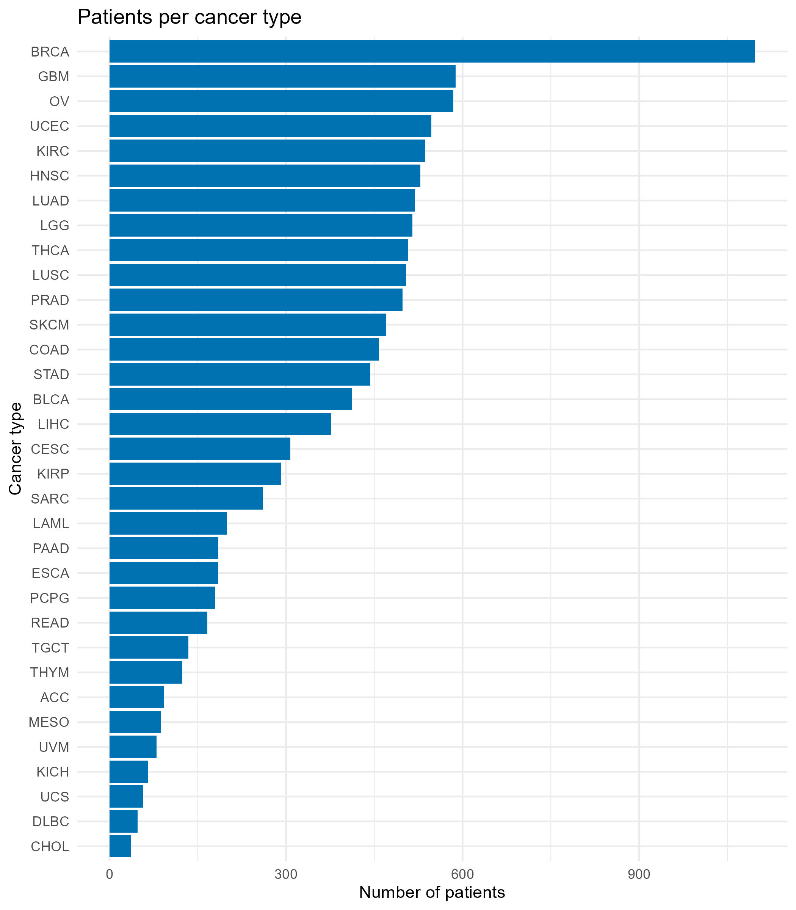

**What to look for:** The dataset is very unbalanced. BRCA is among the
largest cohorts while CHOL and DLBC are small, so comparisons involving
small groups are unstable.

### Q2. How is Age distributed?

**Hint:** Use `geom_histogram()` with `binwidth = 5`. Bin choice changes the
visual impression, so try several values.

```r
p_age_hist <- ggplot(clinical, aes(x = Age)) +
  geom_histogram(binwidth = 5, boundary = 0, colour = "white",
                 fill = "#0072B2", na.rm = TRUE) +
  labs(title = "Age at diagnosis", x = "Age (years)", y = "Number of patients") +
  theme_minimal()
save_fig(p_age_hist, "Fig1_2_age_hist.jpeg")
```

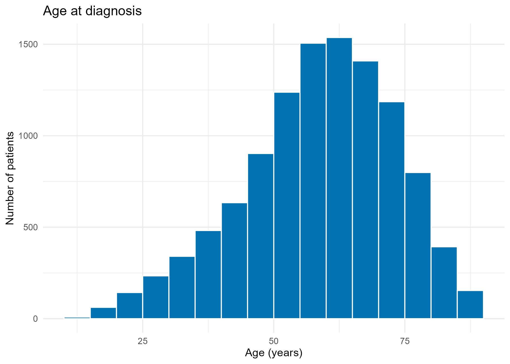

**What to look for:** Peak location, skew, and unusual spikes (for example a
pile-up at age 90, where TCGA caps age for privacy).

### Q3. How does the smoothed density compare?

**Hint:** `geom_density()` estimates a smooth curve. The area under the
curve equals 1, so the y-axis is not a patient count.

```r
p_age_density <- ggplot(clinical, aes(x = Age)) +
  geom_density(fill = "#56B4E9", colour = "#0072B2", alpha = 0.65, na.rm = TRUE) +
  labs(title = "Smoothed age density", x = "Age (years)", y = "Density") +
  theme_minimal()
save_fig(p_age_density, "Fig1_3_age_density.jpeg")
```

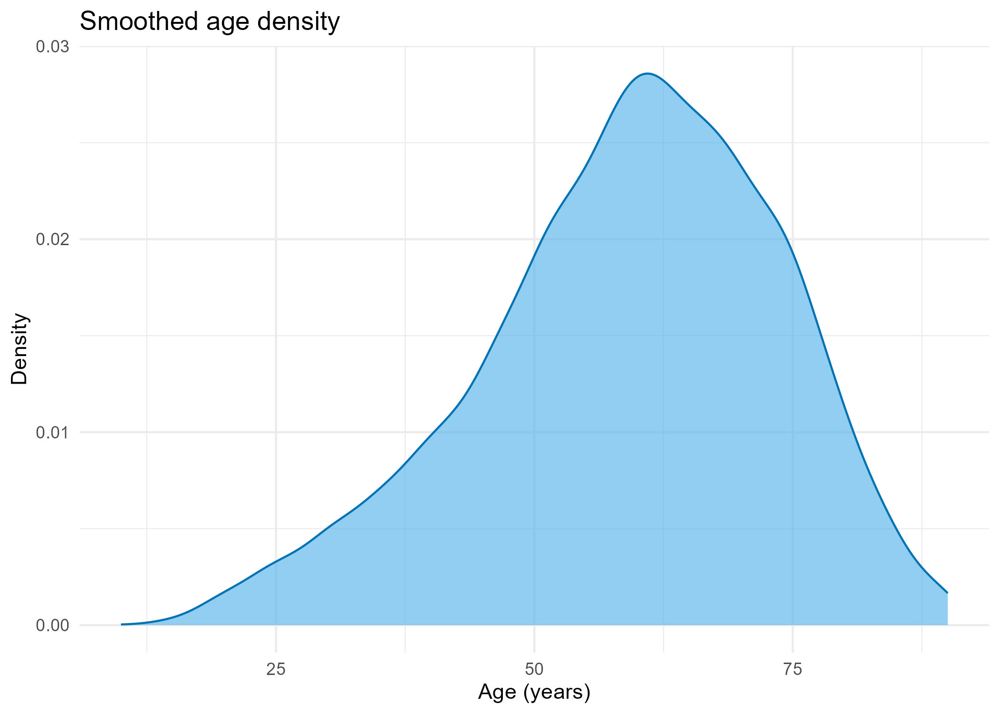

### Q4. How do you label age-group bars with percentages?

**Hint:** Use `after_stat(count / sum(count))` inside `aes()` and format it
with `scales::percent()`.

```r
p_age_group <- clinical |>
  drop_na(Age_Group) |>
  ggplot(aes(x = Age_Group)) +
  geom_bar(fill = "#009E73") +
  geom_text(aes(y = after_stat(count),
                label = percent(after_stat(count / sum(count)), accuracy = 0.1)),
            stat = "count", vjust = -0.35) +
  scale_y_continuous(expand = expansion(mult = c(0, 0.1))) +
  labs(title = "Patients by age group", x = "Age group", y = "Number of patients") +
  theme_minimal()
save_fig(p_age_group, "Fig1_4_age_group_percent.jpeg")
```

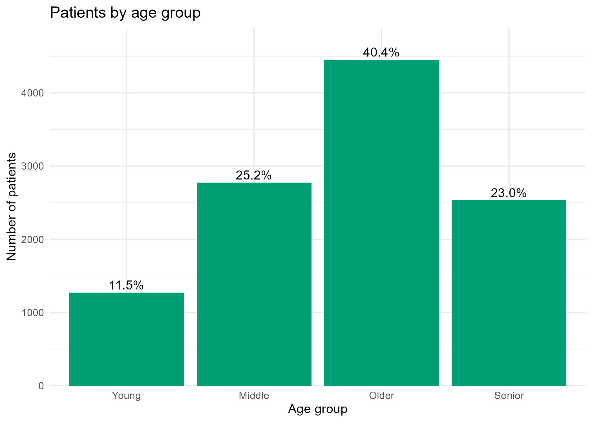

**What to look for:** The percentages should add up to 100% across the bars,
and the factor order should match the intended age progression.

---

## 2. Numeric by category

### Q5. How does Age differ by Gender?

**Hint:** Put the category on x and the numeric measure on y.

```r
p_age_gender_box <- clinical |>
  drop_na(Gender, Age) |>
  ggplot(aes(x = Gender, y = Age)) +
  geom_boxplot(fill = "#E69F00") +
  labs(title = "Age by gender", x = "Gender", y = "Age (years)") +
  theme_minimal()
save_fig(p_age_gender_box, "Fig2_1_age_gender_box.jpeg")
```

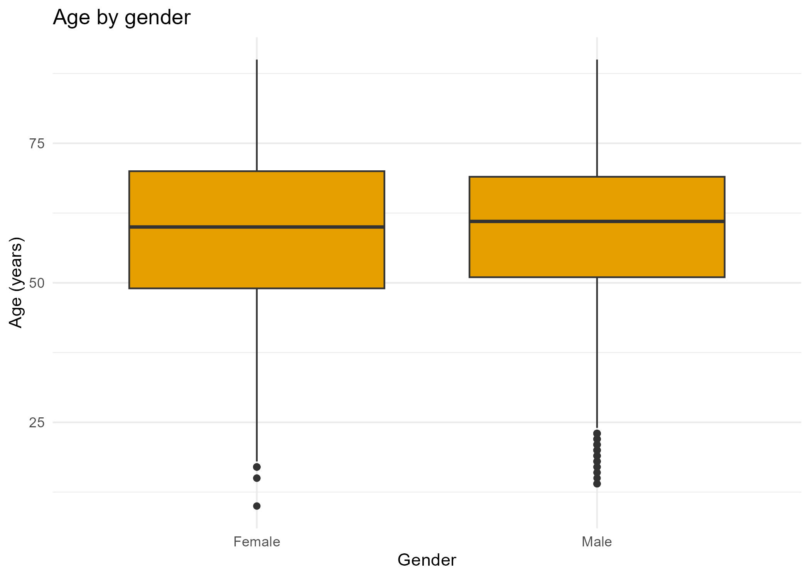

**What to look for:** Medians, spread, and outliers. Gender is partly driven
by cancer type (BRCA is mostly female, PRAD is all male), so this plot mixes
tumour types.

### Q6. How do you combine a violin plot and a boxplot?

**Hint:** Draw `geom_violin()` first, then a narrow `geom_boxplot()` on top
with `outlier.shape = NA`.

```r
p_age_status_violin <- clinical |>
  drop_na(Vital_Status, Age) |>
  ggplot(aes(x = Vital_Status, y = Age, fill = Vital_Status)) +
  geom_violin(alpha = 0.55, trim = FALSE) +
  geom_boxplot(width = 0.14, outlier.shape = NA, fill = "white") +
  scale_fill_manual(values = okabe_ito[2:1]) +
  guides(fill = "none") +
  labs(title = "Age by vital status", x = "Vital status", y = "Age (years)") +
  theme_minimal()
save_fig(p_age_status_violin, "Fig2_2_age_status_violin.jpeg")
```

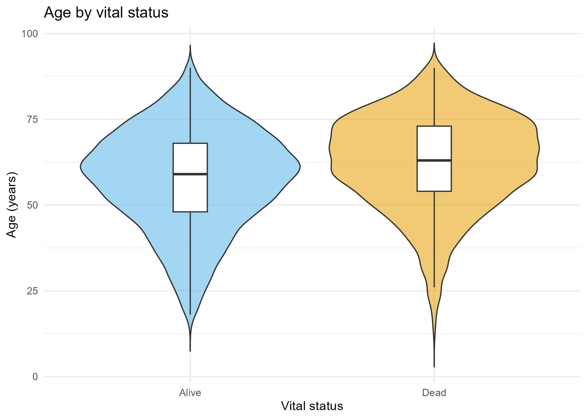

### Q7. How does Age vary by cancer type?

**Hint:** `reorder(Cancer_Type, Age, FUN = median)` sorts by median age;
`coord_flip()` keeps labels readable.

```r
p_age_cancer <- clinical |>
  drop_na(Age) |>
  ggplot(aes(x = reorder(Cancer_Type, Age, FUN = median, na.rm = TRUE), y = Age)) +
  geom_boxplot(fill = "#CC79A7", outlier.alpha = 0.3) +
  coord_flip() +
  labs(title = "Age by cancer type (ordered by median)",
       x = "Cancer type", y = "Age (years)") +
  theme_minimal()
save_fig(p_age_cancer, "Fig2_3_age_cancer_type.jpeg", 7, 8)
```

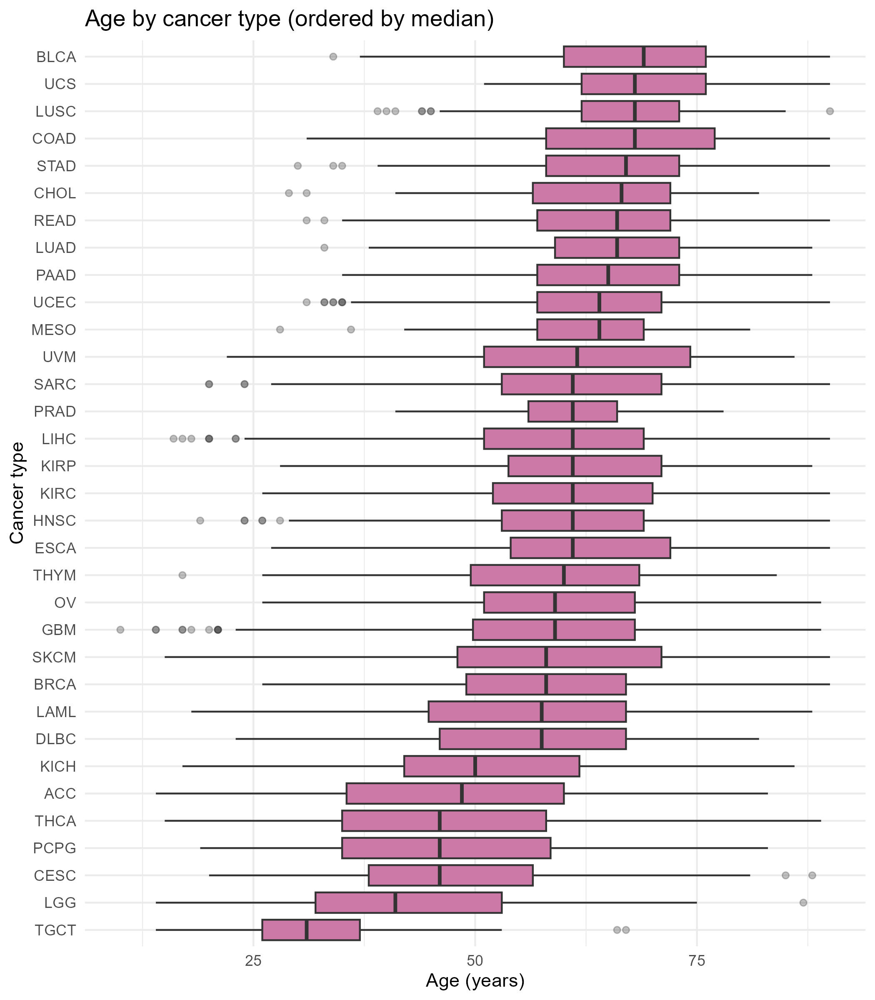

**What to look for:** Cancer types are ordered by observed median age, not
alphabetically. Small groups have unstable medians.

### Q8. Does follow-up time differ by stage?

**Hint:** Jitter shows individual patients; the boxplot summarises them.

```r
p_os_stage <- clinical |>
  drop_na(Stage, OS_months) |>
  ggplot(aes(x = Stage, y = OS_months)) +
  geom_jitter(width = 0.2, alpha = 0.15, colour = "#333333") +
  geom_boxplot(outlier.shape = NA, fill = "#D55E00", alpha = 0.6) +
  labs(title = "Follow-up time by stage", x = "Stage", y = "Follow-up (months)") +
  theme_minimal()
save_fig(p_os_stage, "Fig2_4_os_by_stage.jpeg")
```

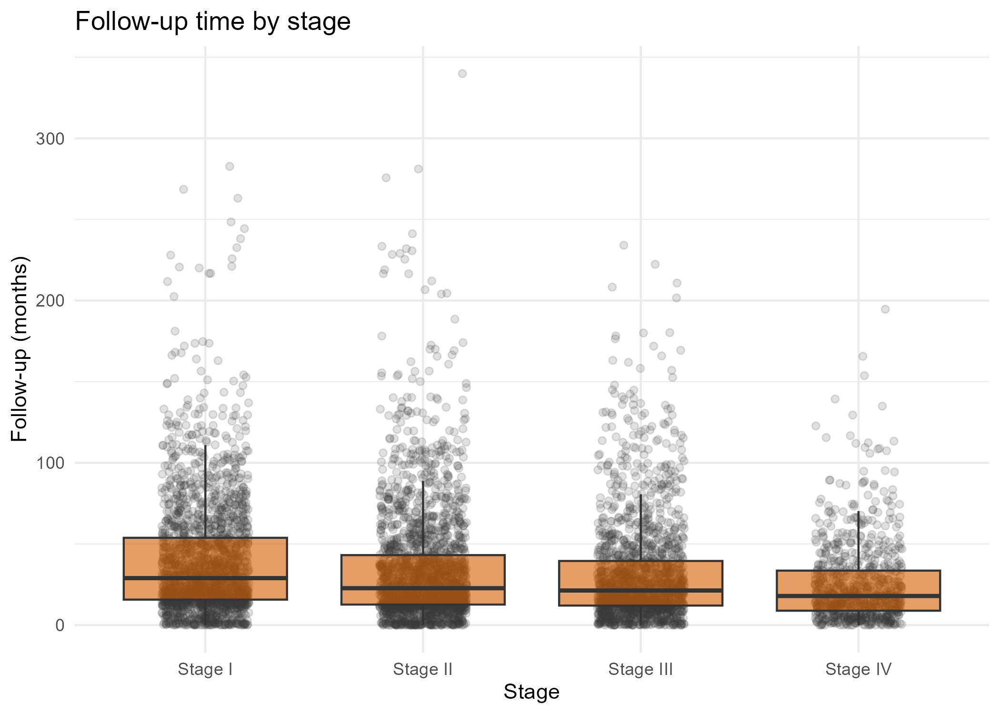

**What to look for:** Higher stages often show shorter follow-up, but
censoring affects this comparison.

---

## 3. Two numeric variables

### Q9. Is there a relationship between Age and follow-up time?

**Hint:** Use points with transparency to handle overplotting.

```r
p_scatter <- clinical |>
  drop_na(Age, OS_months) |>
  ggplot(aes(x = Age, y = OS_months)) +
  geom_point(alpha = 0.15, colour = "#0072B2") +
  labs(title = "Age and follow-up time", x = "Age (years)", y = "Follow-up (months)") +
  theme_minimal()
save_fig(p_scatter, "Fig3_1_scatter.jpeg")
```

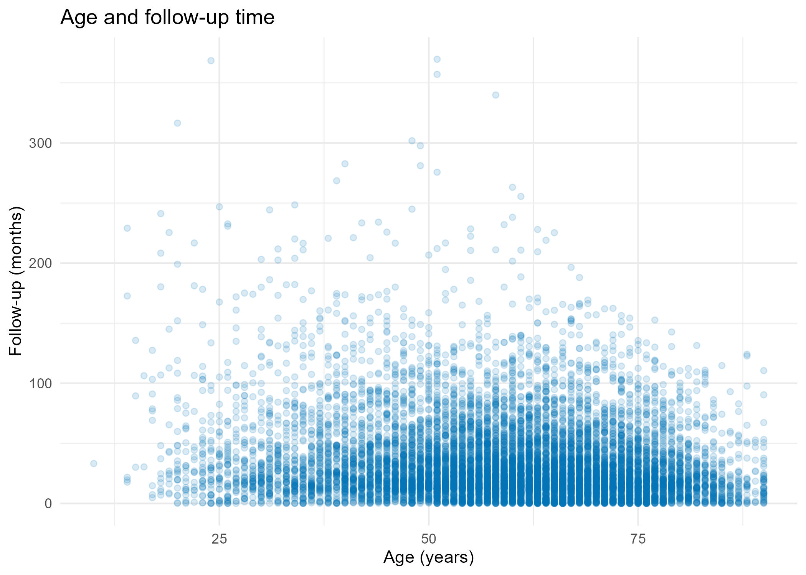

### Q10. How do you add a linear smooth?

**Hint:** `geom_smooth(method = "lm", formula = y ~ x)` adds the fitted line
with a confidence band.

```r
p_lm <- p_scatter +
  geom_smooth(method = "lm", formula = y ~ x, colour = "#D55E00") +
  labs(title = "Age and follow-up with linear trend")
save_fig(p_lm, "Fig3_2_scatter_lm.jpeg")
```

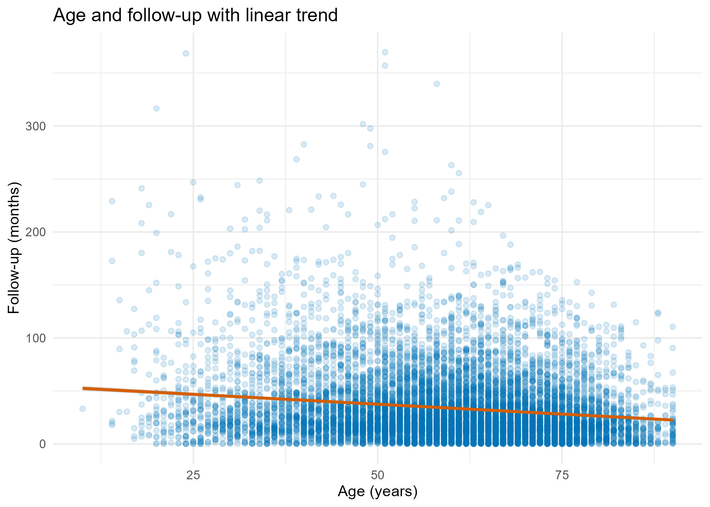

### Q11. Does the trend differ by Vital_Status?

**Hint:** Map `Vital_Status` to `colour`; `geom_smooth()` then fits one line
per group.

```r
p_status_lm <- clinical |>
  drop_na(Age, OS_months, Vital_Status) |>
  ggplot(aes(x = Age, y = OS_months, colour = Vital_Status)) +
  geom_point(alpha = 0.15) +
  geom_smooth(method = "lm", formula = y ~ x, se = FALSE) +
  scale_colour_manual(values = okabe_ito[2:1]) +
  labs(title = "Age and follow-up by vital status",
       x = "Age (years)", y = "Follow-up (months)", colour = "Vital status") +
  theme_minimal()
save_fig(p_status_lm, "Fig3_3_status_lm.jpeg")
```

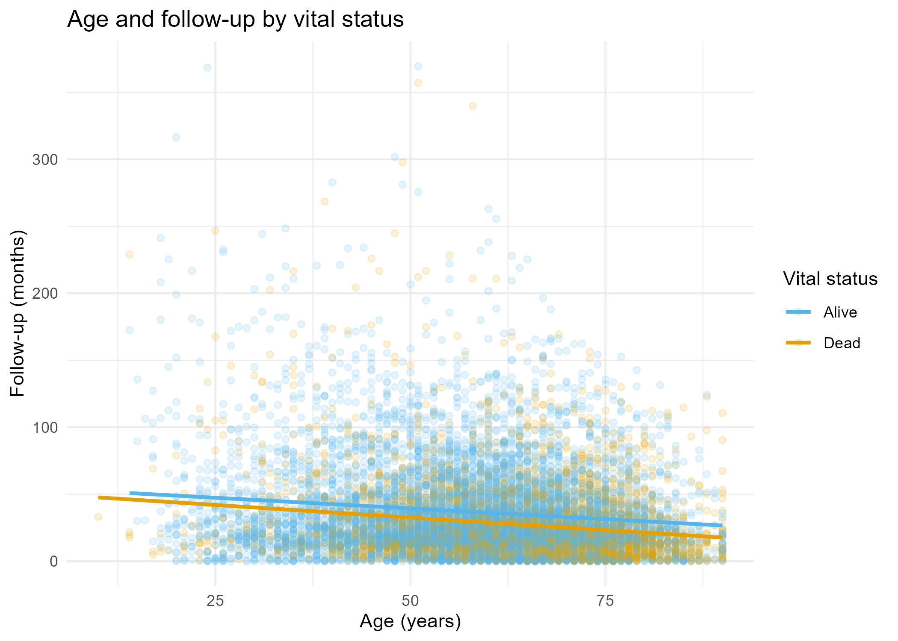

**What to look for:** Do not claim a group difference from line separation
alone. Censoring and cancer-type mix are strong confounders.

### Q12. How do you test the correlation?

**Hint:** Keep only complete pairs, then pass both vectors to `cor.test()`.

```r
complete_numeric <- clinical |>
  select(Age, OS_months) |>
  drop_na()

cor.test(complete_numeric $ Age, complete_numeric $ OS_months, method = "pearson")
```

**What to look for:** Read the estimate, confidence interval, and p-value
together. With thousands of patients, a tiny correlation can be significant
yet unimportant.

---

## 4. Two categorical variables

### Q13. What is the gender composition within each cancer type?

**Hint:** `position = "fill"` scales each bar to 100%.

```r
p_gender_cancer <- clinical |>
  drop_na(Gender) |>
  ggplot(aes(x = Cancer_Type, fill = Gender)) +
  geom_bar(position = "fill") +
  scale_y_continuous(labels = percent) +
  scale_fill_manual(values = okabe_ito[c(2, 1)]) +
  coord_flip() +
  labs(title = "Gender composition by cancer type",
       x = "Cancer type", y = "Percent", fill = "Gender") +
  theme_minimal()
save_fig(p_gender_cancer, "Fig4_1_gender_cancer.jpeg", 7, 8)
```

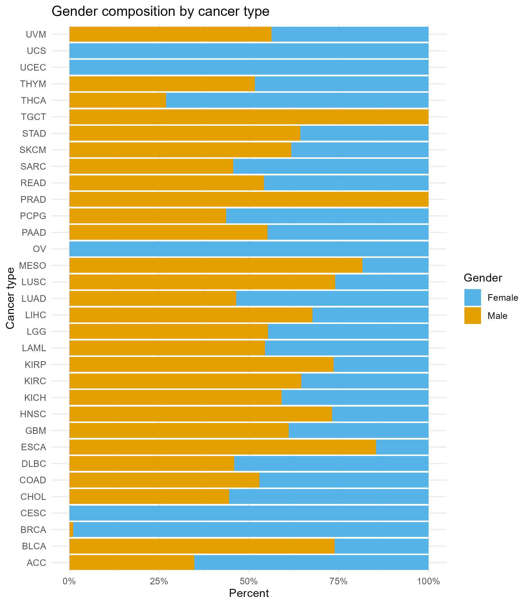

### Q14. What is the race composition within each cancer type?

```r
p_race_cancer <- clinical |>
  drop_na(Race) |>
  ggplot(aes(x = Cancer_Type, fill = Race)) +
  geom_bar(position = "fill") +
  scale_y_continuous(labels = percent) +
  scale_fill_manual(values = okabe_ito) +
  coord_flip() +
  labs(title = "Race composition by cancer type",
       x = "Cancer type", y = "Percent", fill = "Race") +
  theme_minimal()
save_fig(p_race_cancer, "Fig4_2_race_cancer.jpeg", 8, 8)
```

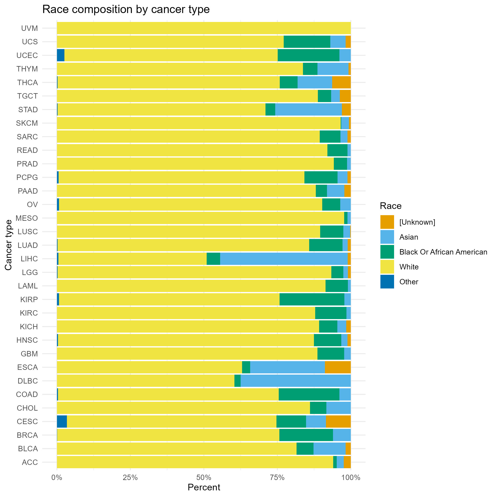

**What to look for:** TCGA is dominated by patients recorded as White.
Percentages for small groups rest on few patients.

### Q15. How are patients distributed across stages?

```r
p_stage_counts <- clinical |>
  drop_na(Stage) |>
  ggplot(aes(x = Stage)) +
  geom_bar(fill = "#0072B2") +
  coord_flip() +
  labs(title = "Patients by pathologic stage", x = "Stage", y = "Number of patients") +
  theme_minimal()
save_fig(p_stage_counts, "Fig4_3_stage_counts.jpeg")
```

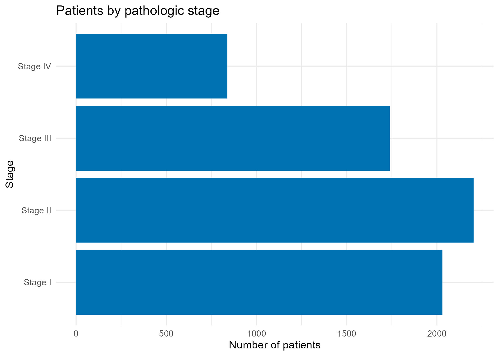

### Q16. How does vital status vary by cancer type?

```r
p_vital_cancer <- clinical |>
  drop_na(Vital_Status) |>
  ggplot(aes(x = Cancer_Type, fill = Vital_Status)) +
  geom_bar(position = "fill") +
  scale_y_continuous(labels = percent) +
  scale_fill_manual(values = okabe_ito[2:1]) +
  coord_flip() +
  labs(title = "Vital status by cancer type",
       x = "Cancer type", y = "Percent", fill = "Vital status") +
  theme_minimal()
save_fig(p_vital_cancer, "Fig4_4_vital_cancer.jpeg", 7, 8)
```

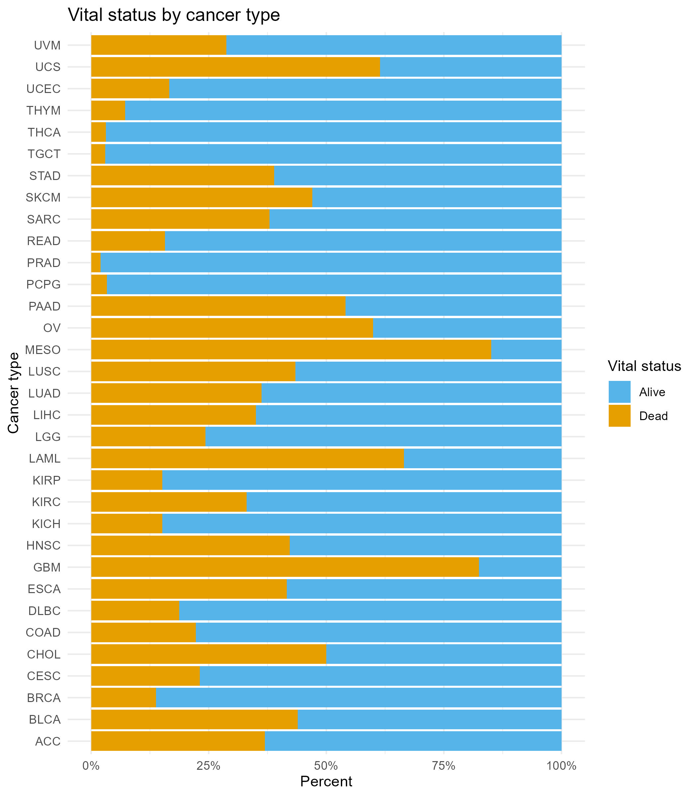

**What to look for:** Aggressive cancers such as GBM show high mortality in
the follow-up window, while THCA and PRAD show very low mortality. Follow-up
length differs by cancer, so compare with care.

---

## 5. Immune and molecular subtypes

### Q17. What are the immune subtypes?

```r
p_immune <- clinical |>
  drop_na(Immune_Subtype) |>
  count(Immune_Subtype) |>
  ggplot(aes(x = reorder(Immune_Subtype, n), y = n)) +
  geom_col(fill = "#009E73") +
  coord_flip() +
  labs(title = "Immune subtypes", x = "Immune subtype", y = "Number of patients") +
  theme_minimal()
save_fig(p_immune, "Fig5_1_immune_subtypes.jpeg")
```

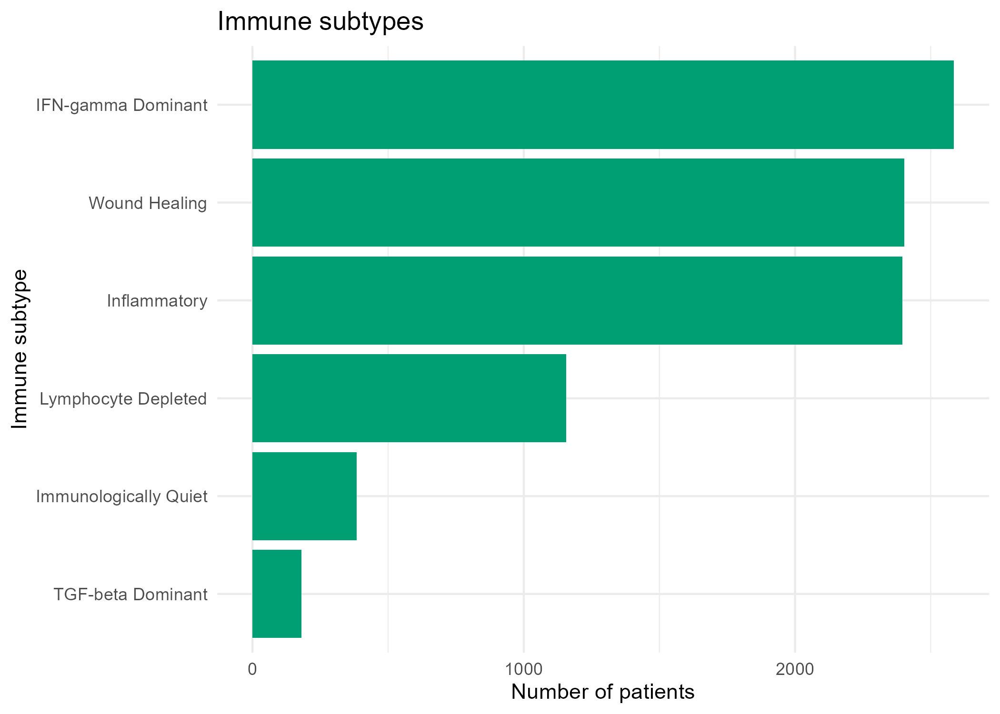

### Q18. How do immune subtypes differ across selected cancers?

**Hint:** `facet_wrap(~ Cancer_Type, scales = "free_y")` gives each cancer its
own panel and y-scale.

```r
focus <- c("BRCA", "LUAD", "COAD", "SKCM", "GBM", "KIRC")

p_immune_facet <- clinical |>
  filter(Cancer_Type %in% focus, !is.na(Immune_Subtype)) |>
  ggplot(aes(x = Immune_Subtype, fill = Immune_Subtype)) +
  geom_bar() +
  facet_wrap(~ Cancer_Type, scales = "free_y") +
  scale_fill_manual(values = okabe_ito) +
  guides(fill = "none") +
  labs(title = "Immune subtypes in selected cancers",
       x = NULL, y = "Number of patients") +
  theme_minimal() +
  theme(axis.text.x = element_text(angle = 45, hjust = 1))
save_fig(p_immune_facet, "Fig5_2_immune_facet.jpeg", 9, 6)
```

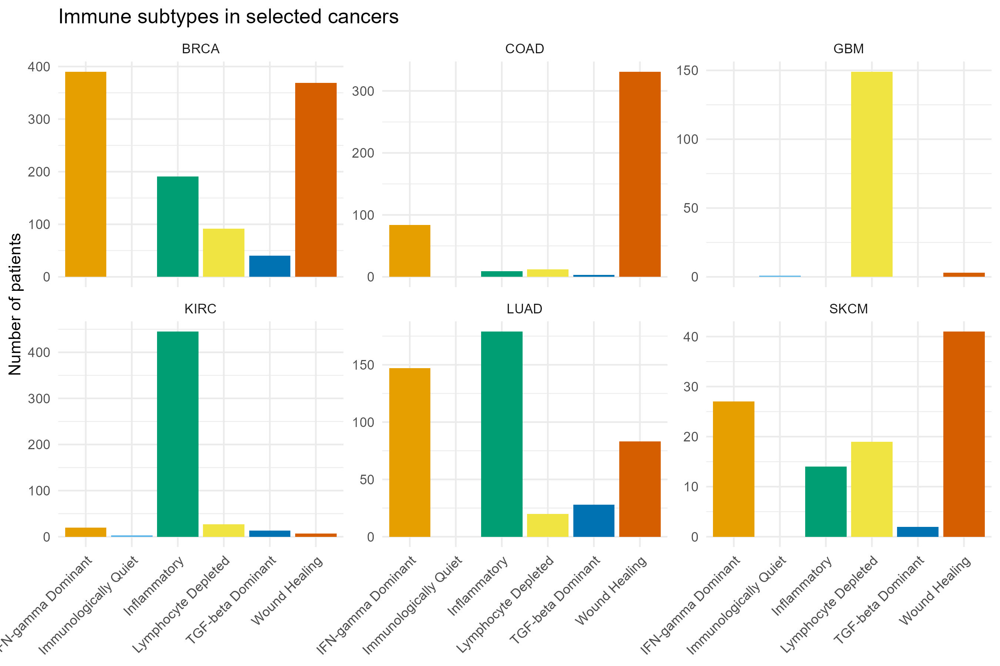

**What to look for:** Free y-scales make the shapes easy to compare but hide
the differences in panel size.

### Q19. What are the BRCA molecular (PAM50) subtypes?

```r
brca <- clinical |>
  filter(Cancer_Type == "BRCA", !is.na(Molecular_Subtype)) |>
  mutate(Molecular_Subtype = str_remove(Molecular_Subtype, "^BRCA\\."))

p_brca_sub <- ggplot(brca, aes(x = fct_infreq(Molecular_Subtype))) +
  geom_bar(fill = "#CC79A7") +
  coord_flip() +
  labs(title = "BRCA molecular subtypes", x = "Subtype", y = "Number of patients") +
  theme_minimal()
save_fig(p_brca_sub, "Fig5_3_brca_subtypes.jpeg")
```

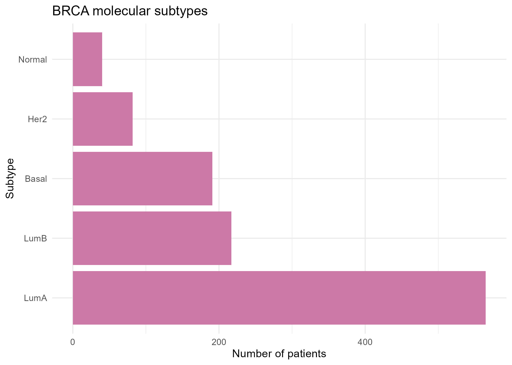

### Q20. Does Age differ across BRCA subtypes?

```r
p_brca_age <- brca |>
  drop_na(Age) |>
  ggplot(aes(x = Molecular_Subtype, y = Age, fill = Molecular_Subtype)) +
  geom_boxplot(outlier.alpha = 0.35) +
  scale_fill_manual(values = okabe_ito) +
  guides(fill = "none") +
  labs(title = "BRCA: age by molecular subtype", x = "Subtype", y = "Age (years)") +
  theme_minimal()
save_fig(p_brca_age, "Fig5_4_brca_age_subtype.jpeg")
```

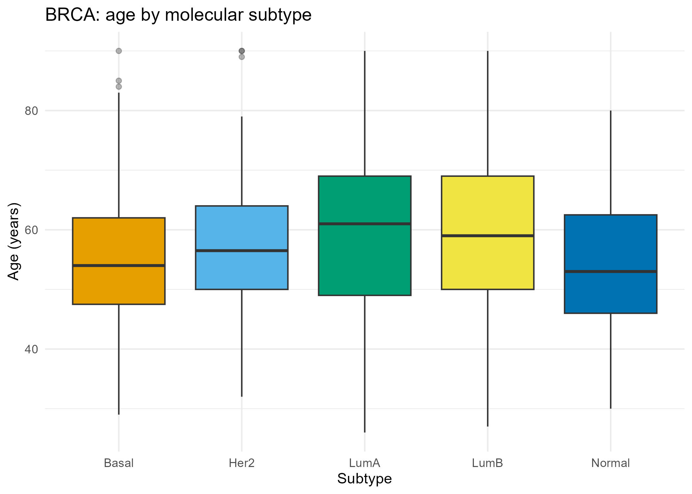

---

## 6. Facets, statistics, and publication style

### Q21. How do you facet an Age histogram by Gender?

```r
p_age_facet <- clinical |>
  drop_na(Gender, Age) |>
  ggplot(aes(x = Age)) +
  geom_histogram(binwidth = 5, boundary = 0, fill = "#0072B2", colour = "white") +
  facet_wrap(~ Gender) +
  labs(title = "Age distribution by gender", x = "Age (years)", y = "Number of patients") +
  theme_minimal()
save_fig(p_age_facet, "Fig6_1_age_gender_facet.jpeg", 8, 4)
```

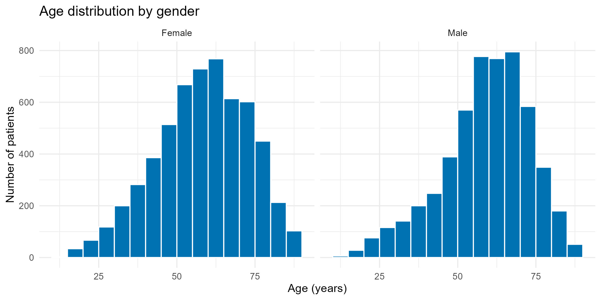

**What to look for:** Compare shape and sample size across panels. Facets
reduce overplotting but do not make groups comparable on their own.

### Q22. How do you add a Wilcoxon test annotation?

**Hint:** `ggpubr::stat_compare_means(method = "wilcox.test")` adds the
p-value to the plot.

```r
p_wilcox <- clinical |>
  drop_na(Vital_Status, Age) |>
  ggboxplot(x = "Vital_Status", y = "Age", color = "Vital_Status",
            palette = okabe_ito[2:1], add = "jitter",
            add.params = list(alpha = 0.15, width = 0.15)) +
  stat_compare_means(method = "wilcox.test", label = "p.format") +
  labs(title = "Age by vital status with Wilcoxon test",
       x = "Vital status", y = "Age (years)") +
  theme_minimal()
save_fig(p_wilcox, "Fig6_2_wilcox.jpeg")
```

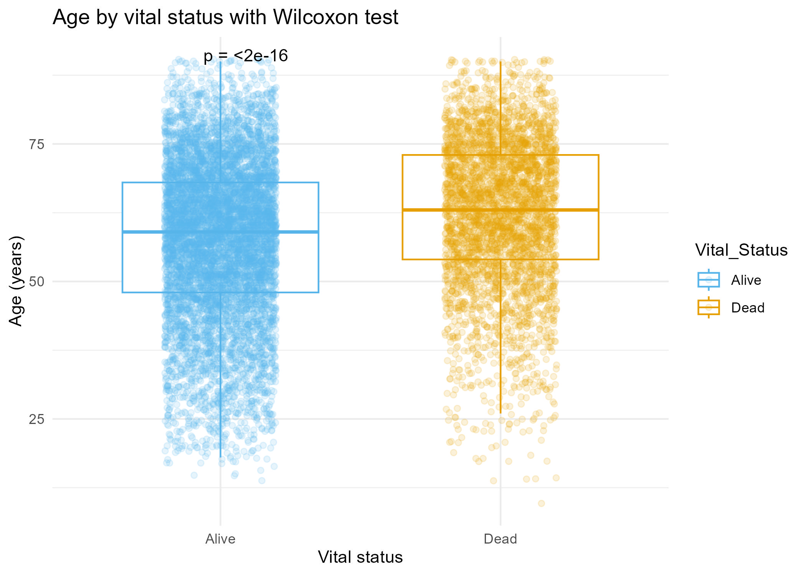

**What to look for:** The annotation reports a p-value for the displayed
groups. It does not measure effect size, prove causation, or replace
inspecting the distributions and sample sizes.

### Q23. How do you build a publication-style figure?

```r
p_pub <- clinical |>
  drop_na(Age_Group, Age, Vital_Status) |>
  ggplot(aes(x = Age_Group, y = Age, fill = Vital_Status)) +
  geom_boxplot(outlier.alpha = 0.3) +
  scale_fill_manual(values = okabe_ito[2:1]) +
  labs(title = "Age across age groups",
       subtitle = "Stratified by vital status (TCGA Pan-Cancer)",
       x = "Age group", y = "Age (years)", fill = "Vital status",
       caption = "Source: TCGA Pan-Cancer Atlas (UCSC Xena)") +
  theme_minimal(base_size = 13) +
  theme(plot.title = element_text(face = "bold", size = 15),
        plot.subtitle = element_text(colour = "grey30"),
        legend.position = "top")
save_fig(p_pub, "Fig6_3_publication.jpeg")
```

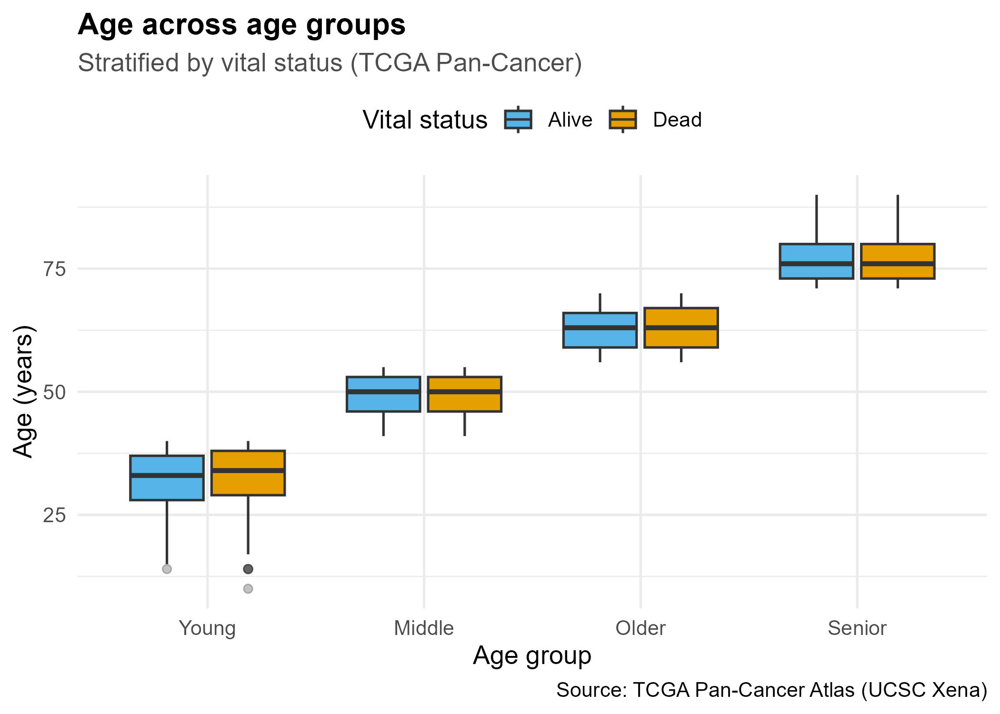

---

## Take-home messages

1. Pan-cancer data mixes very different diseases. Stratify by `Cancer_Type` before drawing biological conclusions.
2. Group sizes are highly unequal. Check counts before comparing percentages.
3. Follow-up time is censored. Use survival analysis (Kaplan-Meier, Cox) for real survival questions.
4. Use colour-blind-safe palettes (Okabe-Ito) and consistent factor ordering.
