# 🎨 The Complete Guide to Color Palettes in R

> A practical, copy-paste-ready tutorial: from base R colors to `ggplot2`, `RColorBrewer`, `viridis`, `scico`, `paletteer`, and the full `ggsci` collection.

---


### 🌈 General Color Inspiration

| Resource | Description | Link |
| :--- | :--- | :--- |
| **Coolors: 2-Color Palettes** | Trending two-color combinations. | [Open →](https://coolors.co/palettes/trending/2%20colors) |
| **Coolors: 3-Color Palettes** | Trending three-color combinations. | [Open →](https://coolors.co/palettes/trending/3%20colors) |
| **Coolors: Halloween** | Popular Halloween palettes. | [Open →](https://coolors.co/palettes/popular/halloween) |
| **Coolors: Christmas** | Popular Christmas palettes. | [Open →](https://coolors.co/palettes/popular/christmas) |
| **Adobe Color Wheel** | Build palettes with color harmony rules. | [Open →](https://color.adobe.com/create/color-wheel) |
| **2Colors (Colorion)** | Curated two-color combinations, duotone palettes, and contrast-ready pairs for UI/UX design. | [Open →](https://2colors.colorion.co/) |


## 📊 R Color Palettes & Color Codes

| Resource | Description | Link |
| :--- | :--- | :--- |
| **R-Charts Color Guide** | Complete list of 657 named colors in R with HEX and RGB codes, with one-click copy. | [Open R-Charts →](https://r-charts.com/colors/) |
| **Emil Hvitfeldt R Palettes** | Comprehensive interactive gallery of color palettes across the entire R ecosystem (ggplot2, paletteer). | [Explore Palettes →](https://emilhvitfeldt.github.io/r-color-palettes/) |
| **ColorBrewer 2.0** | Perceptually balanced sequential, diverging, and qualitative palettes for R (`RColorBrewer`). | [Open ColorBrewer →](https://colorbrewer2.org/) |
| **R Graph Gallery Color Finder** | Searchable tool to explore and pick color palettes designed specifically for data visualization in R. | [Open Palette Finder →](https://r-graph-gallery.com/color-palette-finder) |
| **ggsci Documentation** | Official site for scientific journal and sci-fi themed palettes for ggplot2. | [Open ggsci →](https://nanx.me/ggsci/) |
| **ggsci iTerm Preview** | Single-page preview of all 400+ iTerm color schemes available in ggsci. | [Open Preview →](https://nanx.me/ggsci-iterm/) |

---

## 📦 R Packages for Color Palettes

| Package | Description | Palette Types |
| :--- | :--- | :--- |
| **`ggsci`** | Scientific journal, tech-brand, and sci-fi palettes (NPG, AAAS, NEJM, Lancet, JAMA, D3, Star Trek, Futurama, and more). | Discrete + continuous |
| **`RColorBrewer`** | Cartography-grade palettes designed by Cynthia Brewer. | Sequential, diverging, qualitative |
| **`viridis`** | Perceptually uniform palettes: `magma`, `plasma`, `inferno`, `mako`, `rocket`, `turbo`. | Sequential / qualitative |
| **`scico`** | Scientific Colour Maps (`batlow`, `roma`, `bamako`, `hawaii`). | Sequential, diverging, cyclic |
| **`rcartocolor`** | CARTOColors (`PurpOr`, `Temps`, `Prism`). | Sequential, diverging, qualitative |
| **`ggokabeito`** | Okabe-Ito colorblind-safe palette. | Qualitative |
| **`MetBrewer` / `MoMAColors`** | Palettes inspired by works at the Met and MoMA. | All types |
| **`paletteer`** | One interface to access thousands of palettes from many packages. | All types |
| **`wesanderson`, `ghibli`, `tayloRswift`, `NatParksPalettes`** | Fun, themed palettes (movies, music, national parks). | Mostly discrete |

---

## 📑 Table of Contents

1. [The 3 Core Types of Palettes](#1-the-3-core-types-of-palettes)
2. [Base R Colors](#2-base-r-colors)
3. [Defining Your Own Palette](#3-defining-your-own-palette)
4. [RColorBrewer](#4-rcolorbrewer)
5. [viridis](#5-viridis)
6. [scico (Scientific Colour Maps)](#6-scico-scientific-colour-maps)
7. [Okabe-Ito (Colorblind Safe)](#7-okabe-ito-colorblind-safe)
8. [paletteer: One Interface for Everything](#8-paletteer-one-interface-for-everything)
9. [Custom and Corporate Palettes](#9-custom-and-corporate-palettes)
10. [Fun and Artsy Palettes](#10-fun-and-artsy-palettes)
11. [ggsci: Complete Guide](#11-ggsci-complete-guide)
12. [Accessibility Testing](#12-accessibility-testing)
13. [Quick Decision Guide](#13-quick-decision-guide)

---

## 1. The 3 Core Types of Palettes

Before picking colors, identify what kind of data you have.

| Type | Data Nature | Color Behavior | Examples |
| :--- | :--- | :--- | :--- |
| **Sequential** | Low → high values (ordered) | One hue or related hues, light → dark | `Blues`, `YlOrRd`, `viridis` |
| **Diverging** | Values around a meaningful midpoint (negative / zero / positive) | Two contrasting hues meeting at a neutral middle | `RdBu`, `RdYlBu`, `roma` |
| **Qualitative** | Distinct categories, no order | Distinct hues with similar lightness | `Set1`, `Dark2`, Okabe-Ito |

> ⚠️ **Do not use diverging palettes for non-diverging data.** If flipper length ranges from 170 to 230 mm, there is no natural center, so a diverging palette makes the middle value look like a "faded" special point. Use a sequential palette instead.

---

## 2. Base R Colors

In its simplest form, a palette in R is a **vector of colors**, as named colors or hex codes.

```r
# The default palette
palette()
#[1] "black"   "#DF536B" "#61D04F" "#2297E6" "#28E2E5" "#CD0BBC" "#F5C710" "gray62" 
```

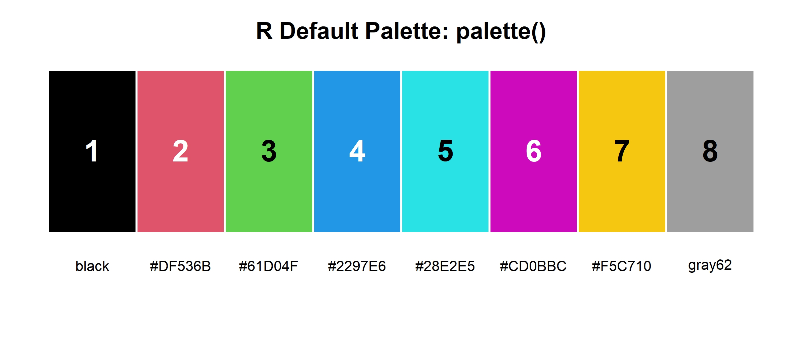

```r
# Reset to default if you changed it earlier
palette("default")

# All 657 built-in color names
head(colors(), 10)
# [1] "white"         "aliceblue"     "antiquewhite"  "antiquewhite1" "antiquewhite2" "antiquewhite3" "antiquewhite4" "aquamarine"    "aquamarine1"   "aquamarine2"  
```
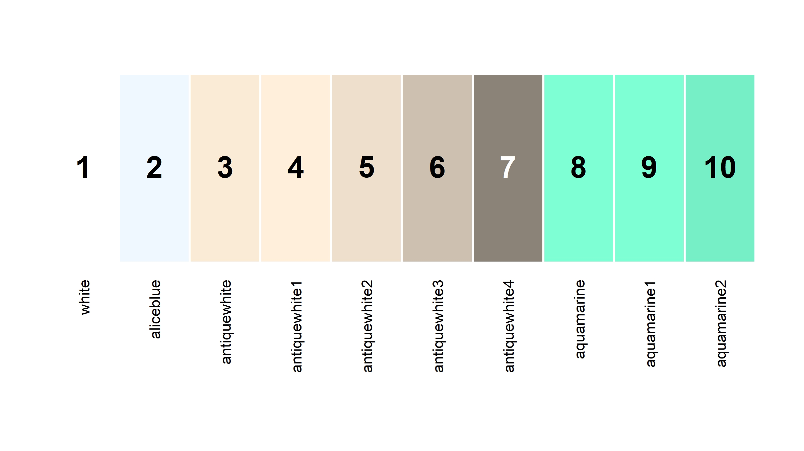


### Built-in gradient palettes (`grDevices`)

```r
rainbow(6)
# [1] "#FF0000" "#FFFF00" "#00FF00" "#00FFFF" "#0000FF" "#FF00FF"
```
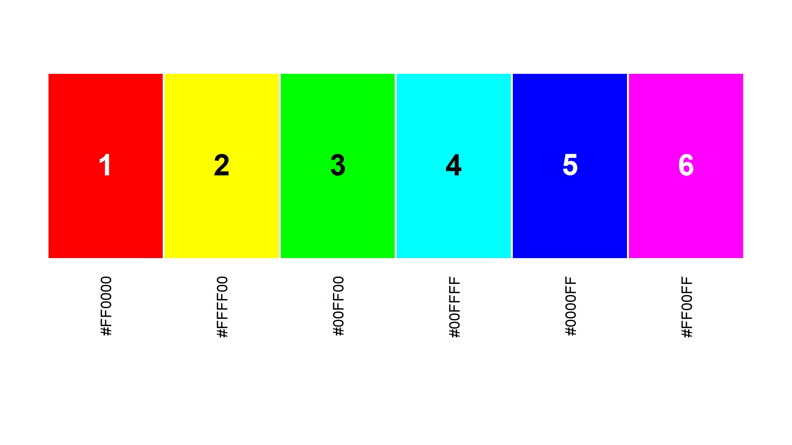

```r
heat.colors(6)
#[1] "#FF0000" "#FF4000" "#FF8000" "#FFBF00" "#FFFF00" "#FFFF80"
```
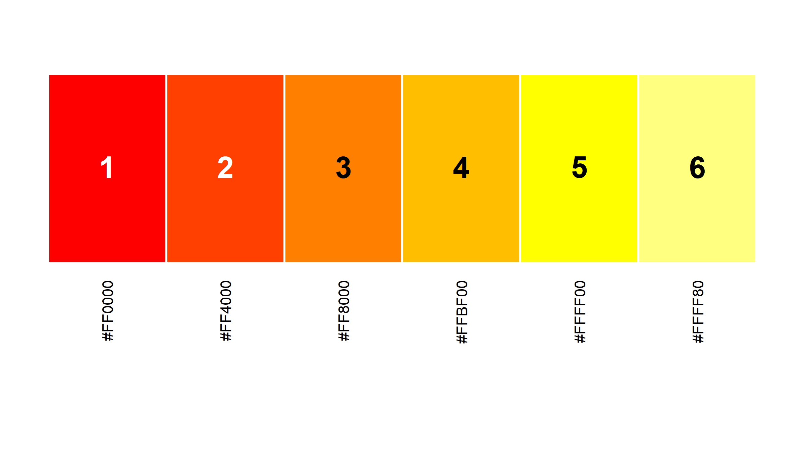


```r
terrain.colors(6)
#[1] "#00A600" "#63C600" "#E6E600" "#EAB64E" "#EEB99F" "#F2F2F2"
```

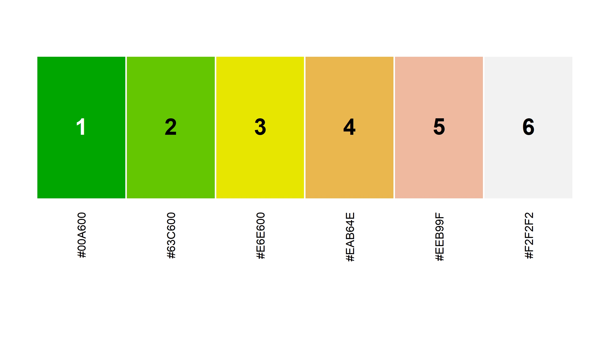

```r

topo.colors(6)
#[1] "#4C00FF" "#00E5FF" "#00FF4D" "#E6FF00" "#FFFF00" "#FFE0B3"
```
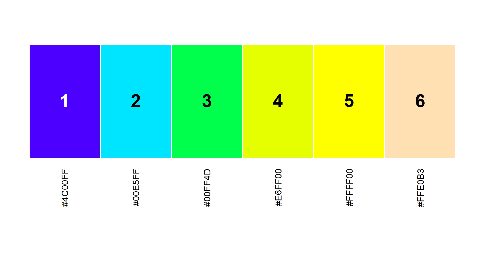

```r
cm.colors(6)
#[1] "#80FFFF" "#AAFFFF" "#D5FFFF" "#FFD5FF" "#FFAAFF" "#FF80FF"
```

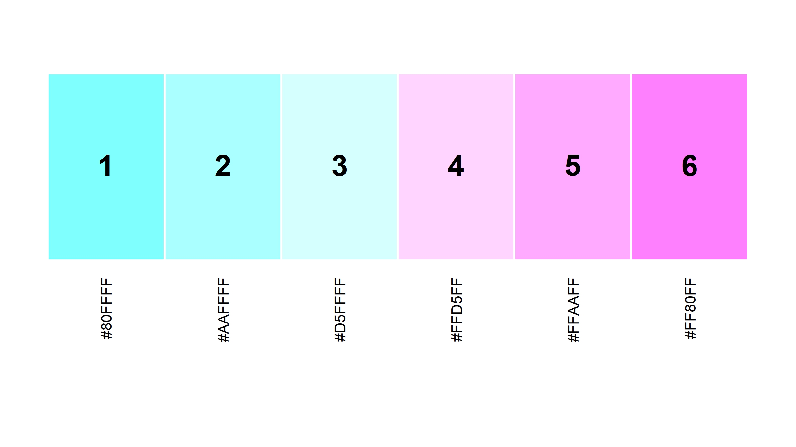

```r

# rainbow() lets you adjust saturation (s) and value (v)
rainbow(6, s = 0.5)
#[1] "#FF8080" "#FFFF80" "#80FF80" "#80FFFF" "#8080FF" "#FF80FF"
```
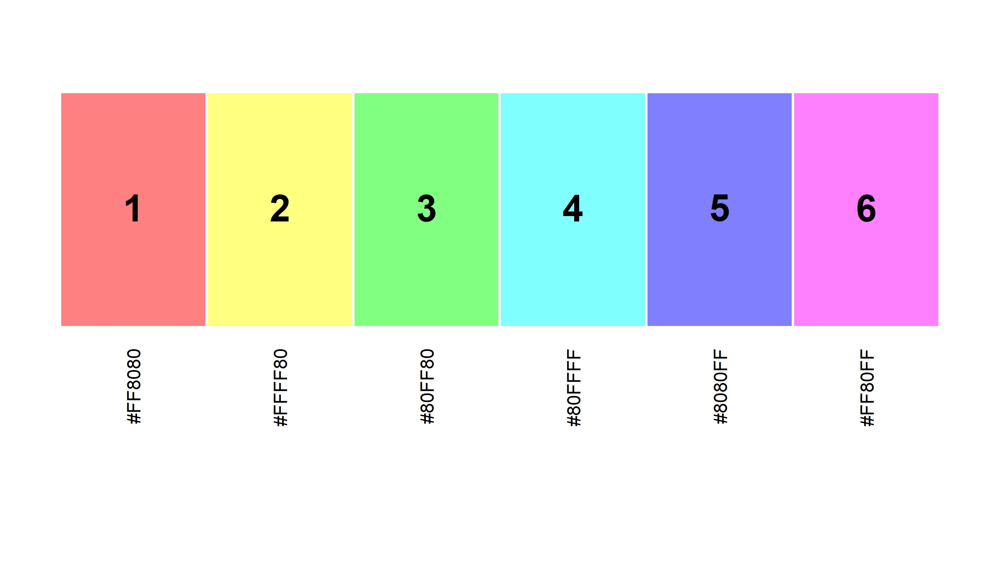

> ⚠️ `rainbow()` is rarely a good choice: it prints poorly in black and white and is hard to read for colorblind viewers (see [Accessibility Testing](#12-accessibility-testing)).

---


## 3. RColorBrewer

Cynthia Brewer designed these palettes for maps, but they work great for any chart.

```r
install.packages("RColorBrewer")
library(RColorBrewer)

# Show every palette
# Top = sequential, middle = qualitative, bottom = diverging
display.brewer.all()

```
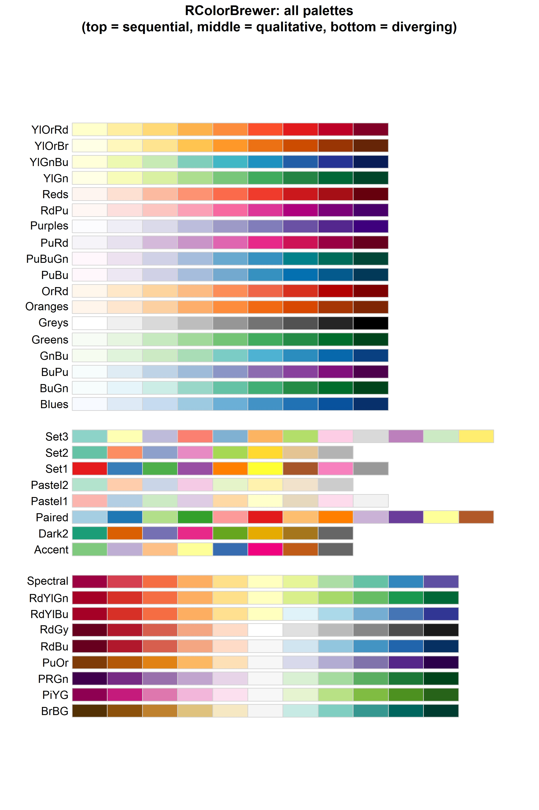


```r
# Show only colorblind-friendly palettes
display.brewer.all(colorblindFriendly = TRUE)

```

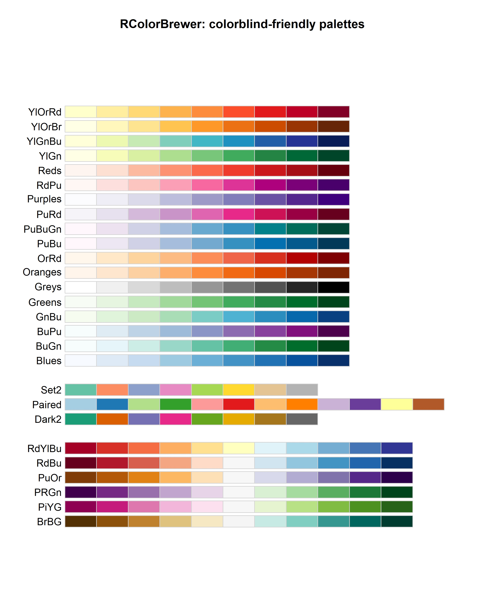


## 4. Using Color Palettes for Publication-Ready Images

```r
data=read.csv("Data/LUAD_clean_data_all_patients.csv")
head(data)
```

```r

#            ID Age Gender     Race Vital_Status Pathologic_stage Cigarettes_per_day Age_Group
# 1 TCGA-55-A48X  63 Female European        Alive        Stage IIA          1.9726027     Young
# 2 TCGA-NJ-A55R  67   Male European        Alive         Stage IA          0.2739726       Old
# 3 TCGA-53-A4EZ  63   Male European        Alive        Stage IIA          2.1917808     Young
# 4 TCGA-44-6777  85 Female European         Dead         Stage IB          3.5068493       Old
# 5 TCGA-55-6982  79 Female European         Dead        Stage IIB          0.0000000       Old
# 6 TCGA-50-7109  60   Male European         Dead         Stage IA          6.5753425     Young

```

```r
# Factors are needed so the colors map to the categories
data$Pathologic_stage <- factor(data$Pathologic_stage)
data$Age_Group        <- factor(data$Age_Group)

# How many colors do we need?
n_stage <- nlevels(data$Pathologic_stage)
n_age   <- nlevels(data$Age_Group)
```

```r
n_stage
#[1] 9
n_age
#[1] 2
```
```r
stage_cols <- brewer.pal(max(3, n_stage), "Set2")[1:n_stage]

barplot(table(data$Pathologic_stage),
        col  = stage_cols,
        main = "Pathologic Stage Distribution",
        ylab = "Number of patients",
        las  = 2)
```
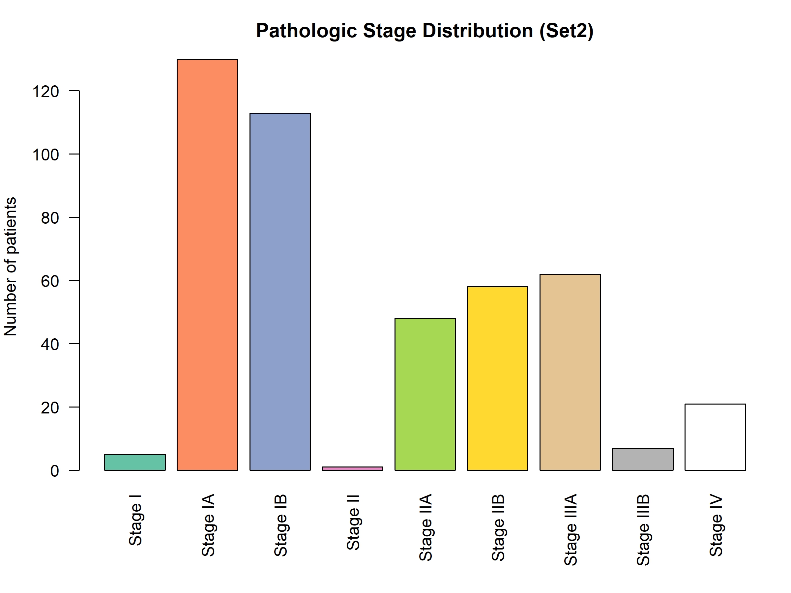


```r
age_cols <- brewer.pal(max(3, n_age), "Dark2")[1:n_age]

barplot(table(data$Age_Group),
        col  = age_cols,
        main = "Age Group Distribution",
        ylab = "Number of patients")

```
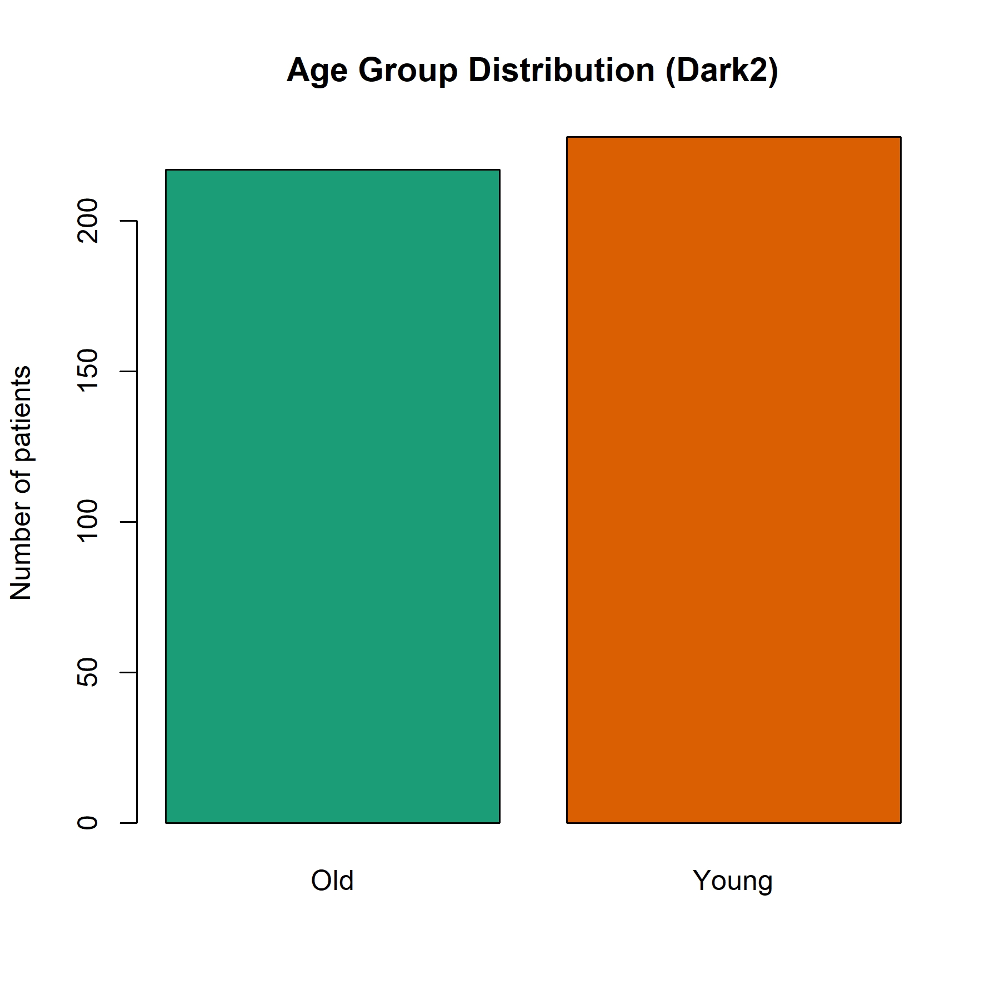


## 5. ggsci: Journal-Specific Color Palettes

The **ggsci** package provides palettes inspired by scientific journals, data visualization libraries, and TV shows. If you are preparing a figure for a specific journal, ggsci lets you match its visual style with a single line of code.

> 💡 **When to use ggsci:** use it for **qualitative (categorical)** data when you want a journal-style look. For continuous data, prefer `viridis` or `scico`.

---

### 5.1 Install and Load

```r
# Install (run once only)
#install.packages("ggsci")

# Or the development version from GitHub
# remotes::install_github("nanxstats/ggsci")

library(ggsci)
library(ggplot2)
library(scales)   # for show_col()
```

> 💡 Open the quick-start guide any time with `vignette("ggsci")`.

---

### 5.2 How ggsci Works

ggsci gives you **two kinds of functions** for every palette:

| Function type | Pattern | Purpose | Example |
| :--- | :--- | :--- | :--- |
| **Palette generator** | `pal_*()` | Returns hex codes (works in base R and ggplot2) | `pal_npg()(5)` |
| **ggplot2 scale** | `scale_fill_*()` / `scale_color_*()` | Applies the palette inside ggplot2 | `scale_fill_npg()` |

```r
# pal_npg() returns a FUNCTION, so the double parentheses are needed
pal_npg()(5)
# [1] "#E64B35" "#4DBBD5" "#00A087" "#3C5488" "#F39B7F"

# Preview with hex codes
show_col(pal_npg()(5), labels = TRUE)
```

---

### 5.3 Journal Palettes

| Journal | Palette | Fill scale | Color scale |
| :--- | :--- | :--- | :--- |
| **Nature Publishing Group** | `pal_npg()` | `scale_fill_npg()` | `scale_color_npg()` |
| **Science (AAAS)** | `pal_aaas()` | `scale_fill_aaas()` | `scale_color_aaas()` |
| **NEJM** | `pal_nejm()` | `scale_fill_nejm()` | `scale_color_nejm()` |
| **The Lancet** | `pal_lancet()` | `scale_fill_lancet()` | `scale_color_lancet()` |
| **JAMA** | `pal_jama()` | `scale_fill_jama()` | `scale_color_jama()` |
| **BMJ** | `pal_bmj()` | `scale_fill_bmj()` | `scale_color_bmj()` |
| **JCO** | `pal_jco()` | `scale_fill_jco()` | `scale_color_jco()` |

---

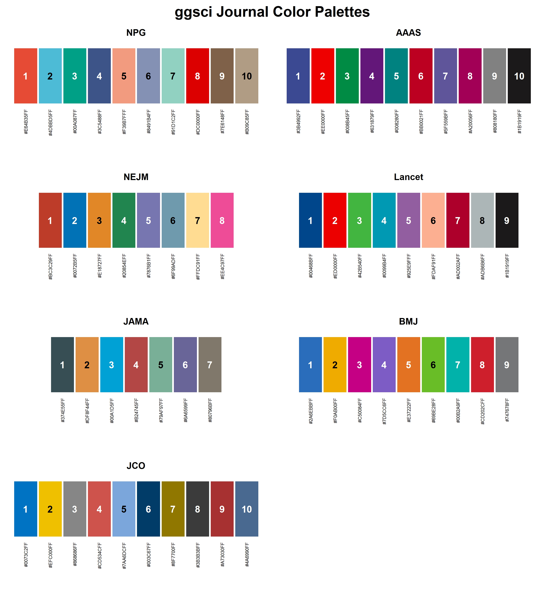


---

### 5.5 Apply Journal Palettes to the LUAD Data

Use `scale_fill_*()` for **filled shapes** (bars, boxes) and `scale_color_*()` for **points and lines**.

**Bar plot with NPG (Nature style):**

```r
p1 <- ggplot(data, aes(x = Pathologic_stage, fill = Pathologic_stage)) +
  geom_bar() +
  scale_fill_npg() +
  labs(title = "Pathologic Stage Distribution (NPG)",
       x = "Pathologic stage", y = "Number of patients") +
  theme_classic(base_size = 12) +
  theme(axis.text.x = element_text(angle = 90, hjust = 1, vjust = 0.5),
        legend.position = "none")
p1
```

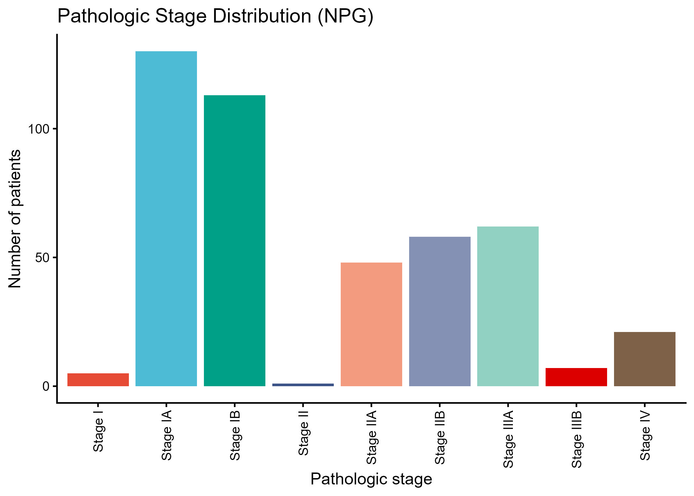

**Box plot with Lancet:**

```r
p2 <- ggplot(data, aes(x = Age_Group, y = Age, fill = Age_Group)) +
  geom_boxplot() +
  scale_fill_lancet() +
  labs(title = "Age by Age Group (Lancet)",
       x = "Age group", y = "Age (years)") +
  theme_classic(base_size = 12) +
  theme(legend.position = "none")
p2
```

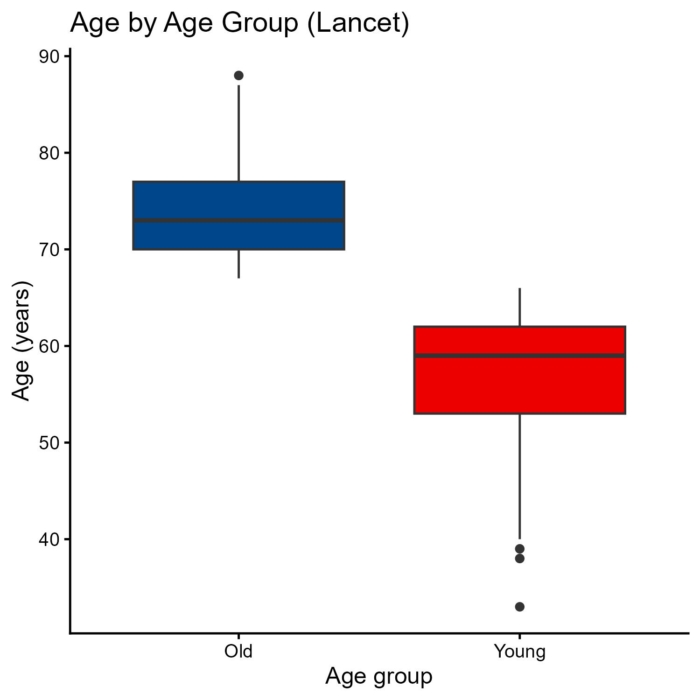

**Scatter plot with NEJM:**

```r
p3 <- ggplot(data, aes(x = Age, y = Cigarettes_per_day, color = Age_Group)) +
  geom_point(size = 2, alpha = 0.7) +
  scale_color_nejm() +
  labs(title = "Age vs Smoking (NEJM)",
       x = "Age (years)", y = "Cigarettes per day") +
  theme_classic(base_size = 12)
p3
```

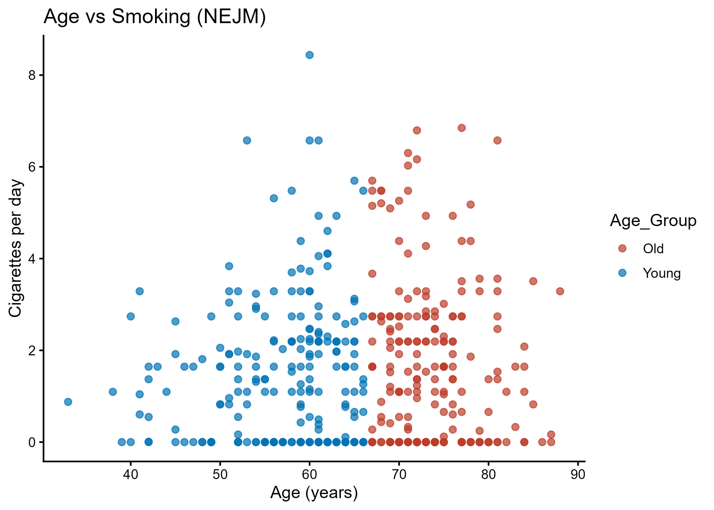

> 💡 To switch journal style, change only the suffix: `scale_fill_jama()`, `scale_fill_aaas()`, `scale_fill_jco()`, and so on.

---

### 5.6 Save Publication-Ready Figures

```r
ggsave("color/Fig_col_14.jpeg", p1, width = 7, height = 5,
       units = "in", dpi = 300)
ggsave("color/Fig_col_15.jpeg", p2, width = 5, height = 5,
       units = "in", dpi = 300)
ggsave("color/Fig_col_16.jpeg", p3, width = 7, height = 5,
       units = "in", dpi = 300)
```

`ggsave()` is the ggplot2 equivalent of `jpeg()` + `dev.off()`. Use `dpi = 300` or higher for journal submission.

---

### 5.7 Use ggsci Colors in Base R

Because `pal_*()` returns plain hex codes, ggsci palettes also work with `barplot()`, `hist()`, and `boxplot()`.

```r
stage_cols <- pal_npg()(nlevels(data$Pathologic_stage))

barplot(table(data$Pathologic_stage),
        col  = stage_cols,
        main = "Pathologic Stage Distribution (NPG)",
        ylab = "Number of patients",
        las  = 2)
```

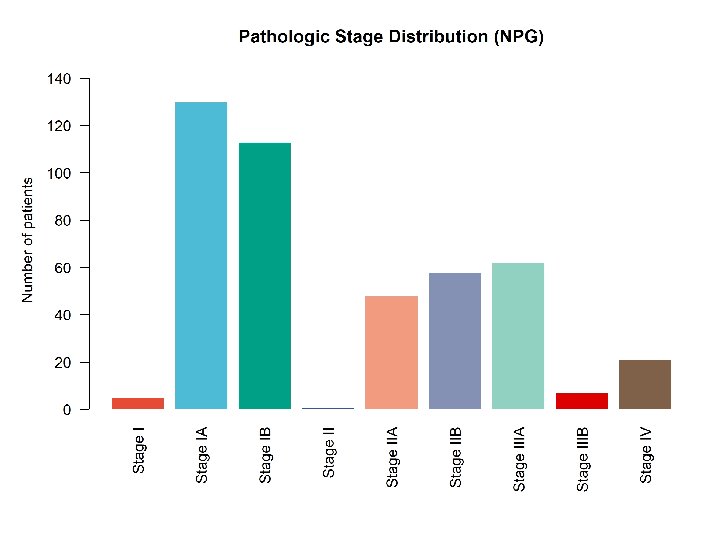

---

### 5.8 Palette Variants and Transparency

Many palettes have variants, and all accept an `alpha` argument.

```r
# NPG with transparency
pal_npg(alpha = 0.6)(5)
#[1] "#E64B3599" "#4DBBD599" "#00A08799" "#3C548899" "#F39B7F99"


# JCO, D3 and others have variants
pal_d3("category20")(20)
# [1] "#1F77B4FF" "#FF7F0EFF" "#2CA02CFF" "#D62728FF" "#9467BDFF" "#8C564BFF" "#E377C2FF" "#7F7F7FFF" "#BCBD22FF" "#17BECFFF" "#AEC7E8FF" "#FFBB78FF" "#98DF8AFF" "#FF9896FF"
# [15] "#C5B0D5FF" "#C49C94FF" "#F7B6D2FF" "#C7C7C7FF" "#DBDB8DFF" "#9EDAE5FF"


pal_aaas()(10)
#[1] "#3B4992FF" "#EE0000FF" "#008B45FF" "#631879FF" "#008280FF" "#BB0021FF" "#5F559BFF" "#A20056FF" "#808180FF" "#1B1919FF"
```

```r
# Transparency inside ggplot2
ggplot(data, aes(x = Age, fill = Age_Group)) +
  geom_density() +
  scale_fill_npg(alpha = 0.6) +
  theme_classic()
```

Check `?pal_npg`, `?pal_d3`, and `?pal_igv` for the available variants.

---

### 5.9 Other ggsci Families

**Genomics tools (useful for bioinformatics figures):**

| Palette | Function | Typical use |
| :--- | :--- | :--- |
| UCSC Genome Browser | `scale_fill_ucscgb()` | Chromosome colors |
| IGV | `scale_fill_igv()` | Chromosomes and annotations |
| LocusZoom | `scale_fill_locuszoom()` | GWAS regional plots |
| COSMIC | `scale_fill_cosmic()` | Mutation signatures |
| GSEA | `scale_fill_gsea()` | Continuous enrichment heatmaps |

**Visualization and design systems:**

| Palette | Function |
| :--- | :--- |
| D3 | `scale_fill_d3()` |
| Gephi | `scale_fill_gephi()` |
| Observable | `scale_fill_observable()` |
| Primer (GitHub) | `scale_fill_primer()` |
| Atlassian | `scale_fill_atlassian()` |
| iTerm | `scale_fill_iterm()` |
| UChicago | `scale_fill_uchicago()` |
| Flat UI | `scale_fill_flatui()` |
| Frontiers | `scale_fill_frontiers()` |
| Bootstrap 5 | `scale_fill_bs5()` |
| Material Design | `scale_fill_material()` |
| Tailwind CSS | `scale_fill_tw3()` |

**Sci-fi and TV (for presentations, not papers):**

| Palette | Function |
| :--- | :--- |
| Star Trek | `scale_fill_startrek()` |
| Tron Legacy | `scale_fill_tron()` |
| Futurama | `scale_fill_futurama()` |
| Rick and Morty | `scale_fill_rickandmorty()` |
| The Simpsons | `scale_fill_simpsons()` |

> 💡 Some palettes (for example `iterm`, `material`, `tw3`, `bs5`) need a color scheme or hue argument. Check the help page, e.g. `?scale_fill_material`. If a function is not found, update ggsci with `install.packages("ggsci")`, since newer palettes are added in recent versions.

---

### 5.10 Continuous Palettes

Some ggsci palettes also provide **continuous** scales for heatmaps and gradients.

```r
# GSEA continuous palette
ggplot(data, aes(x = Age, y = Cigarettes_per_day, color = Age)) +
  geom_point(size = 2) +
  scale_color_gsea() +
  theme_classic()
```

For general continuous data, `viridis` or `scico` are usually safer choices than ggsci.

---

### ⚠️ 5.11 Accessibility Note

Journal palettes are designed for **branding and print consistency**, not necessarily for color-vision deficiency. NPG and AAAS, for example, contain red and green tones that can look similar to colorblind readers.

**Recommendations:**

* Check the journal's author guidelines first.
* Test your figure with a colorblind simulator (see [Accessibility Testing](#12-accessibility-testing)).
* If accessibility matters more than journal style, use `pal_jco()`, Okabe-Ito, or the colorblind-friendly RColorBrewer palettes.
* Use the **same color for the same category** across all figures in a paper.
* Do not use more colors than needed. Most journal palettes work best with 8 or fewer categories.

---

### 5.12 Summary

| Task | Code |
| :--- | :--- |
| Get hex codes | `pal_npg()(n)` |
| Preview colors | `show_col(pal_npg()(n))` |
| Fill in ggplot2 | `scale_fill_npg()` |
| Color in ggplot2 | `scale_color_npg()` |
| Add transparency | `pal_npg(alpha = 0.6)(n)` |
| Use in base R | `col = pal_npg()(n)` |
| Save at 300 dpi | `ggsave("file.jpeg", p, dpi = 300)` |

**Quick pick:**

| Goal | Palette |
| :--- | :--- |
| Nature-style figure | `npg` |
| Science-style figure | `aaas` |
| Clinical journals | `nejm`, `lancet`, `jama`, `bmj` |
| Clear, high-contrast, general | `jco` |
| Genome tracks and chromosomes | `igv`, `ucscgb` |
| Many categories (up to 20) | `d3("category20")` |

---

### 🧠 5.13 Quick Check

**Q1.** What is the difference between `pal_npg()` and `scale_fill_npg()`?

<details><summary>Show answer</summary>

`pal_npg()` returns a function that generates hex codes (usable anywhere, including base R). `scale_fill_npg()` is a ggplot2 scale that applies the palette to a `fill` aesthetic.

</details>

**Q2.** Why do we write `pal_npg()(5)` with two sets of parentheses?

<details><summary>Show answer</summary>

The first call, `pal_npg()`, returns a palette function. The second call, `(5)`, asks that function for 5 colors.

</details>

**Q3.** Which scale do you use for a scatter plot colored by group?

<details><summary>Show answer</summary>

`scale_color_*()` (for example `scale_color_nejm()`), because points use the `color` aesthetic. Bars and boxes use `scale_fill_*()`.

</details>

**Q4.** Are journal palettes always colorblind-safe?

<details><summary>Show answer</summary>

No. They are designed for journal branding. Test your figure with a colorblind simulator or choose a safer palette such as Okabe-Ito or `jco`.

</details>

---

### ✏️ 5.14 Try It Yourself

1. Recreate the stage bar plot using `scale_fill_jama()` and compare it with the NPG version.
2. Make a box plot of `Cigarettes_per_day` by `Gender` using `scale_fill_aaas()`.
3. Save one of your plots at 600 dpi with `ggsave()`.

<details><summary>Show hints</summary>

```r
# 1
ggplot(data, aes(Pathologic_stage, fill = Pathologic_stage)) +
  geom_bar() + scale_fill_jama() + theme_classic() +
  theme(axis.text.x = element_text(angle = 90, hjust = 1),
        legend.position = "none")

# 2
ggplot(data, aes(Gender, Cigarettes_per_day, fill = Gender)) +
  geom_boxplot() + scale_fill_aaas() + theme_classic()

# 3
ggsave("color/Fig_col_18.jpeg", width = 7, height = 5, dpi = 600)
```

</details>

---

Notes on how this fits your existing document:

- I numbered it **5** to follow your current Section 4. Your table of contents lists RColorBrewer as 4 and ggsci as 11, so you will need to renumber it. If you want to keep your original numbering, change my heading to `## 11. ggsci: Complete Guide`.
- Figure numbers continue from your last image (`Fig_col_12`), so the new ones are `Fig_col_13` to `Fig_col_17`. Remember to run the code once to generate them, or tell me and I can write a small helper function that saves each one automatically.
- The `show_col()` call needs the `scales` package, which is loaded in 5.1.


## 🔗 Further Reading

* [Emil Hvitfeldt's Comprehensive List of R Palettes](https://emilhvitfeldt.github.io/r-color-palettes/)
* [`paletteer` on GitHub](https://github.com/EmilHvitfeldt/paletteer)
* [ggsci documentation](https://nanx.me/ggsci/)
* [R Graph Gallery Color Finder](https://r-graph-gallery.com/color-palette-finder)
* [ColorBrewer 2.0](https://colorbrewer2.org/)
* [Viz Palette](https://projects.susielu.com/viz-palette) for testing palettes in context
