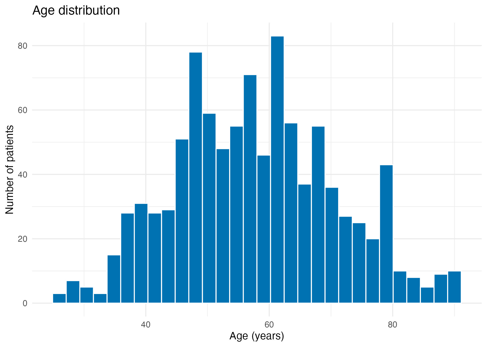
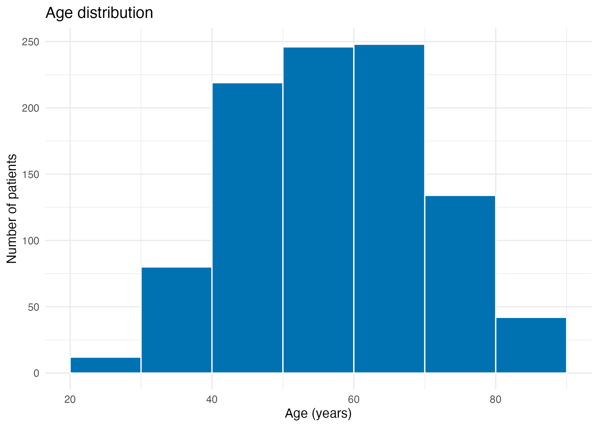

# Data Visualization with ggplot2

This tutorial uses **only** `data/BRCA_clean_data_all_patients.csv` (579 rows) to introduce the grammar of graphics and build clear, reproducible clinical data visualizations. Every example is designed to be copied into an R script or an R Markdown/Quarto document.

## Table of contents

- [Learning objectives](#learning-objectives)
- [Before you start](#before-you-start)
- [Cheat sheet](#cheat-sheet)
- [1. Grammar of graphics and one variable](#1-grammar-of-graphics--one-variable)
- [2. Numeric by category](#2-numeric-by-category)
- [3. Two numeric variables](#3-two-numeric-variables)
- [4. Two categorical variables](#4-two-categorical-variables)
- [5. Facets, themes, and colour-blind design](#5-facets-themes-and-colour-blind-design)
- [6. Combining and annotating](#6-combining--annotating)
- [Common mistakes](#common-mistakes)
- [Practice exercises](#practice-exercises)
- [Closing reflection](#closing-reflection)

## Learning objectives

By the end of this tutorial, you should be able to:

- Explain how data, aesthetics, geoms, scales, facets, and themes work together in the grammar of graphics.
- Select an appropriate `ggplot2` geometry for one numeric variable, one categorical variable, comparisons, associations, and compositions.
- Distinguish counts from proportions and describe what a visualization does—and does not—show.
- Use colour-blind-friendly palettes, faceting, labels, and themes to make figures easier to interpret.
- Save, combine, and annotate plots reproducibly without changing the underlying clinical data.

## Before you start

Run this setup from the project root. It reads the single source file, converts categorical columns to factors, previews the structure, and creates a folder for exported figures. `read_csv()` will show a parsing message if the file contains an unexpected value; investigate such messages rather than silently ignoring them.

```r
library(tidyverse)
library(ggpubr)
library(patchwork)
library(RColorBrewer)
library(scales)

clinical <- read_csv("data/BRCA_clean_data_all_patients.csv", show_col_types = FALSE) |>
  mutate(
    Gender = factor(Gender),
    Race = factor(Race),
    Vital_Status = factor(Vital_Status),
    Pathologic_stage = factor(Pathologic_stage),
    Age_Group = factor(Age_Group)
  )

str(clinical)

```
```r
tibble [981 × 8] (S3: tbl_df/tbl/data.frame)
 $ ID              : chr [1:981] "TCGA-BH-A0W3" "TCGA-AR-A24V" "TCGA-E9-A1NE" "TCGA-AC-A8OQ" ...
 $ Age             : num [1:981] 58 52 28 72 62 55 48 67 56 61 ...
 $ Gender          : Factor w/ 1 level "female": 1 1 1 1 1 1 1 1 1 1 ...
 $ Race            : Factor w/ 3 levels "African","Asian",..: 3 3 3 1 3 2 3 3 3 3 ...
 $ Vital_Status    : Factor w/ 2 levels "Alive","Dead": 1 1 1 1 1 1 1 1 1 1 ...
 $ Pathologic_stage: Factor w/ 12 levels "Stage I","Stage IA",..: 5 6 6 6 6 6 5 8 6 8 ...
 $ Alcohol         : chr [1:981] "Not Reported" "Not Reported" "Not Reported" "Not Reported" ...
 $ Age_Group       : Factor w/ 2 levels "Old","Young": 1 2 2 1 1 2 2 1 2 1 ...
```
The numeric variables in this tutorial are `Age` and `Cigarettes_per_day`; 

the categorical variables are `Gender`, `Race`, `Vital_Status`, `Pathologic_stage`, and `Age_Group`. 

Missing values are handled explicitly where a calculation requires complete pairs.

Next, we create folder named figures to save all our images from this analysis

```r
dir.create("figures", showWarnings = FALSE)
```


## Cheat sheet

| Variable type or question | Plot choice | Typical `ggplot2` geom or tool |
|---|---|---|
| One numeric variable | Distribution and shape | `geom_histogram()`, `geom_density()` |
| One categorical variable | Counts or percentages | `geom_bar()`, `after_stat()` |
| Numeric by category | Compare distributions | `geom_boxplot()`, `geom_violin()`, `geom_jitter()` |
| Two numeric variables | Association and trend | `geom_point()`, `geom_smooth()` |
| Two categorical variables | Composition or counts | `geom_bar(position = "fill")`, stacked bars |
| Many groups or subgroups | Small multiples | `facet_wrap()` |
| Publication-ready output | Consistent styling and export | `theme_*()`, `scale_*()`, `ggsave()` |

## 1. Grammar of graphics & one variable


### **Q1. How do you show the distribution of Age with a histogram (default bins)?** 

**Hint:** Put `Age` on the x-axis and use `geom_histogram()` with default binning. A histogram counts observations in intervals; the bin boundaries can affect the visual impression.

```r
p_age_hist <- ggplot(clinical, aes(x = Age)) +
  geom_histogram(colour = "white", fill = "#0072B2") +
  labs(title = "Age distribution", x = "Age (years)", y = "Number of patients") +
  theme_minimal()

ggsave("Fig4_1_p_age_hist.jpeg", p_age_hist, width = 7, height = 5, units = "in", dpi = 300)

p_age_hist
```
**Output:**



**What to look for:** Look for the centre, spread, skew, gaps, and unusually high or low ages. Do not interpret a tall bin as a rate; it is a count. With default bins, compare the general shape but be careful — default bin width depends on the data range.


### **Q2. How do you show the distribution of Age with histogram bins 10 years wide?**

**Hint:** Add `binwidth = 10` to `geom_histogram()` and set `boundary = 0` so bins start at 0, 10,20,  … making the intervals align to meaningful five-year age groups.

```r
p_age_hist_binned <- ggplot(clinical, aes(x = Age)) +
  geom_histogram(binwidth = 10, boundary = 0, colour = "white", fill = "#0072B2") +
  labs(title = "Age distribution", x = "Age (years)", y = "Number of patients") +
  theme_minimal()

ggsave("Fig4_2_p_age_hist_binned.jpeg", p_age_hist_binned, width = 7, height = 5, units = "in", dpi = 300)

p_age_hist_binned
```

**Output:**




**What to look for:** Look for the centre, spread, skew, gaps, and unusually high or low ages. Do not interpret a tall bin as a rate; it is a count. With fixed five-year bins, the shape is stable and comparable across datasets — note how the choice of bin width changes the visual impression compared with the image above.


### **Q2. How can you display Age as a smoothed density curve?**

**Hint:** `geom_density()` estimates a smooth curve. Save the plot as `p_age_density` so that it can be reused later.

```r
p_age_density <- ggplot(clinical, aes(x = Age)) +
  geom_density(fill = "#56B4E9", colour = "#0072B2", alpha = 0.65, na.rm = TRUE) +
  labs(title = "Smoothed age density", x = "Age (years)", y = "Density") +
  theme_minimal()

p_age_density
```

**What to look for:** Peaks indicate ages where observations are concentrated; the area under a density curve is one, so the y-axis is not a patient count.

### **Q3. How do you count patients in each Age_Group?**

**Hint:** Map a categorical variable to `x` and use `geom_bar()`. With no `y` mapping, `geom_bar()` counts rows.

```r
p_age_group_counts <- ggplot(clinical, aes(x = Age_Group)) +
  geom_bar(fill = "#009E73") +
  labs(title = "Patients by age group", x = "Age group", y = "Number of patients") +
  theme_minimal()

p_age_group_counts
```

**What to look for:** Compare the number of records in each age group and check whether factor ordering communicates the intended progression.

### **Q4. How do you label the Age_Group bars with percentages?**

**Hint:** Use `after_stat(count / sum(count))` inside `aes()` and format the result with `scales::percent()`. The denominator is the total count represented in the plot.

```r
p_age_group_percent <- ggplot(clinical, aes(x = Age_Group)) +
  geom_bar(fill = "#009E73") +
  geom_text(
    aes(
      y = after_stat(count),
      label = scales::percent(after_stat(count / sum(count)), accuracy = 0.1)
    ),
    stat = "count",
    vjust = -0.35
  ) +
  labs(title = "Patients by age group", x = "Age group", y = "Number of patients") +
  expand_limits(y = NA) +
  theme_minimal()

p_age_group_percent
```

**What to look for:** Each label should represent that group’s share of all plotted records; percentages should sum to approximately 100% after rounding.

### **Q5. How do you save an age distribution figure?**

**Hint:** `ggsave()` saves the last plot by default, but naming the object explicitly is safer and reproducible.

```r
ggsave(
  filename = "figures/age_distribution.png",
  plot = p_age_hist,
  width = 7,
  height = 5,
  units = "in",
  dpi = 300
)
```

**What to look for:** Confirm that `figures/age_distribution.png` is created at the requested size and resolution, and that the labels remain legible outside the R plotting pane.

## 2. Numeric by category

### **Q6. How does Age differ by Vital_Status in a boxplot?**

**Hint:** Put the category on x and the numeric measure on y. A boxplot shows the median, quartiles, and potential outliers.

```r
p_age_status_box <- ggplot(clinical, aes(x = Vital_Status, y = Age)) +
  geom_boxplot(fill = "#E69F00", na.rm = TRUE) +
  labs(title = "Age by vital status", x = "Vital status", y = "Age (years)") +
  theme_minimal()

p_age_status_box
```

**What to look for:** Compare medians and interquartile ranges, while remembering that group sizes and overlapping distributions affect how convincing a visual difference is.

### **Q7. How can jittered points reveal individual ages by Vital_Status?**

**Hint:** Add horizontal noise with `width` so points do not stack exactly. Use transparency to show overplotting.

```r
p_age_status_jitter <- ggplot(clinical, aes(x = Vital_Status, y = Age)) +
  geom_jitter(width = 0.18, height = 0, alpha = 0.45, colour = "#0072B2", na.rm = TRUE) +
  labs(title = "Individual ages by vital status", x = "Vital status", y = "Age (years)") +
  theme_minimal()

p_age_status_jitter
```

**What to look for:** Look for the raw observations, repeated ages, gaps, and unequal group sizes that a boxplot alone can hide.

### **Q8. How do you combine a violin plot and a boxplot for Age by Vital_Status?**

**Hint:** Draw the violin first, then put a narrower boxplot on top with `width` and `outlier.shape = NA`.

```r
p_age_status_violin <- ggplot(clinical, aes(x = Vital_Status, y = Age, fill = Vital_Status)) +
  geom_violin(alpha = 0.55, trim = FALSE, na.rm = TRUE) +
  geom_boxplot(width = 0.14, outlier.shape = NA, fill = "white", na.rm = TRUE) +
  labs(title = "Age distribution by vital status", x = "Vital status", y = "Age (years)") +
  guides(fill = "none") +
  theme_minimal()

p_age_status_violin
```

**What to look for:** The violin shows distribution shape, while the boxplot anchors the median and quartiles. Avoid treating the smoothed violin width as extra observations.

### **Q9. How do Cigarettes_per_day distributions vary across Age_Group?**

**Hint:** Overlay jittered observations on a boxplot; use `position_jitter()` so points stay within their group.

```r
p_smoking_age_group <- ggplot(clinical, aes(x = Age_Group, y = Cigarettes_per_day)) +
  geom_boxplot(outlier.shape = NA, fill = "#D55E00", alpha = 0.65, na.rm = TRUE) +
  geom_jitter(width = 0.16, alpha = 0.4, colour = "#333333", na.rm = TRUE) +
  labs(
    title = "Cigarettes per day by age group",
    x = "Age group",
    y = "Cigarettes per day"
  ) +
  theme_minimal()

p_smoking_age_group
```

**What to look for:** Compare medians, variability, zeros, and extreme values. Missing smoking values should not be mistaken for zero cigarettes per day.

### **Q10. How do you reorder Race by the median Age and flip the coordinates?**

**Hint:** Use `reorder(Race, Age, FUN = median, na.rm = TRUE)` inside the x aesthetic, then `coord_flip()` for readable labels.

```r
p_age_race <- ggplot(
  clinical,
  aes(x = reorder(Race, Age, FUN = median, na.rm = TRUE), y = Age)
) +
  geom_boxplot(fill = "#CC79A7", na.rm = TRUE) +
  coord_flip() +
  labs(title = "Age by race, ordered by median age", x = "Race", y = "Age (years)") +
  theme_minimal()

p_age_race
```

**What to look for:** Race categories are ordered by their observed median Age, not alphabetically. Small groups may have unstable medians and should be interpreted cautiously.

## 3. Two numeric variables

### **Q11. What is the relationship between Age and Cigarettes_per_day?**

**Hint:** Use points for individual observations and save the result as `p_scatter` for later layers.

```r
p_scatter <- ggplot(
  clinical,
  aes(x = Age, y = Cigarettes_per_day)
) +
  geom_point(alpha = 0.55, colour = "#0072B2", na.rm = TRUE) +
  labs(
    title = "Age and cigarettes per day",
    x = "Age (years)",
    y = "Cigarettes per day"
  ) +
  theme_minimal()

p_scatter
```

**What to look for:** Look for direction, strength, nonlinearity, clusters, and influential points. A cloud of points without a visible trend is still informative.

### **Q12. How do you add a linear-model smooth to the scatterplot?**

**Hint:** Add `geom_smooth(method = "lm")` to `p_scatter` and set `se = TRUE` to show the model-based confidence band.

```r
p_lm <- p_scatter +
  geom_smooth(method = "lm", formula = y ~ x, se = TRUE, colour = "#D55E00", na.rm = TRUE) +
  labs(title = "Age and cigarettes per day with a linear trend")

p_lm
```

**What to look for:** The line summarizes the average linear trend; the band reflects uncertainty in the fitted mean, not the range of individual future observations.

### **Q13. How does the Age–Cigarettes_per_day relationship vary by Vital_Status?**

**Hint:** Map `Vital_Status` to colour and use `aes(group = Vital_Status)` so `geom_smooth()` fits one model per group.

```r
p_status_lm <- ggplot(
  clinical,
  aes(x = Age, y = Cigarettes_per_day, colour = Vital_Status)
) +
  geom_point(alpha = 0.5, na.rm = TRUE) +
  geom_smooth(aes(group = Vital_Status), method = "lm", formula = y ~ x, se = FALSE, na.rm = TRUE) +
  labs(
    title = "Age and cigarettes per day by vital status",
    x = "Age (years)",
    y = "Cigarettes per day",
    colour = "Vital status"
  ) +
  theme_minimal()

p_status_lm
```

**What to look for:** Compare the fitted slopes and the amount of overlap, but do not claim a group difference from line separation alone; sample size, confounding, and uncertainty matter.

### **Q14. How do you test the correlation using complete pairs?**

**Hint:** Select only `Age` and `Cigarettes_per_day`, remove rows missing either variable, then pass the two numeric vectors to `cor.test()`.

```r
complete_numeric <- clinical |>
  select(Age, Cigarettes_per_day) |>
  drop_na()

cor.test(
  complete_numeric$Age,
  complete_numeric$Cigarettes_per_day,
  method = "pearson"
)
```

**What to look for:** Read the correlation estimate, confidence interval, and p-value together. Correlation measures linear association and does not establish causation.

## 4. Two categorical variables

### **Q15. How do you show Vital_Status counts within Race using stacked bars?**

**Hint:** Map `Race` to x and `Vital_Status` to fill. The default bar position is stacked.

```r
p_race_status_counts <- ggplot(clinical, aes(x = Race, fill = Vital_Status)) +
  geom_bar() +
  labs(title = "Vital status counts within race", x = "Race", y = "Number of patients", fill = "Vital status") +
  theme_minimal()

p_race_status_counts
```

**What to look for:** Total bar height shows the number of records in each Race; segment height shows the count for each Vital_Status.

### **Q16. How do you compare Vital_Status percentages within Race?**

**Hint:** `position = "fill"` scales every bar to the same height. Add percentage labels using `after_stat()` within each x group.

```r
p_race_status_percent <- ggplot(clinical, aes(x = Race, fill = Vital_Status)) +
  geom_bar(position = "fill") +
  geom_text(
    aes(
      label = scales::percent(after_stat(count / sum(count)), accuracy = 1)
    ),
    stat = "count",
    position = position_fill(vjust = 0.5),
    colour = "white",
    size = 3
  ) +
  scale_y_continuous(labels = scales::percent) +
  labs(title = "Vital status composition within race", x = "Race", y = "Percent", fill = "Vital status") +
  theme_minimal()

p_race_status_percent
```

**What to look for:** Compare composition rather than group size. A small Race group can have a high percentage based on relatively few records.

### **Q17. How do you flip the Race-by-Vital_Status chart for readable labels?**

**Hint:** Add `coord_flip()` after the geoms and scales; the categorical axis becomes vertical.

```r
p_race_status_flipped <- p_race_status_counts +
  coord_flip() +
  labs(title = "Vital status counts within race (flipped)")

p_race_status_flipped
```

**What to look for:** Long Race labels should be easier to read, and the stacked counts remain the same after flipping.

### **Q18. How do you display Pathologic_stage counts with a flipped bar chart?**

**Hint:** Use `geom_bar()` for counts and `coord_flip()` to make stage labels easier to scan.

```r
p_stage_counts <- ggplot(clinical, aes(x = Pathologic_stage)) +
  geom_bar(fill = "#0072B2") +
  coord_flip() +
  labs(title = "Patients by pathologic stage", x = "Pathologic stage", y = "Number of patients") +
  theme_minimal()

p_stage_counts
```

**What to look for:** Identify common and uncommon stages and check whether missing or non-standard stage labels are present as separate categories.

## 5. Facets, themes, and colour-blind design

### **Q19. How do you facet an Age histogram by Gender?**

**Hint:** Add `facet_wrap(~ Gender)` after the histogram. Keep binwidth and axis units consistent so panels can be compared.

```r
p_age_gender <- ggplot(clinical, aes(x = Age)) +
  geom_histogram(binwidth = 5, boundary = 0, fill = "#0072B2", colour = "white", na.rm = TRUE) +
  facet_wrap(~ Gender) +
  labs(title = "Age distribution by gender", x = "Age (years)", y = "Number of patients") +
  theme_minimal()

p_age_gender
```

**What to look for:** Compare the shape and sample size across Gender panels. Facets reduce overplotting but do not automatically make groups comparable if scales differ.

### **Q20. How do you facet by Race while filling by Vital_Status?**

**Hint:** Use `facet_wrap(~ Race)` and map `Vital_Status` to `fill`; `drop = FALSE` can preserve factor levels when useful.

```r
p_stage_race_status <- ggplot(
  clinical,
  aes(x = Pathologic_stage, fill = Vital_Status)
) +
  geom_bar() +
  facet_wrap(~ Race, scales = "free_x") +
  labs(
    title = "Pathologic stage and vital status by race",
    x = "Pathologic stage",
    y = "Number of patients",
    fill = "Vital status"
  ) +
  theme_minimal() +
  theme(axis.text.x = element_text(angle = 45, hjust = 1))

p_stage_race_status
```

**What to look for:** Look for within-Race patterns while remembering that free x scales can change the visual width of categories and that small facets may be noisy.

### **Q21. How do you apply theme_minimal() and rotate crowded labels?**

**Hint:** Apply `theme_minimal()` and adjust `element_text()` for the axis that contains long labels.

```r
p_stage_theme <- ggplot(clinical, aes(x = Pathologic_stage, fill = Vital_Status)) +
  geom_bar(position = "dodge") +
  theme_minimal(base_size = 12) +
  theme(
    axis.text.x = element_text(angle = 45, hjust = 1, vjust = 1),
    legend.position = "top",
    plot.title = element_text(face = "bold")
  ) +
  labs(title = "Pathologic stage by vital status", x = "Pathologic stage", y = "Number of patients", fill = "Vital status")

p_stage_theme
```

**What to look for:** Labels should not overlap, the hierarchy should be clear, and the theme should support the data rather than compete with it.

### **Q22. How do you build an Okabe–Ito colour-blind-friendly palette from Vital_Status levels?**

**Hint:** Create the palette as a named vector whose names are exactly `levels(clinical$Vital_Status)`, then use `scale_fill_manual()` and `scale_colour_manual()`.

```r
okabe_ito <- c(
  "#E69F00", "#56B4E9", "#009E73", "#F0E442",
  "#0072B2", "#D55E00", "#CC79A7", "#000000"
)

vital_levels <- levels(clinical$Vital_Status)
vital_palette <- setNames(
  rep(okabe_ito, length.out = length(vital_levels)),
  vital_levels
)

p_colour_blind <- ggplot(clinical, aes(x = Race, fill = Vital_Status)) +
  geom_bar() +
  scale_fill_manual(values = vital_palette, drop = FALSE) +
  labs(title = "Vital status by race", x = "Race", y = "Number of patients", fill = "Vital status") +
  theme_minimal()

p_colour_blind
```

**What to look for:** The legend names should match the data levels exactly, and categories should remain distinguishable without relying on red-versus-green perception alone.

### **Q23. How do you make a publication-ready plot and save it as p_pub?**

**Hint:** Combine a clear title and labels with a restrained theme, accessible palette, legible text, and an explicit legend position.

```r
p_pub <- ggplot(clinical, aes(x = Age_Group, y = Age, fill = Vital_Status)) +
  geom_boxplot(outlier.alpha = 0.35, na.rm = TRUE) +
  scale_fill_manual(values = vital_palette, drop = FALSE) +
  labs(
    title = "Age distribution across age groups",
    subtitle = "Stratified by vital status",
    x = "Age group",
    y = "Age (years)",
    fill = "Vital status",
    caption = "Source: data/clinical_data.csv"
  ) +
  theme_minimal(base_size = 13) +
  theme(
    plot.title = element_text(face = "bold", size = 15),
    plot.subtitle = element_text(colour = "grey30"),
    legend.position = "top",
    panel.grid.minor = element_blank(),
    plot.caption = element_text(hjust = 0)
  )

p_pub
```

**What to look for:** A publication-ready figure has an explicit message, readable typography, an honest scale, and a palette that remains interpretable in grayscale or for readers with colour-vision differences.

## 6. Combining & annotating

### **Q24. How do you combine related plots with patchwork?**

**Hint:** The `patchwork` package lets you compose named ggplot objects with `+` and control layout with `/` or `plot_layout()`.

```r
p_combo <- (
  p_age_hist + p_age_density
) / (
  p_scatter + p_lm
) +
  patchwork::plot_annotation(
    title = "Clinical data overview",
    subtitle = "Distributions and the Age–Cigarettes_per_day relationship"
  )

p_combo
```

**What to look for:** The combined figure should tell a coherent story: univariate distributions first, followed by the two-variable relationship and its fitted trend.

### **Q25. How do you save a multi-panel ggplot2 figure?**

**Hint:** Pass the patchwork object explicitly to `ggsave()` and set dimensions that preserve the panel layout.

```r
ggsave(
  filename = "figures/ggplot2_multi_panel.png",
  plot = p_combo,
  width = 11,
  height = 8,
  units = "in",
  dpi = 300
)
```

**What to look for:** Check the exported PNG at its final viewing size. A figure that looks fine in an interactive pane may need larger dimensions or text for a report.

### **Q26. How can you add a Wilcoxon comparison to a ggpubr boxplot?**

**Hint:** `ggboxplot()` creates a publication-style boxplot and `stat_compare_means(method = "wilcox.test")` adds a non-parametric comparison. This is a **visual aid only**: use a pre-specified analysis for formal inference and account for multiple comparisons or study design as appropriate.

```r
p_wilcox_visual <- ggpubr::ggboxplot(
  clinical,
  x = "Vital_Status",
  y = "Age",
  color = "Vital_Status",
  palette = unname(vital_palette[levels(clinical$Vital_Status)]),
  add = "jitter",
  add.params = list(alpha = 0.35, width = 0.15)
) +
  ggpubr::stat_compare_means(
    method = "wilcox.test",
    label = "p.format"
  ) +
  labs(title = "Age by vital status with Wilcoxon annotation", x = "Vital status", y = "Age (years)") +
  theme_minimal()

p_wilcox_visual
```

**What to look for:** The annotation reports a test result for the displayed groups; it does not measure effect size, prove causality, or replace inspection of the distributions and sample sizes.

## Common mistakes

1. **Confusing counts and percentages.** `geom_bar()` without a y aesthetic counts rows; `position = "fill"` shows within-bar proportions. State which denominator you are using.
2. **Using a histogram for a categorical variable.** Use `geom_bar()` for categories and `geom_histogram()` for continuous numeric measurements.
3. **Choosing an arbitrary binwidth.** Try a defensible binwidth and explain how it affects the apparent shape.
4. **Overplotting every observation.** Use transparency, jitter, faceting, or a summary layer when points overlap.
5. **Treating a smooth as proof.** `geom_smooth(method = "lm")` describes a fitted model; it does not establish causation or guarantee that a linear model is appropriate.
6. **Ignoring missingness.** `drop_na()` is appropriate for a complete-pair calculation, but do not silently reinterpret missing values as zeros.
7. **Letting factor order happen by accident.** Use `factor()` levels or `reorder()` when order communicates meaning.
8. **Using colour without a legend or accessible contrast.** Use labels, a named palette, and colour-blind-friendly choices.
9. **Comparing facets with inconsistent scales without saying so.** Free scales can be useful but can also mislead visual comparisons.
10. **Saving only what is displayed.** Pass the intended object explicitly to `ggsave()` and specify width, height, units, and resolution.

## Quiz: test your understanding

Try each question before opening the answer. Questions are grouped by difficulty, and every answer is hidden until you click it.

---

### Part A: Multiple choice

**Q27. In the grammar of graphics, which component maps a variable to a visual property such as x, y, colour, or fill?**

- A. Geometry
- B. Aesthetic mapping
- C. Theme
- D. Facet

<details><summary>Show answer</summary>

**B.** Aesthetic mappings, written inside `aes()`, connect data variables to visual properties.

</details>

**Q28. Which geom is the most appropriate for showing the distribution of a single continuous variable such as `Age`?**

- A. `geom_bar()`
- B. `geom_histogram()`
- C. `geom_col()`
- D. `geom_tile()`

<details><summary>Show answer</summary>

**B.** `geom_histogram()` bins a continuous variable, while `geom_bar()` counts the rows in each category of a discrete variable.

</details>

**Q29. What does `geom_bar(position = "fill")` display?**

- A. The raw count in each group
- B. The proportion of each fill category within each bar
- C. The mean of the y variable
- D. A smoothed density

<details><summary>Show answer</summary>

**B.** Every bar is scaled to the same height, so you compare composition rather than group size.

</details>

**Q30. What is the difference between `geom_bar()` and `geom_col()`?**

- A. None, they are aliases
- B. `geom_bar()` counts rows by default, while `geom_col()` plots a y value you already computed
- C. `geom_col()` is only for histograms
- D. `geom_bar()` cannot be used with factors

<details><summary>Show answer</summary>

**B.** `geom_bar()` uses `stat = "count"`, and `geom_col()` uses `stat = "identity"`.

</details>

**Q31. A boxplot's central line represents which statistic?**

- A. Mean
- B. Mode
- C. Median
- D. Maximum

<details><summary>Show answer</summary>

**C.** The line is the median. The box spans the first to third quartile (the interquartile range).

</details>

**Q32. What does the shaded band around `geom_smooth(method = "lm")` represent?**

- A. The range of all observed data points
- B. A confidence interval for the fitted mean trend
- C. The standard deviation of y
- D. The prediction interval for new patients

<details><summary>Show answer</summary>

**B.** It reflects uncertainty in the fitted *mean*, not the spread of individual observations, so it is much narrower than the data.

</details>

**Q33. Which function adds a separate panel for each level of a variable?**

- A. `facet_wrap()`
- B. `coord_flip()`
- C. `scale_fill_manual()`
- D. `theme_minimal()`

<details><summary>Show answer</summary>

**A.** `facet_wrap(~ variable)` creates small multiples.

</details>

**Q34. Which statement about the Okabe–Ito palette is correct?**

- A. It is designed to be distinguishable by people with common forms of colour-vision deficiency
- B. It contains only shades of red and green
- C. It works only in grayscale
- D. It cannot be used with `scale_fill_manual()`

<details><summary>Show answer</summary>

**A.** It was designed for colour-blind accessibility. Pass it to `scale_fill_manual()` or `scale_colour_manual()`.

</details>

**Q35. What does `coord_flip()` do?**

- A. Swaps the x and y axes
- B. Reverses the data order
- C. Transposes the dataset
- D. Rotates the legend

<details><summary>Show answer</summary>

**A.** It swaps the axes visually. The underlying data and statistics are unchanged.

</details>

---

### Part B: True or False

**Q36. A density curve's y-axis shows the number of patients at each age.**

<details><summary>Show answer</summary>

**False.** The y-axis is density, and the area under the curve equals 1.

</details>

**Q37. `stat_compare_means()` provides a formal analysis that replaces a prespecified statistical plan.**

<details><summary>Show answer</summary>

**False.** It is a visual aid only. Formal inference needs a prespecified analysis, with multiple comparisons and study design considered.

</details>

**Q38. A correlation coefficient close to zero proves there is no relationship between two variables.**

<details><summary>Show answer</summary>

**False.** Pearson correlation measures only *linear* association. A strong nonlinear relationship can still give r near 0.

</details>

**Q39. Changing the histogram binwidth can change the apparent shape of the distribution.**

<details><summary>Show answer</summary>

**True.** That is why you should try several binwidths and not over-interpret fine detail.

</details>

**Q40. Missing smoking values should be treated as zero cigarettes per day.**

<details><summary>Show answer</summary>

**False.** Missing means unknown, not zero. Treating `NA` as 0 would bias any summary.

</details>

**Q41. `ggsave()` can save a patchwork object, not just a single plot.**

<details><summary>Show answer</summary>

**True.** Pass the patchwork object explicitly via `plot =`.

</details>

---

### Part C: Short answer

**Q42. When would you choose a violin plot over a boxplot?**

<details><summary>Show answer</summary>

When distribution *shape* matters, for example bimodality or skew, that a box summary would hide. Overlaying a narrow boxplot (as in Q8) gives both the shape and the quartiles.

</details>

**Q43. Why add jitter and transparency (`alpha`) to a scatter or strip plot?**

<details><summary>Show answer</summary>

Many patients share the same values (such as ages and zeros), so points stack on top of each other. Jitter spreads them apart and transparency shows density, which reduces overplotting.

</details>

**Q44. Write code to make a bar chart of `Gender` counts, filled by `Vital_Status`, with side-by-side bars.**

<details><summary>Show answer</summary>

```r
ggplot(clinical, aes(x = Gender, fill = Vital_Status)) +
  geom_bar(position = "dodge")
```

</details>

**Q45. Write code to draw a scatterplot of `Age` vs `Cigarettes_per_day` coloured by `Gender`, with a title and axis labels.**

<details><summary>Show answer</summary>

```r
ggplot(clinical, aes(x = Age, y = Cigarettes_per_day, colour = Gender)) +
  geom_point(alpha = 0.5, na.rm = TRUE) +
  labs(
    title = "Age and cigarettes per day by gender",
    x = "Age (years)",
    y = "Cigarettes per day",
    colour = "Gender"
  ) +
  theme_minimal()
```

</details>

**Q46. Write code to facet an `Age` histogram by `Pathologic_stage` using 4 columns.**

<details><summary>Show answer</summary>

```r
ggplot(clinical, aes(x = Age)) +
  geom_histogram(binwidth = 5, fill = "#0072B2", colour = "white") +
  facet_wrap(~ Pathologic_stage, ncol = 4)
```

</details>

**Q47. Your colleague says "the lines for Alive and Dead patients have different slopes, so smoking affects survival differently with age." What is wrong with this conclusion?**

<details><summary>Show answer</summary>

Slope differences in a descriptive plot do not establish an interaction, let alone causation. Group sizes, confounding, and uncertainty matter. You would need a formal model (for example, an interaction term) and confidence intervals before drawing a conclusion.

</details>

---

### Part D: Try it yourself

1. Draw a boxplot of `Cigarettes_per_day` by `Pathologic_stage`, flip the coordinates, and order the stages by median smoking.
2. Make a filled bar chart of `Age_Group` by `Gender` with percentage labels, using a colour-blind-friendly palette.
3. Build a two-panel `patchwork` figure (one distribution plot and one comparison plot), give it a title, and save it as a 300 dpi PNG.
4. Pick one plot from this tutorial and write a two-sentence caption stating what it shows and one limitation.

<details><summary>Show hints</summary>

```r
# 1
ggplot(clinical, aes(x = reorder(Pathologic_stage, Cigarettes_per_day,
                                 FUN = median, na.rm = TRUE),
                     y = Cigarettes_per_day)) +
  geom_boxplot(na.rm = TRUE) +
  coord_flip() +
  labs(x = "Pathologic stage", y = "Cigarettes per day")

# 2
ggplot(clinical, aes(x = Gender, fill = Age_Group)) +
  geom_bar(position = "fill") +
  geom_text(
    aes(label = scales::percent(after_stat(count / sum(count)), accuracy = 1)),
    stat = "count", position = position_fill(vjust = 0.5), size = 3
  ) +
  scale_fill_manual(values = c("#E69F00", "#0072B2", "#009E73")) +
  scale_y_continuous(labels = scales::percent)
# Note: percentages here are shares of ALL patients, not within each gender.
# Compute within-group percentages first if that is what you want.

# 3
p1 <- ggplot(clinical, aes(Age)) + geom_histogram(binwidth = 5)
p2 <- ggplot(clinical, aes(Vital_Status, Age)) + geom_boxplot()
p_final <- p1 + p2 + patchwork::plot_annotation(title = "Age overview")
ggsave("figures/quiz_panel.png", p_final, width = 10, height = 5, dpi = 300)
```

</details>

---

#### 🎯 Scoring guide

| Score (of 20 graded items, Q27-Q46) | Level |
|---|---|
| 18-20 | Excellent, ready for publication-quality figures |
| 14-17 | Good, review the topics you missed |
| 9-13 | Fair, re-read sections 1-6 |
| 0-8 | Re-run the tutorial from the start |


Before you finish, choose one figure that communicates a useful clinical pattern and one that could be misread. For each, identify the data variables, the visual encodings, the denominator or model being used, and the uncertainty or limitation that should accompany it. Good visualization is not decoration: it is a transparent argument about what the data support.
