# Exploring TCGA Pan-Cancer Clinical Data with ggplot2

This tutorial uses the TCGA Pan-Cancer Atlas clinical table (about 11,000
patients across 33 cancer types) to practise core ggplot2 skills:
histograms, boxplots, scatterplots, bar charts, facets, and statistical
annotation.

**Data source:** TCGA Pan-Cancer (PANCAN) clinical data, downloaded from [UCSC Xena](https://xenabrowser.net/datapages/?cohort=TCGA%20Pan-Cancer%20(PANCAN)&removeHub=https%3A%2F%2Fxena.treehouse.gi.ucsc.edu%3A443).

**Script:** Now we run every
code block below and saves all figures to `figures/`.


---

## 1. Setup

```r
library(tidyverse)
library(scales)
library(ggpubr)

raw <- readRDS("data/TCGA_pancancer_clinical.rds")
str(raw)
```

```r
tibble [12,591 × 45] (S3: tbl_df/tbl/data.frame)
 $ patient_id                         : chr [1:12591] "TCGA-OR-A5J1" "TCGA-OR-A5J2" "TCGA-OR-A5J3" "TCGA-OR-A5J4" ...
 $ cancer_type                        : chr [1:12591] "ACC" "ACC" "ACC" "ACC" ...
 $ age_at_initial_pathologic_diagnosis: num [1:12591] 58 44 23 23 30 29 30 66 22 53 ...
 $ gender                             : chr [1:12591] "MALE" "FEMALE" "FEMALE" "FEMALE" ...
 $ race                               : chr [1:12591] "WHITE" "WHITE" "WHITE" "WHITE" ...
 $ ajcc_pathologic_tumor_stage        : chr [1:12591] "Stage II" "Stage IV" "Stage III" "Stage IV" ...
 $ clinical_stage                     : chr [1:12591] NA NA NA NA ...
 $ histological_type                  : chr [1:12591] "Adrenocortical carcinoma- Usual Type" "Adrenocortical carcinoma- Usual Type" "Adrenocortical carcinoma- Usual Type" "Adrenocortical carcinoma- Usual Type" ...
 $ histological_grade                 : chr [1:12591] NA NA NA NA ...
 $ initial_pathologic_dx_year         : num [1:12591] 2000 2004 2008 2000 2000 ...
 $ menopause_status                   : chr [1:12591] NA NA NA NA ...
 $ birth_days_to                      : num [1:12591] -21496 -16090 -8624 -8451 -11171 ...
 $ vital_status                       : chr [1:12591] "Dead" "Dead" "Alive" "Dead" ...
 $ tumor_status                       : chr [1:12591] "WITH TUMOR" "WITH TUMOR" "WITH TUMOR" "WITH TUMOR" ...
 $ last_contact_days_to               : num [1:12591] NA NA 2091 NA NA ...
 $ death_days_to                      : num [1:12591] 1355 1677 NA 423 365 ...
 $ cause_of_death                     : chr [1:12591] NA NA NA NA ...
 $ new_tumor_event_type               : chr [1:12591] "Distant Metastasis" "Distant Metastasis" "Distant Metastasis" "Locoregional Recurrence" ...
 $ new_tumor_event_site               : chr [1:12591] "Peritoneal Surfaces" "Soft Tissue" "Lung" "Peritoneal Surfaces" ...
 $ new_tumor_event_site_other         : chr [1:12591] NA NA NA NA ...
 $ new_tumor_event_dx_days_to         : num [1:12591] 754 289 53 126 50 NA 162 530 414 NA ...
 $ treatment_outcome_first_course     : chr [1:12591] "Complete Remission/Response" "Progressive Disease" "Complete Remission/Response" "Progressive Disease" ...
 $ margin_status                      : chr [1:12591] NA NA NA NA ...
 $ residual_tumor                     : chr [1:12591] NA NA NA NA ...
 $ OS                                 : num [1:12591] 1 1 0 1 1 0 1 1 0 1 ...
 $ OS.time                            : num [1:12591] 1355 1677 2091 423 365 ...
 $ DSS                                : num [1:12591] 1 1 0 1 1 0 1 1 0 1 ...
 $ DSS.time                           : num [1:12591] 1355 1677 2091 423 365 ...
 $ DFI                                : num [1:12591] 1 NA 1 NA NA 0 NA 1 1 NA ...
 $ DFI.time                           : num [1:12591] 754 NA 53 NA NA ...
 $ PFI                                : num [1:12591] 1 1 1 1 1 0 1 1 1 1 ...
 $ PFI.time                           : num [1:12591] 754 289 53 126 50 ...
 $ Redaction                          : chr [1:12591] NA NA NA NA ...
 $ sample_barcode                     : chr [1:12591] "TCGA-OR-A5J1-01" "TCGA-OR-A5J2-01" "TCGA-OR-A5J3-01" "TCGA-OR-A5J4-01" ...
 $ sample_type                        : chr [1:12591] "Primary Tumor" "Primary Tumor" "Primary Tumor" "Primary Tumor" ...
 $ primary_disease                    : chr [1:12591] "adrenocortical cancer" "adrenocortical cancer" "adrenocortical cancer" "adrenocortical cancer" ...
 $ Subtype_Immune_Model_Based         : chr [1:12591] "Lymphocyte Depleted (Immune C4)" "Inflammatory (Immune C3)" "Lymphocyte Depleted (Immune C4)" NA ...
 $ Subtype_mRNA                       : chr [1:12591] "steroid-phenotype-high+proliferation" "steroid-phenotype-high+proliferation" "steroid-phenotype-high" NA ...
 $ Subtype_DNAmeth                    : chr [1:12591] "CIMP-high" "CIMP-low" "CIMP-intermediate" "CIMP-high" ...
 $ Subtype_protein                    : chr [1:12591] NA "1" "3" NA ...
 $ Subtype_miRNA                      : chr [1:12591] "miRNA_1" "miRNA_1" "miRNA_6" "miRNA_6" ...
 $ Subtype_CNA                        : chr [1:12591] "Quiet" "Noisy" "Chromosomal" "Chromosomal" ...
 $ Subtype_Integrative                : chr [1:12591] "COC3" "COC3" "COC2" NA ...
 $ Subtype_other                      : chr [1:12591] "C1A" "C1A" "C1A" NA ...
 $ Subtype_Selected                   : chr [1:12591] "ACC.CIMP-high" "ACC.CIMP-low" "ACC.CIMP-intermediate" "ACC.CIMP-high" ...

```

### Columns used

| Column (cleaned) | Meaning | Type |
|---|---|---|
| `Cancer_Type` | TCGA study code (BRCA, LUAD, ...) | categorical |
| `Age` | Age at diagnosis (years) | numeric |
| `Gender` | Female / Male | categorical |
| `Race` | Self-reported race (rare levels lumped into "Other") | categorical |
| `Stage` | Stage I-IV (substages collapsed) | ordered factor |
| `Vital_Status` | Alive / Dead | categorical |
| `OS_months` | Follow-up time in months | numeric |
| `Immune_Subtype` | Pan-cancer immune subtype | categorical |
| `Molecular_Subtype` | Cancer-specific subtype (e.g. PAM50 for BRCA) | categorical |

`OS_months` is **follow-up time**. For patients who are still alive it is
censored, so it is not the same as time to death.

### Cleaning

```r
clinical <- raw |>
  distinct(patient_id, .keep_all = TRUE) |>
  transmute(
    Patient_ID        = patient_id,
    Cancer_Type       = cancer_type,
    Age               = age_at_initial_pathologic_diagnosis,
    Gender            = str_to_title(gender),
    Race              = str_to_title(race),
    Stage_raw         = ajcc_pathologic_tumor_stage,
    Vital_Status      = vital_status,
    OS                = OS,
    OS_months         = OS.time / 30.44,
    Immune_Subtype    = Subtype_Immune_Model_Based,
    Molecular_Subtype = Subtype_Selected
  ) |>
  mutate(
    Stage = case_when(
      str_detect(Stage_raw, "Stage IV")  ~ "Stage IV",
      str_detect(Stage_raw, "Stage III") ~ "Stage III",
      str_detect(Stage_raw, "Stage II")  ~ "Stage II",
      str_detect(Stage_raw, "Stage I")   ~ "Stage I",
      TRUE ~ NA_character_
    ),
    Stage        = factor(Stage, levels = c("Stage I", "Stage II", "Stage III", "Stage IV")),
    Gender       = factor(Gender),
    Vital_Status = factor(Vital_Status, levels = c("Alive", "Dead")),
    Race         = na_if(Race, "[Not Evaluated]"),
    Race         = fct_lump_min(factor(Race), min = 100, other_level = "Other"),
    Immune_Subtype = str_remove(Immune_Subtype, " \\(Immune C\\d\\)"),
    Age_Group    = cut(Age, c(-Inf, 40, 55, 70, Inf),
                       labels = c("Young", "Middle", "Older", "Senior"),
                       ordered_result = TRUE)
  ) |>
  select(-Stage_raw)
str(clinical)
```

```r
tibble [11,081 × 12] (S3: tbl_df/tbl/data.frame)
 $ Patient_ID       : chr [1:11081] "TCGA-OR-A5J1" "TCGA-OR-A5J2" "TCGA-OR-A5J3" "TCGA-OR-A5J4" ...
 $ Cancer_Type      : chr [1:11081] "ACC" "ACC" "ACC" "ACC" ...
 $ Age              : num [1:11081] 58 44 23 23 30 29 30 66 22 53 ...
 $ Gender           : Factor w/ 2 levels "Female","Male": 2 1 1 1 2 1 1 2 1 1 ...
 $ Race             : Factor w/ 5 levels "[Unknown]","Asian",..: 4 4 4 4 4 3 4 4 4 4 ...
 $ Vital_Status     : Factor w/ 2 levels "Alive","Dead": 2 2 1 2 2 1 2 2 1 2 ...
 $ OS               : num [1:11081] 1 1 0 1 1 0 1 1 0 1 ...
 $ OS_months        : num [1:11081] 44.5 55.1 68.7 13.9 12 ...
 $ Immune_Subtype   : chr [1:11081] "Lymphocyte Depleted" "Inflammatory" "Lymphocyte Depleted" NA ...
 $ Molecular_Subtype: chr [1:11081] "ACC.CIMP-high" "ACC.CIMP-low" "ACC.CIMP-intermediate" "ACC.CIMP-high" ...
 $ Stage            : Factor w/ 4 levels "Stage I","Stage II",..: 2 4 3 4 3 2 3 3 2 4 ...
 $ Age_Group        : Ord.factor w/ 4 levels "Young"<"Middle"<..: 3 2 1 1 1 1 1 3 1 2 ...
```


### Palette and save helper

```r
okabe_ito <- c("#E69F00", "#56B4E9", "#009E73", "#F0E442",
               "#0072B2", "#D55E00", "#CC79A7", "#000000")

dir.create("figures", showWarnings = FALSE)

save_fig <- function(plot, name, w = 7, h = 5) {
  ggsave(file.path("figures", name), plot,
         width = w, height = h, units = "in", dpi = 300)
}
```

---

## 2. One variable

### Q1. How many patients are in each cancer type?

**Hint:** Count first, then plot with `geom_col()`. Use `reorder()` to sort
and `coord_flip()` for readable labels.

```r
p_cancer_counts <- clinical |>
  count(Cancer_Type) |>
  ggplot(aes(x = reorder(Cancer_Type, n), y = n)) +
  geom_col(fill = "#0072B2") +
  coord_flip() +
  labs(title = "Patients per cancer type", x = "Cancer type", y = "Number of patients") +
  theme_minimal()
save_fig(p_cancer_counts, "Fig1_1_cancer_counts.jpeg", 7, 8)
```


<p align="center">
  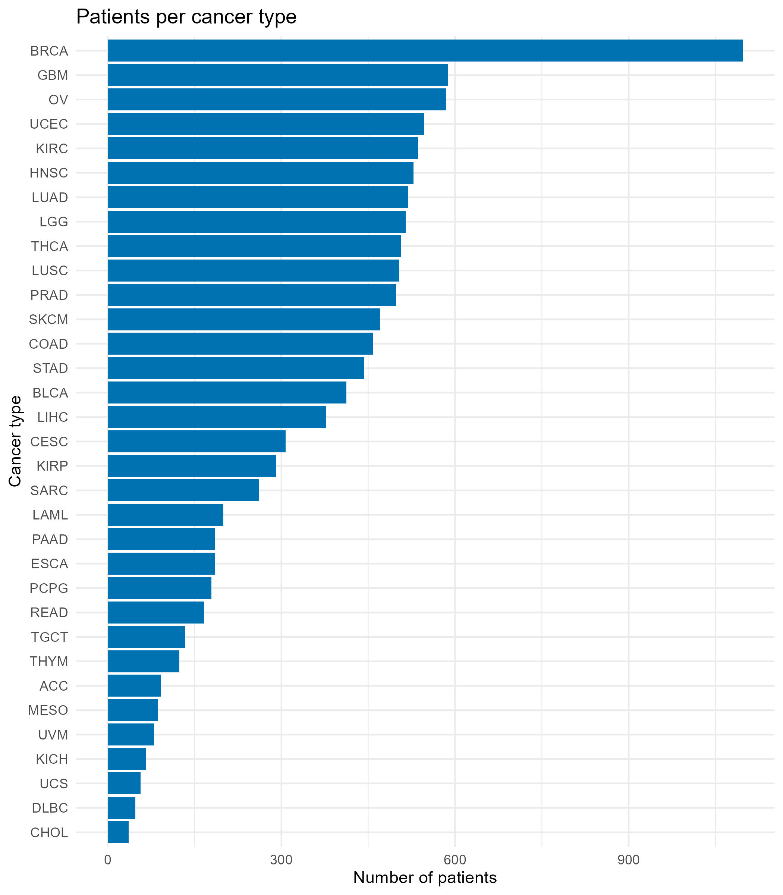
</p>


**What to look for:** The dataset is very unbalanced. BRCA is among the
largest cohorts while CHOL and DLBC are small, so comparisons involving
small groups are unstable.

### Q2. How is Age distributed?

**Hint:** Use `geom_histogram()` with `binwidth = 5`. Bin choice changes the
visual impression, so try several values.

```r
p_age_hist <- ggplot(clinical, aes(x = Age)) +
  geom_histogram(binwidth = 5, boundary = 0, colour = "white",
                 fill = "#0072B2", na.rm = TRUE) +
  labs(title = "Age at diagnosis", x = "Age (years)", y = "Number of patients") +
  theme_minimal()
save_fig(p_age_hist, "Fig1_2_age_hist.jpeg")
```

<p align="center">
  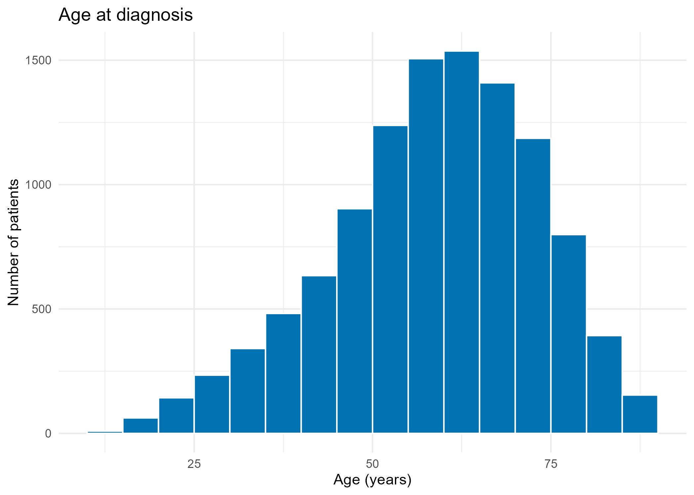
</p>

### 🔍 What to look for

**Peak location, skew, and unusual spikes** (for example a pile-up at age 90, where TCGA caps age).

**📖 Interpretation:**

- **Peak location:** the distribution peaks at about **55 to 65 years**, with the tallest bars near 60 (about 1,500 patients per bin). This is the typical age range for cancer diagnosis.
- **Skew:** the shape is slightly **left-skewed**. The left tail (young patients) is longer and gentler, while the right side falls off more steeply after about 70. So the mean sits a little below the median.
- **Tails:** very few patients are younger than 25, and counts drop sharply after 80.
- **Unusual spikes:** there is **no pile-up at age 90** in this plot. TCGA caps ages above 89, which can create a spike at the upper end. Here the last bar (about 85 to 90) is small, so there is no sign of that artifact, but always check the right edge of an age histogram.

> 💡 **Tip:** the apparent peak and skew can change with bin width. Try `binwidth = 2`, `5`, and `10` to confirm the pattern is real and not an artifact of binning.

### Q3. How does the smoothed density compare?

**Hint:** `geom_density()` estimates a smooth curve. The area under the
curve equals 1, so the y-axis is not a patient count.

```r
p_age_density <- ggplot(clinical, aes(x = Age)) +
  geom_density(fill = "#56B4E9", colour = "#0072B2", alpha = 0.65, na.rm = TRUE) +
  labs(title = "Smoothed age density", x = "Age (years)", y = "Density") +
  theme_minimal()
save_fig(p_age_density, "Fig1_3_age_density.jpeg")
```

<p align="center">
  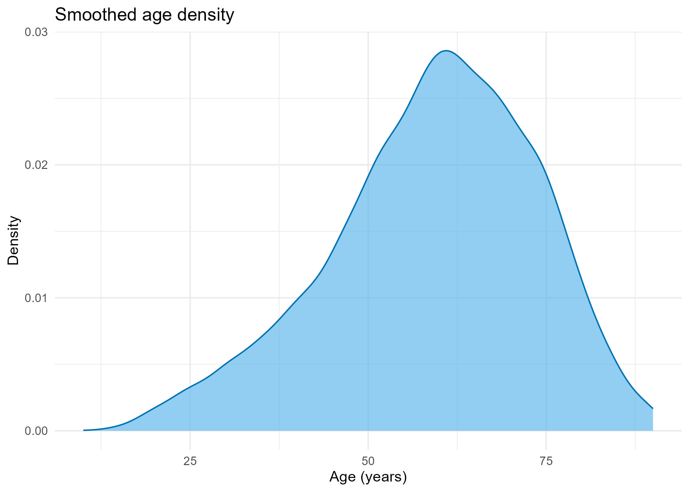
</p>

### Q4. How do you label age-group bars with percentages?

**Hint:** Use `after_stat(count / sum(count))` inside `aes()` and format it
with `scales::percent()`.

```r
p_age_group <- clinical |>
  drop_na(Age_Group) |>
  ggplot(aes(x = Age_Group)) +
  geom_bar(fill = "#009E73") +
  geom_text(aes(y = after_stat(count),
                label = percent(after_stat(count / sum(count)), accuracy = 0.1)),
            stat = "count", vjust = -0.35) +
  scale_y_continuous(expand = expansion(mult = c(0, 0.1))) +
  labs(title = "Patients by age group", x = "Age group", y = "Number of patients") +
  theme_minimal()
save_fig(p_age_group, "Fig1_4_age_group_percent.jpeg")
```
<p align="center">
  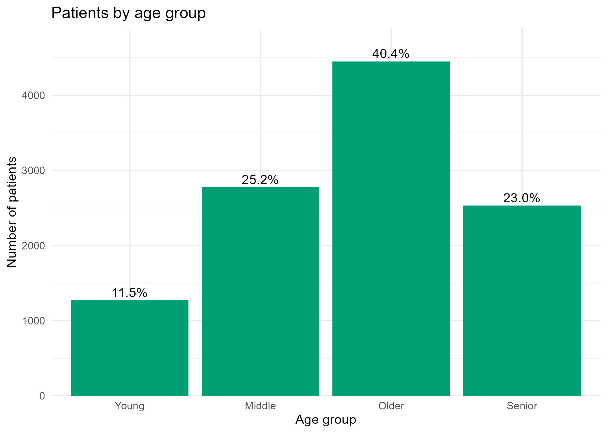
</p>

**What to look for:** The percentages should add up to 100% across the bars,
and the factor order should match the intended age progression.

---

## 2. Numeric by category

### Q5. How does Age differ by Gender?

**Hint:** Put the category on x and the numeric measure on y.

```r
p_age_gender_box <- clinical |>
  drop_na(Gender, Age) |>
  ggplot(aes(x = Gender, y = Age)) +
  geom_boxplot(fill = "#E69F00") +
  labs(title = "Age by gender", x = "Gender", y = "Age (years)") +
  theme_minimal()
save_fig(p_age_gender_box, "Fig2_1_age_gender_box.jpeg")
```

<p align="center">
  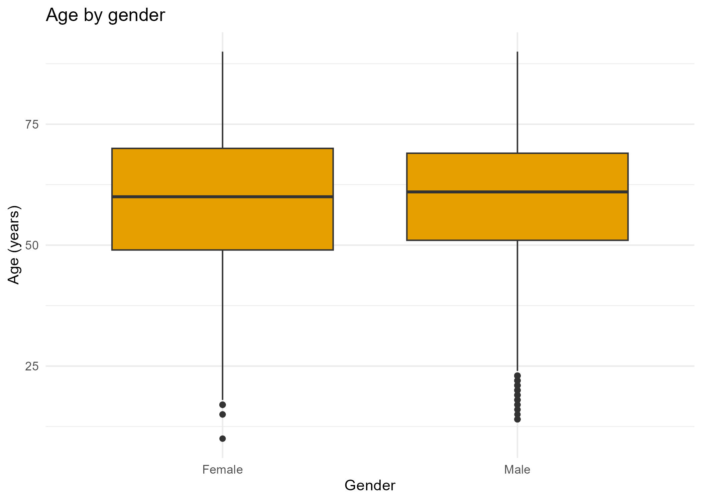
</p>

**What to look for:** Medians, spread, and outliers. Gender is partly driven
by cancer type (BRCA is mostly female, PRAD is all male), so this plot mixes
tumour types.

### Q6. How do you combine a violin plot and a boxplot?

**Hint:** Draw `geom_violin()` first, then a narrow `geom_boxplot()` on top
with `outlier.shape = NA`.

```r
p_age_status_violin <- clinical |>
  drop_na(Vital_Status, Age) |>
  ggplot(aes(x = Vital_Status, y = Age, fill = Vital_Status)) +
  geom_violin(alpha = 0.55, trim = FALSE) +
  geom_boxplot(width = 0.14, outlier.shape = NA, fill = "white") +
  scale_fill_manual(values = okabe_ito[2:1]) +
  guides(fill = "none") +
  labs(title = "Age by vital status", x = "Vital status", y = "Age (years)") +
  theme_minimal()
save_fig(p_age_status_violin, "Fig2_2_age_status_violin.jpeg")
```
<p align="center">
  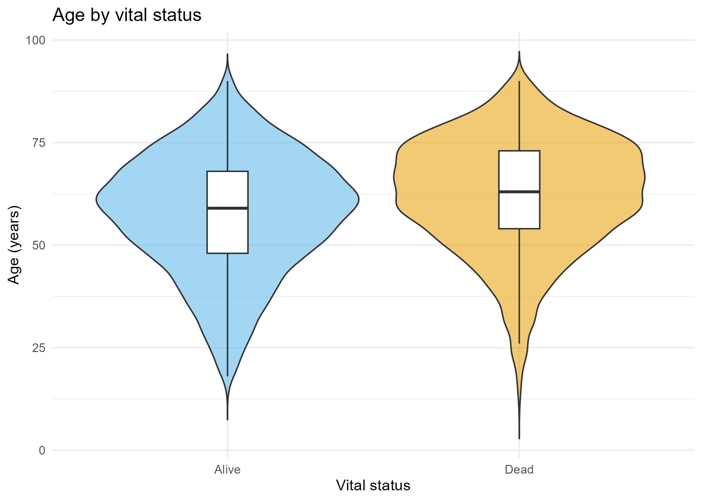
</p>


### 🔍 What to look for

**Compare the center (median line), spread (box height), and shape (violin width) of the two groups.** Look for a shift in the median and for differences in tails.

**📖 Interpretation:**

| Feature | Alive | Dead |
|---|---|---|
| **Median age** | about 59 years | about 63 years |
| **Middle 50% (box)** | about 48 to 68 | about 54 to 73 |
| **Violin shape** | widest near 60, tapering evenly | wider and flatter across 55 to 75 |
| **Lower tail** | extends to about 8 | extends to about 3 |

- **Center:** patients who died were **older at diagnosis** (median about 4 years higher). The whole box is shifted upward, not just the median.
- **Spread:** the Dead group has a slightly higher and more compact upper range, with more weight at ages 60 to 75. The Alive group is more concentrated around 60.
- **Shape:** both violins are roughly symmetric, with thin tails at the young and very old ends. The Dead violin is more "barrel" shaped, meaning more patients are spread across older ages.
- **Takeaway:** older age at diagnosis is **associated with** higher mortality, which fits the general expectation that older patients tend to have poorer outcomes.

> ⚠️ **Caution:** this is an association, not proof of cause. Age is also linked to disease stage, other illnesses, and treatment choices. Also, a visible shift does not prove a significant difference. Test it with `wilcox.test(Age ~ Vital_Status, data = data)` or `t.test()`.

> 💡 **Reading the plot:** the **violin** shows the full distribution (wider = more patients at that age), while the **white box** shows the median and quartiles. Combining both is more informative than a boxplot alone.


### Q7. How does Age vary by cancer type?

**Hint:** `reorder(Cancer_Type, Age, FUN = median)` sorts by median age;
`coord_flip()` keeps labels readable.

```r
p_age_cancer <- clinical |>
  drop_na(Age) |>
  ggplot(aes(x = reorder(Cancer_Type, Age, FUN = median, na.rm = TRUE), y = Age)) +
  geom_boxplot(fill = "#CC79A7", outlier.alpha = 0.3) +
  coord_flip() +
  labs(title = "Age by cancer type (ordered by median)",
       x = "Cancer type", y = "Age (years)") +
  theme_minimal()
save_fig(p_age_cancer, "Fig2_3_age_cancer_type.jpeg", 7, 8)
```

<p align="center">
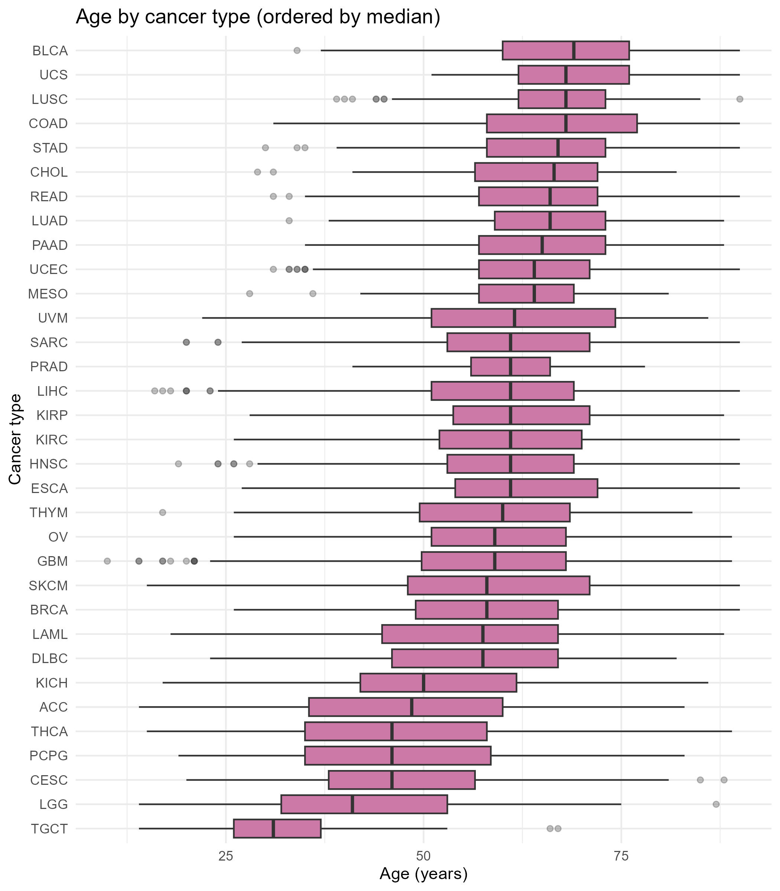
</p>

### 🔍 What to look for

**Compare the median (thick line), spread (box width), and outliers (dots) across cancer types.** Because the types are ordered by median age, look for a clear gradient from older to younger cancers, and for types with unusually wide or narrow boxes.

**📖 Interpretation:**

| Group | Cancer types | Median age (approx.) |
|---|---|---|
| **Oldest** | BLCA, UCS, LUSC, COAD, STAD | about 66 to 69 |
| **Middle** | LUAD, PAAD, UCEC, KIRC, HNSC, OV, BRCA | about 57 to 66 |
| **Youngest** | KICH, ACC, THCA, PCPG, CESC, LGG, TGCT | about 31 to 50 |

- **Gradient:** median age at diagnosis spans roughly **30 to nearly 70 years**, so age is strongly tied to cancer type. Carcinomas of the bladder, lung, and colon appear mostly in older adults.
- **Youngest cancers:** **TGCT** (testicular germ cell tumors) is the clear outlier, with a median near 31 and a very narrow box. **LGG**, **CESC**, **PCPG**, and **THCA** also skew young.
- **Spread:** wide boxes (for example **UVM**, **COAD**, **ACC**) mean ages vary a lot within that cancer. Narrow boxes (for example **PRAD**, **TGCT**) mean patients are diagnosed in a tight age range.
- **Outliers:** dots on the left (for example in **GBM**, **LIHC**, **LUSC**) are unusually young patients. Few cancers show old-age outliers, partly because TCGA caps age at about 90 for privacy.
- **Where LUAD sits:** our cohort of interest falls in the older-middle group, with a median near 66, which matches the 65.2 mean age seen earlier.

> ⚠️ **Caution:** boxplots show age at diagnosis, not cancer incidence. Cancers with fewer samples (for example **CHOL**, **UCS**, **KICH**) have less reliable boxes. TCGA samples also do not perfectly represent the general population.

> 💡 **Reading the plot:** the box covers the middle 50% of patients (Q1 to Q3), the thick line is the median, the whiskers extend to about 1.5 x IQR, and the dots are outliers beyond that.

### Q8. Does follow-up time differ by stage?

**Hint:** Jitter shows individual patients; the boxplot summarises them.

```r
p_os_stage <- clinical |>
  drop_na(Stage, OS_months) |>
  ggplot(aes(x = Stage, y = OS_months)) +
  geom_jitter(width = 0.2, alpha = 0.15, colour = "#333333") +
  geom_boxplot(outlier.shape = NA, fill = "#D55E00", alpha = 0.6) +
  labs(title = "Follow-up time by stage", x = "Stage", y = "Follow-up (months)") +
  theme_minimal()
save_fig(p_os_stage, "Fig2_4_os_by_stage.jpeg")
```

<p align="center">
  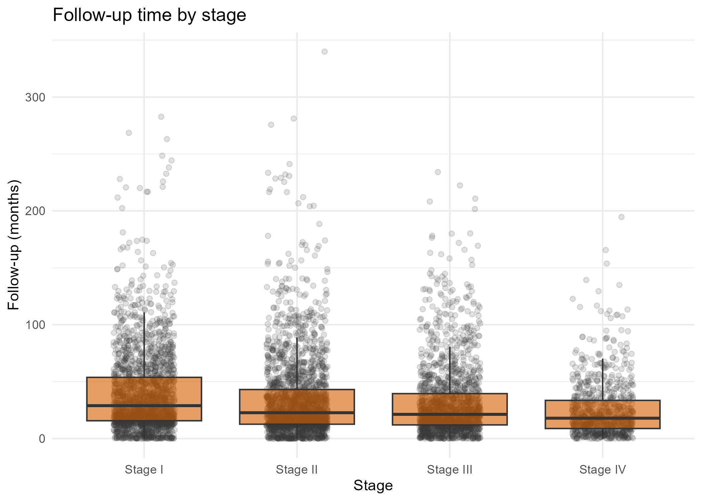
</p>

### 🔍 What to look for

**Compare the median follow-up (thick line) and the spread (box height) across stages, and notice how the points (individual patients) are distributed.** Look for a downward trend with advancing stage, a long upper tail of long-term follow-up, and a heavy pile-up near zero.

**📖 Interpretation:**

| Stage | Median follow-up (approx.) | Middle 50% (box) | Longest follow-up |
|---|---|---|---|
| **Stage I** | about 28 months | about 15 to 53 | about 280+ |
| **Stage II** | about 22 months | about 12 to 43 | about 340 |
| **Stage III** | about 21 months | about 11 to 39 | about 235 |
| **Stage IV** | about 18 months | about 9 to 33 | about 195 |

- **Trend:** median follow-up time **decreases with stage**, from about 28 months (Stage I) to about 18 months (Stage IV). The boxes also get shorter, so late-stage patients have both shorter and less variable follow-up.
- **Why this happens:** follow-up time is the time until death or last contact. Patients with advanced disease are more likely to die early, which ends their follow-up sooner. This is a **survival signal**, not just a record-keeping detail.
- **Right skew:** the median sits low in each box, and a long tail of points extends upward. Most patients are followed for **under 5 years (60 months)**, while a few are followed for more than 10 or 20 years.
- **Pile-up near zero:** many patients have very short follow-up (close to 0). These are often people who died soon after diagnosis or were lost to follow-up.
- **Sample sizes:** the Stage I to III clouds are dense, while Stage IV has visibly fewer points, so its distribution rests on fewer patients.

> ⚠️ **Caution:** follow-up time is **not the same as survival time**. A short follow-up can mean death, but it can also mean the patient was simply enrolled recently or dropped out (censoring). To analyze outcomes correctly you need **Kaplan-Meier curves** and a **log-rank test**, which account for censoring. A plain boxplot of follow-up can therefore mislead.

> 💡 **Reading the plot:** the **jittered points** show every patient, so you can see sample size and density that a boxplot alone hides. Overlapping points are semi-transparent, so darker areas mean more patients.

---

## 3. Two numeric variables

### Q9. Is there a relationship between Age and follow-up time?

**Hint:** Use points with transparency to handle overplotting.

```r
p_scatter <- clinical |>
  drop_na(Age, OS_months) |>
  ggplot(aes(x = Age, y = OS_months)) +
  geom_point(alpha = 0.15, colour = "#0072B2") +
  labs(title = "Age and follow-up time", x = "Age (years)", y = "Follow-up (months)") +
  theme_minimal()
save_fig(p_scatter, "Fig3_1_scatter.jpeg")
```

<p align="center">
  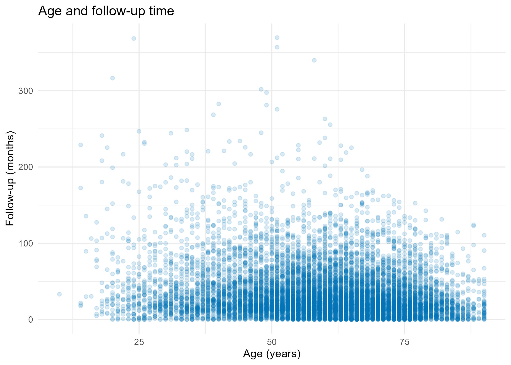
</p>

### Q10. How do you add a linear smooth?

**Hint:** `geom_smooth(method = "lm", formula = y ~ x)` adds the fitted line
with a confidence band.

```r
p_lm <- p_scatter +
  geom_smooth(method = "lm", formula = y ~ x, colour = "#D55E00") +
  labs(title = "Age and follow-up with linear trend")
save_fig(p_lm, "Fig3_2_scatter_lm.jpeg")
```

<p align="center">
  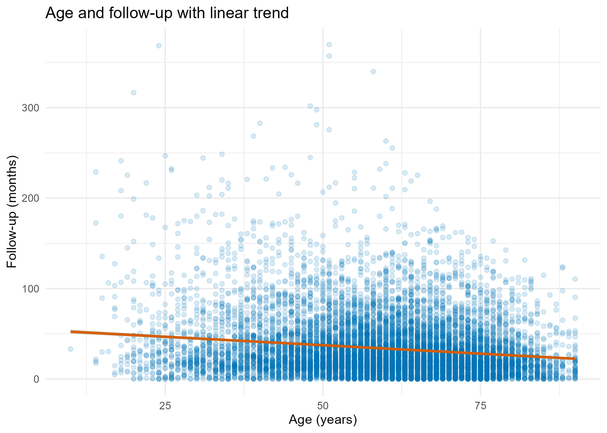
</p>

### Q11. Does the trend differ by Vital_Status?

**Hint:** Map `Vital_Status` to `colour`; `geom_smooth()` then fits one line
per group.

```r
p_status_lm <- clinical |>
  drop_na(Age, OS_months, Vital_Status) |>
  ggplot(aes(x = Age, y = OS_months, colour = Vital_Status)) +
  geom_point(alpha = 0.15) +
  geom_smooth(method = "lm", formula = y ~ x, se = FALSE) +
  scale_colour_manual(values = okabe_ito[2:1]) +
  labs(title = "Age and follow-up by vital status",
       x = "Age (years)", y = "Follow-up (months)", colour = "Vital status") +
  theme_minimal()
save_fig(p_status_lm, "Fig3_3_status_lm.jpeg")
```

<p align="center">
  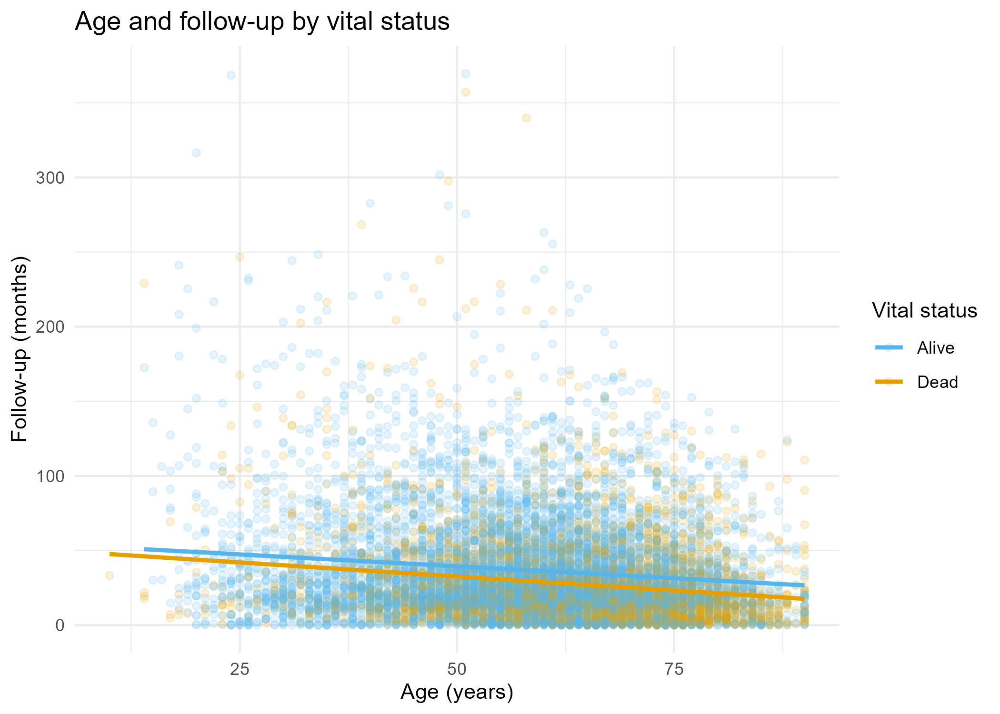
</p>

**What to look for:** Do not claim a group difference from line separation
alone. Censoring and cancer-type mix are strong confounders.

### Q12. How do you test the correlation?

**Hint:** Keep only complete pairs, then pass both vectors to `cor.test()`.

```r
complete_numeric <- clinical |>
  select(Age, OS_months) |>
  drop_na()

cor.test(complete_numeric $ Age, complete_numeric $ OS_months, method = "pearson")
```

```r
#	Pearson's product-moment correlation

# data:  complete_numeric$Age and complete_numeric$OS_months
# t = -16.761, df = 10990, p-value < 2.2e-16
# alternative hypothesis: true correlation is not equal to 0
# 95 percent confidence interval:
# -0.1760493 -0.1395915
# sample estimates:
#       cor 
# -0.1578742 
```


**What to look for:** Read the estimate, confidence interval, and p-value
together. With thousands of patients, a tiny correlation can be significant
yet unimportant.

---

## 4. Two categorical variables

### Q13. What is the gender composition within each cancer type?

**Hint:** `position = "fill"` scales each bar to 100%.

```r
p_gender_cancer <- clinical |>
  drop_na(Gender) |>
  ggplot(aes(x = Cancer_Type, fill = Gender)) +
  geom_bar(position = "fill") +
  scale_y_continuous(labels = percent) +
  scale_fill_manual(values = okabe_ito[c(2, 1)]) +
  coord_flip() +
  labs(title = "Gender composition by cancer type",
       x = "Cancer type", y = "Percent", fill = "Gender") +
  theme_minimal()
save_fig(p_gender_cancer, "Fig4_1_gender_cancer.jpeg", 7, 8)
```

<p align="center">
  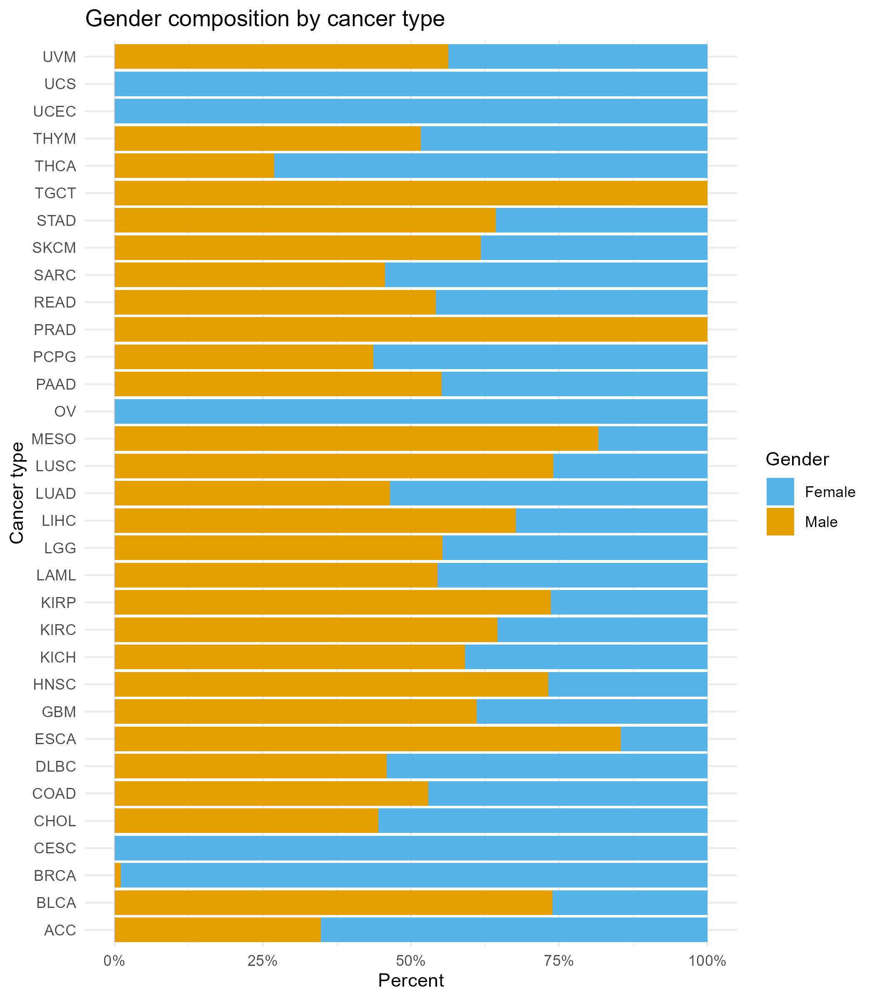
</p>

### Q14. What is the race composition within each cancer type?

```r
p_race_cancer <- clinical |>
  drop_na(Race) |>
  ggplot(aes(x = Cancer_Type, fill = Race)) +
  geom_bar(position = "fill") +
  scale_y_continuous(labels = percent) +
  scale_fill_manual(values = okabe_ito) +
  coord_flip() +
  labs(title = "Race composition by cancer type",
       x = "Cancer type", y = "Percent", fill = "Race") +
  theme_minimal()
save_fig(p_race_cancer, "Fig4_2_race_cancer.jpeg", 8, 8)
```

<p align="center">
  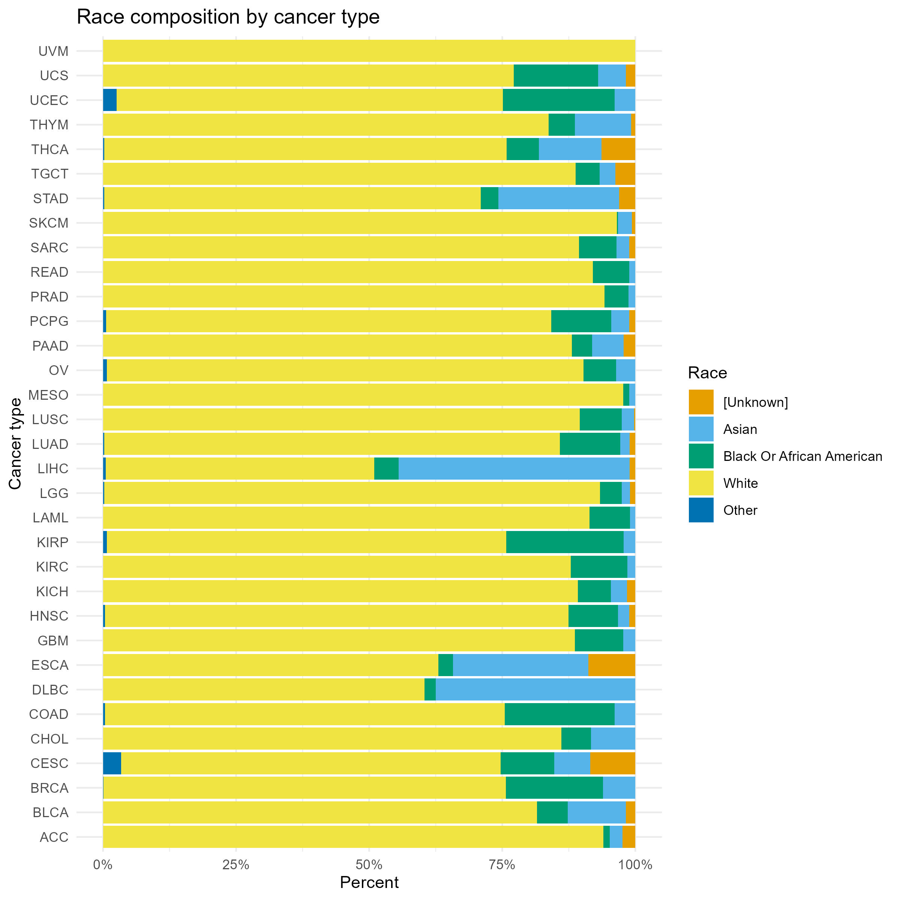
</p>

**What to look for:** TCGA is dominated by patients recorded as White.
Percentages for small groups rest on few patients.

### Q15. How are patients distributed across stages?

```r
p_stage_counts <- clinical |>
  drop_na(Stage) |>
  ggplot(aes(x = Stage)) +
  geom_bar(fill = "#0072B2") +
  coord_flip() +
  labs(title = "Patients by pathologic stage", x = "Stage", y = "Number of patients") +
  theme_minimal()
save_fig(p_stage_counts, "Fig4_3_stage_counts.jpeg")
```

<p align="center">
  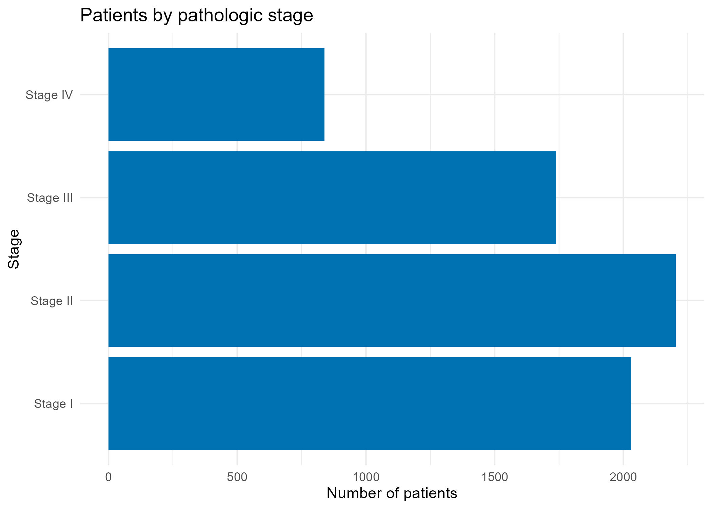
</p>

### Q16. How does vital status vary by cancer type?

```r
p_vital_cancer <- clinical |>
  drop_na(Vital_Status) |>
  ggplot(aes(x = Cancer_Type, fill = Vital_Status)) +
  geom_bar(position = "fill") +
  scale_y_continuous(labels = percent) +
  scale_fill_manual(values = okabe_ito[2:1]) +
  coord_flip() +
  labs(title = "Vital status by cancer type",
       x = "Cancer type", y = "Percent", fill = "Vital status") +
  theme_minimal()
save_fig(p_vital_cancer, "Fig4_4_vital_cancer.jpeg", 7, 8)
```

<p align="center">
  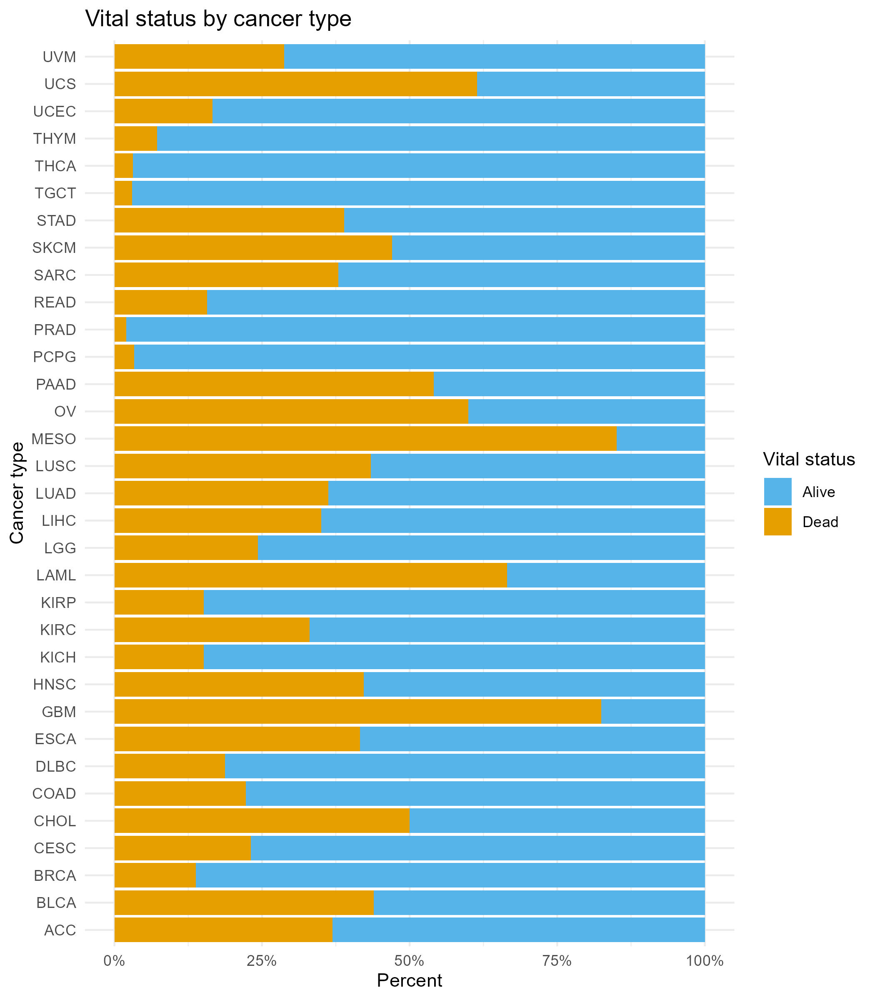
</p>

**What to look for:** Aggressive cancers such as GBM show high mortality in
the follow-up window, while THCA and PRAD show very low mortality. Follow-up
length differs by cancer, so compare with care.

---

## 5. Immune and molecular subtypes

### Q17. What are the immune subtypes?

```r
p_immune <- clinical |>
  drop_na(Immune_Subtype) |>
  count(Immune_Subtype) |>
  ggplot(aes(x = reorder(Immune_Subtype, n), y = n)) +
  geom_col(fill = "#009E73") +
  coord_flip() +
  labs(title = "Immune subtypes", x = "Immune subtype", y = "Number of patients") +
  theme_minimal()
save_fig(p_immune, "Fig5_1_immune_subtypes.jpeg")
```

<p align="center">
  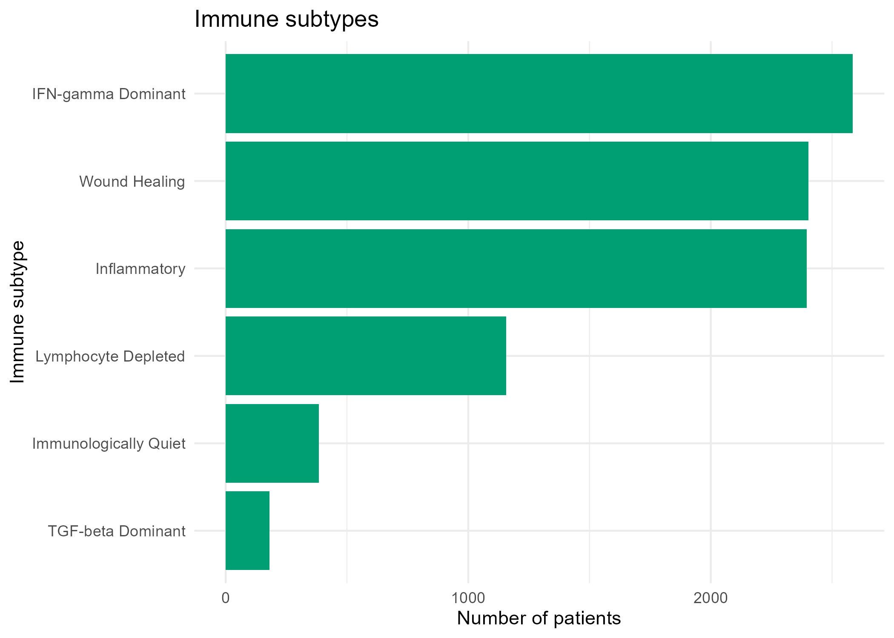
</p>

### Q18. How do immune subtypes differ across selected cancers?

**Hint:** `facet_wrap(~ Cancer_Type, scales = "free_y")` gives each cancer its
own panel and y-scale.

```r
focus <- c("BRCA", "LUAD", "COAD", "SKCM", "GBM", "KIRC")

p_immune_facet <- clinical |>
  filter(Cancer_Type %in% focus, !is.na(Immune_Subtype)) |>
  ggplot(aes(x = Immune_Subtype, fill = Immune_Subtype)) +
  geom_bar() +
  facet_wrap(~ Cancer_Type, scales = "free_y") +
  scale_fill_manual(values = okabe_ito) +
  guides(fill = "none") +
  labs(title = "Immune subtypes in selected cancers",
       x = NULL, y = "Number of patients") +
  theme_minimal() +
  theme(axis.text.x = element_text(angle = 45, hjust = 1))
save_fig(p_immune_facet, "Fig5_2_immune_facet.jpeg", 9, 6)
```

<p align="center">
  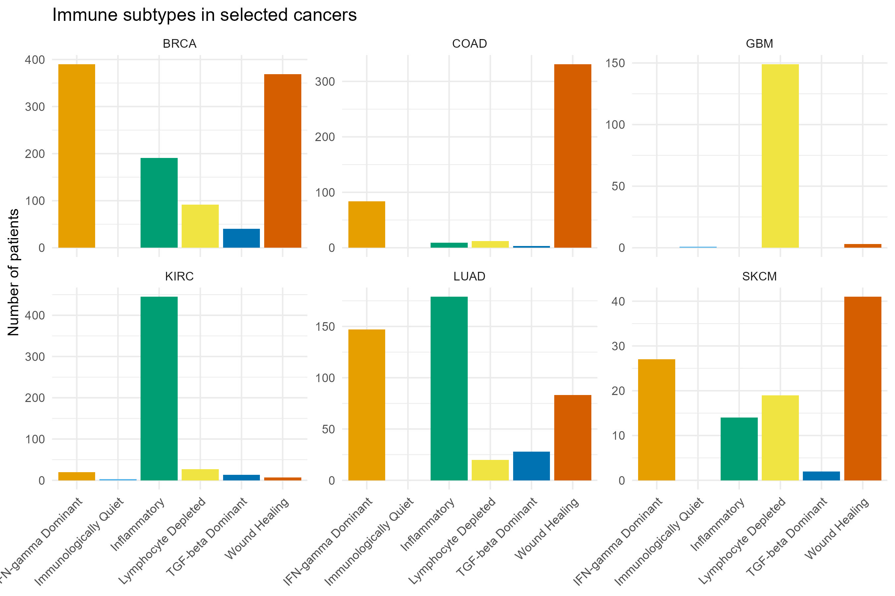
</p>

**What to look for:** Free y-scales make the shapes easy to compare but hide
the differences in panel size.

### Q19. What are the BRCA molecular (PAM50) subtypes?

```r
brca <- clinical |>
  filter(Cancer_Type == "BRCA", !is.na(Molecular_Subtype)) |>
  mutate(Molecular_Subtype = str_remove(Molecular_Subtype, "^BRCA\\."))

p_brca_sub <- ggplot(brca, aes(x = fct_infreq(Molecular_Subtype))) +
  geom_bar(fill = "#CC79A7") +
  coord_flip() +
  labs(title = "BRCA molecular subtypes", x = "Subtype", y = "Number of patients") +
  theme_minimal()
save_fig(p_brca_sub, "Fig5_3_brca_subtypes.jpeg")
```
<p align="center">
  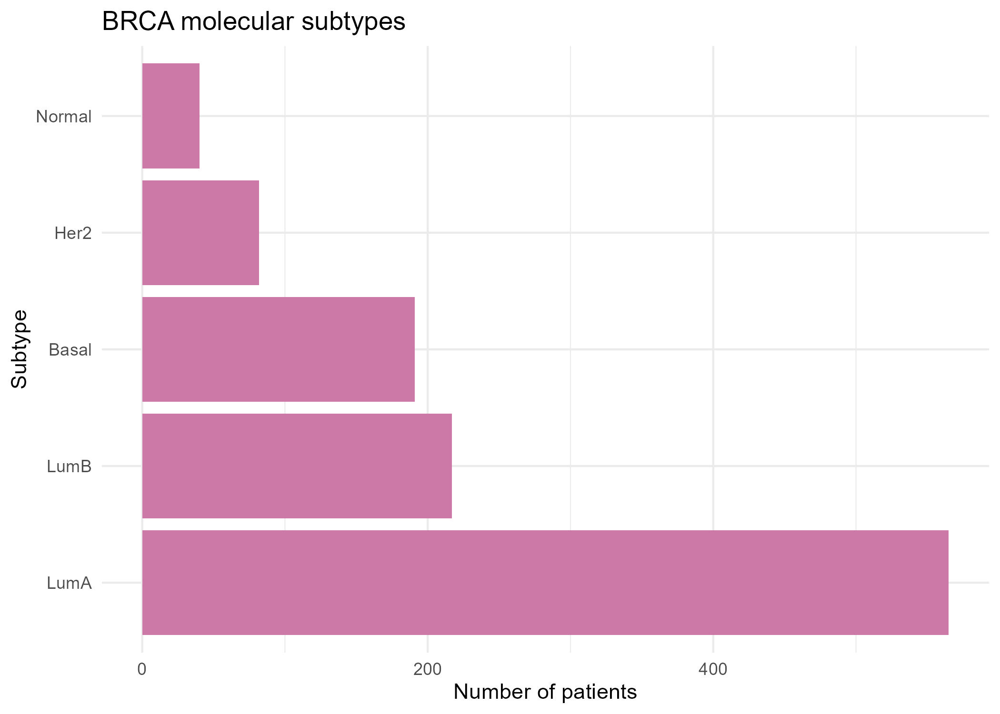
</p>

### Q20. Does Age differ across BRCA subtypes?

```r
p_brca_age <- brca |>
  drop_na(Age) |>
  ggplot(aes(x = Molecular_Subtype, y = Age, fill = Molecular_Subtype)) +
  geom_boxplot(outlier.alpha = 0.35) +
  scale_fill_manual(values = okabe_ito) +
  guides(fill = "none") +
  labs(title = "BRCA: age by molecular subtype", x = "Subtype", y = "Age (years)") +
  theme_minimal()
save_fig(p_brca_age, "Fig5_4_brca_age_subtype.jpeg")
```

<p align="center">
  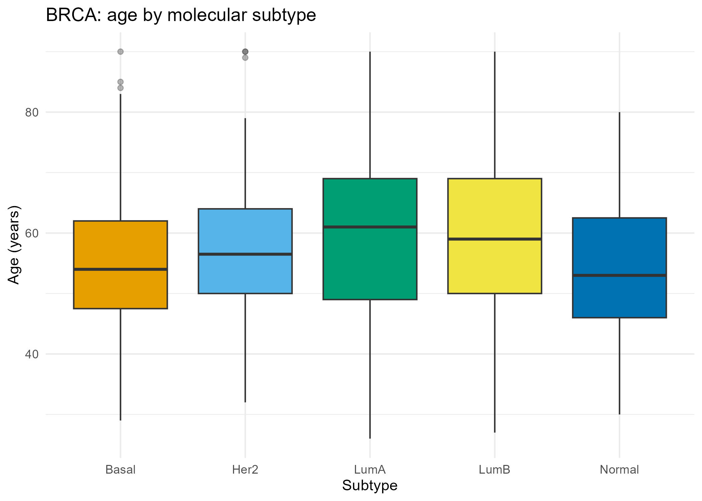
</p>

---

## 6. Facets, statistics, and publication style

### Q21. How do you facet an Age histogram by Gender?

```r
p_age_facet <- clinical |>
  drop_na(Gender, Age) |>
  ggplot(aes(x = Age)) +
  geom_histogram(binwidth = 5, boundary = 0, fill = "#0072B2", colour = "white") +
  facet_wrap(~ Gender) +
  labs(title = "Age distribution by gender", x = "Age (years)", y = "Number of patients") +
  theme_minimal()
save_fig(p_age_facet, "Fig6_1_age_gender_facet.jpeg", 8, 4)
```

<p align="center">
  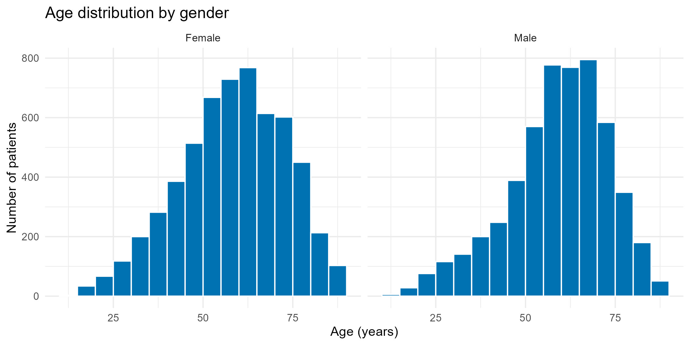
</p>

**What to look for:** Compare shape and sample size across panels. Facets
reduce overplotting but do not make groups comparable on their own.

### Q22. How do you add a Wilcoxon test annotation?

**Hint:** `ggpubr::stat_compare_means(method = "wilcox.test")` adds the
p-value to the plot.

```r
p_wilcox <- clinical |>
  drop_na(Vital_Status, Age) |>
  ggboxplot(x = "Vital_Status", y = "Age", color = "Vital_Status",
            palette = okabe_ito[2:1], add = "jitter",
            add.params = list(alpha = 0.15, width = 0.15)) +
  stat_compare_means(method = "wilcox.test", label = "p.format") +
  labs(title = "Age by vital status with Wilcoxon test",
       x = "Vital status", y = "Age (years)") +
  theme_minimal()
save_fig(p_wilcox, "Fig6_2_wilcox.jpeg")
```

<p align="center">
  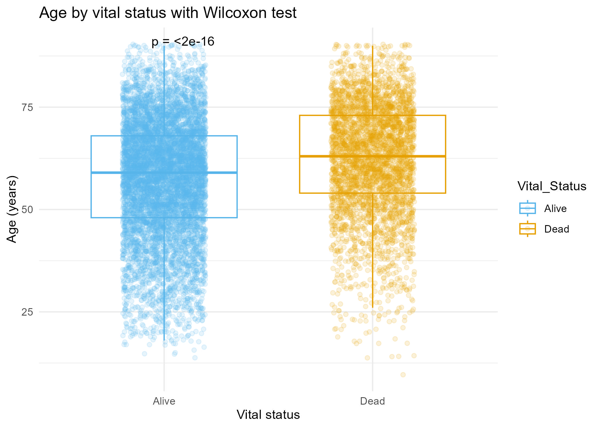
</p>

**What to look for:** The annotation reports a p-value for the displayed
groups. It does not measure effect size, prove causation, or replace
inspecting the distributions and sample sizes.

### Q23. How do you build a publication-style figure?

```r
p_pub <- clinical |>
  drop_na(Age_Group, Age, Vital_Status) |>
  ggplot(aes(x = Age_Group, y = Age, fill = Vital_Status)) +
  geom_boxplot(outlier.alpha = 0.3) +
  scale_fill_manual(values = okabe_ito[2:1]) +
  labs(title = "Age across age groups",
       subtitle = "Stratified by vital status (TCGA Pan-Cancer)",
       x = "Age group", y = "Age (years)", fill = "Vital status",
       caption = "Source: TCGA Pan-Cancer Atlas (UCSC Xena)") +
  theme_minimal(base_size = 13) +
  theme(plot.title = element_text(face = "bold", size = 15),
        plot.subtitle = element_text(colour = "grey30"),
        legend.position = "top")
save_fig(p_pub, "Fig6_3_publication.jpeg")
```

<p align="center">
  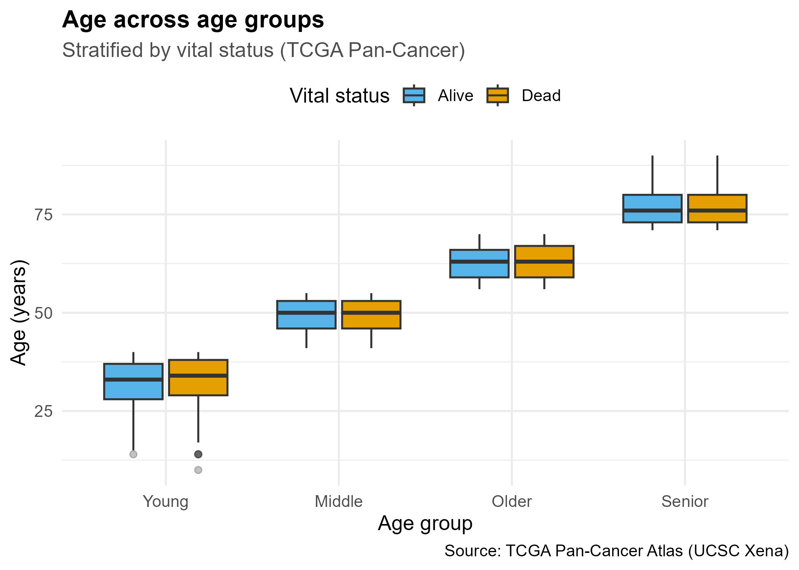
</p>

---

## Take-home messages

1. Pan-cancer data mixes very different diseases. Stratify by `Cancer_Type` before drawing biological conclusions.
2. Group sizes are highly unequal. Check counts before comparing percentages.
3. Follow-up time is censored. Use survival analysis (Kaplan-Meier, Cox) for real survival questions.
4. Use colour-blind-safe palettes (Okabe-Ito) and consistent factor ordering.


---

## Common mistakes

1. **Confusing counts and percentages.** `geom_bar()` without a y aesthetic counts rows; `position = "fill"` shows within-bar proportions. State which denominator you are using.
2. **Using a histogram for a categorical variable.** Use `geom_bar()` for categories and `geom_histogram()` for continuous numeric measurements.
3. **Choosing an arbitrary binwidth.** Try a defensible binwidth and explain how it affects the apparent shape.
4. **Overplotting every observation.** Use transparency, jitter, faceting, or a summary layer when points overlap.
5. **Treating a smooth as proof.** `geom_smooth(method = "lm")` describes a fitted model; it does not establish causation or guarantee that a linear model is appropriate.
6. **Ignoring missingness.** `drop_na()` is appropriate for a complete-pair calculation, but do not silently reinterpret missing values as zeros.
7. **Letting factor order happen by accident.** Use `factor()` levels or `reorder()` when order communicates meaning.
8. **Using colour without a legend or accessible contrast.** Use labels, a named palette, and colour-blind-friendly choices.
9. **Comparing facets with inconsistent scales without saying so.** Free scales can be useful but can also mislead visual comparisons.
10. **Saving only what is displayed.** Pass the intended object explicitly to `ggsave()` and specify width, height, units, and resolution.
11. **Pooling all cancer types.** Pan-cancer plots mix very different diseases. A pattern in the pooled data can disappear, or reverse, within each cancer type.
12. **Treating follow-up time as survival time.** `OS_months` is censored for patients who are still alive. Use Kaplan-Meier or Cox models for real survival questions.

## Quiz: test your understanding

Try each question before opening the answer. Questions are grouped by difficulty, and every answer is hidden until you click it.

---

### Part A: Multiple choice

**Q27. In the grammar of graphics, which component maps a variable to a visual property such as x, y, colour, or fill?**

- A. Geometry
- B. Aesthetic mapping
- C. Theme
- D. Facet

<details><summary>Show answer</summary>

**B.** Aesthetic mappings, written inside `aes()`, connect data variables to visual properties.

</details>

**Q28. Which geom is the most appropriate for showing the distribution of a single continuous variable such as `Age`?**

- A. `geom_bar()`
- B. `geom_histogram()`
- C. `geom_col()`
- D. `geom_tile()`

<details><summary>Show answer</summary>

**B.** `geom_histogram()` bins a continuous variable, while `geom_bar()` counts the rows in each category of a discrete variable.

</details>

**Q29. What does `geom_bar(position = "fill")` display?**

- A. The raw count in each group
- B. The proportion of each fill category within each bar
- C. The mean of the y variable
- D. A smoothed density

<details><summary>Show answer</summary>

**B.** Every bar is scaled to the same height, so you compare composition rather than group size.

</details>

**Q30. What is the difference between `geom_bar()` and `geom_col()`?**

- A. None, they are aliases
- B. `geom_bar()` counts rows by default, while `geom_col()` plots a y value you already computed
- C. `geom_col()` is only for histograms
- D. `geom_bar()` cannot be used with factors

<details><summary>Show answer</summary>

**B.** `geom_bar()` uses `stat = "count"`, and `geom_col()` uses `stat = "identity"`.

</details>

**Q31. A boxplot's central line represents which statistic?**

- A. Mean
- B. Mode
- C. Median
- D. Maximum

<details><summary>Show answer</summary>

**C.** The line is the median. The box spans the first to third quartile (the interquartile range).

</details>

**Q32. What does the shaded band around `geom_smooth(method = "lm")` represent?**

- A. The range of all observed data points
- B. A confidence interval for the fitted mean trend
- C. The standard deviation of y
- D. The prediction interval for new patients

<details><summary>Show answer</summary>

**B.** It reflects uncertainty in the fitted *mean*, not the spread of individual observations, so it is much narrower than the data.

</details>

**Q33. Which function adds a separate panel for each level of a variable?**

- A. `facet_wrap()`
- B. `coord_flip()`
- C. `scale_fill_manual()`
- D. `theme_minimal()`

<details><summary>Show answer</summary>

**A.** `facet_wrap(~ variable)` creates small multiples.

</details>

**Q34. Which statement about the Okabe-Ito palette is correct?**

- A. It is designed to be distinguishable by people with common forms of colour-vision deficiency
- B. It contains only shades of red and green
- C. It works only in grayscale
- D. It cannot be used with `scale_fill_manual()`

<details><summary>Show answer</summary>

**A.** It was designed for colour-blind accessibility. Pass it to `scale_fill_manual()` or `scale_colour_manual()`.

</details>

**Q35. What does `coord_flip()` do?**

- A. Swaps the x and y axes
- B. Reverses the data order
- C. Transposes the dataset
- D. Rotates the legend

<details><summary>Show answer</summary>

**A.** It swaps the axes visually. The underlying data and statistics are unchanged.

</details>

---

### Part B: True or False

**Q36. A density curve's y-axis shows the number of patients at each age.**

<details><summary>Show answer</summary>

**False.** The y-axis is density, and the area under the curve equals 1.

</details>

**Q37. `stat_compare_means()` provides a formal analysis that replaces a prespecified statistical plan.**

<details><summary>Show answer</summary>

**False.** It is a visual aid only. Formal inference needs a prespecified analysis, with multiple comparisons and study design considered.

</details>

**Q38. A correlation coefficient close to zero proves there is no relationship between two variables.**

<details><summary>Show answer</summary>

**False.** Pearson correlation measures only *linear* association. A strong nonlinear relationship can still give r near 0.

</details>

**Q39. Changing the histogram binwidth can change the apparent shape of the distribution.**

<details><summary>Show answer</summary>

**True.** That is why you should try several binwidths and not over-interpret fine detail.

</details>

**Q40. Missing stage values (`NA`) should be treated as Stage I.**

<details><summary>Show answer</summary>

**False.** Missing means unknown, not the lowest stage. Treating `NA` as a real category would bias every stage comparison. Drop missing values explicitly with `drop_na(Stage)` and report how many were removed.

</details>

**Q41. `ggsave()` can save a patchwork object, not just a single plot.**

<details><summary>Show answer</summary>

**True.** Pass the patchwork object explicitly via `plot =`.

</details>

---

### Part C: Short answer

**Q42. When would you choose a violin plot over a boxplot?**

<details><summary>Show answer</summary>

When distribution *shape* matters, for example bimodality or skew, that a box summary would hide. Overlaying a narrow boxplot (as in Q6) gives both the shape and the quartiles.

</details>

**Q43. Why add jitter and transparency (`alpha`) to a scatter or strip plot?**

<details><summary>Show answer</summary>

Many patients share the same values (such as whole-number ages), so points stack on top of each other. Jitter spreads them apart and transparency shows density, which reduces overplotting.

</details>

**Q44. Write code to make a bar chart of `Gender` counts, filled by `Vital_Status`, with side-by-side bars.**

<details><summary>Show answer</summary>

```r
clinical |>
  drop_na(Gender, Vital_Status) |>
  ggplot(aes(x = Gender, fill = Vital_Status)) +
  geom_bar(position = "dodge")
```

</details>

**Q45. Write code to draw a scatterplot of `Age` vs `OS_months` coloured by `Gender`, with a title and axis labels.**

<details><summary>Show answer</summary>

```r
clinical |>
  drop_na(Age, OS_months, Gender) |>
  ggplot(aes(x = Age, y = OS_months, colour = Gender)) +
  geom_point(alpha = 0.2) +
  labs(
    title = "Age and follow-up time by gender",
    x = "Age (years)",
    y = "Follow-up (months)",
    colour = "Gender"
  ) +
  theme_minimal()
```

</details>

**Q46. Write code to facet an `Age` histogram by `Stage` using 2 columns.**

<details><summary>Show answer</summary>

```r
clinical |>
  drop_na(Stage, Age) |>
  ggplot(aes(x = Age)) +
  geom_histogram(binwidth = 5, fill = "#0072B2", colour = "white") +
  facet_wrap(~ Stage, ncol = 2)
```

</details>

**Q47 (discussion). Your colleague says: "The lines for Alive and Dead patients have different slopes, so age affects survival differently in the two groups." What is wrong with this conclusion?**

<details><summary>Show answer</summary>

Slope differences in a descriptive plot do not establish an interaction, let alone causation. Here the problem is even stronger: `OS_months` is censored follow-up time, so alive patients' times only reflect how long they were observed. Cancer-type mix, group sizes, and uncertainty also matter. You would need a formal survival model (for example, a Cox model with an age-by-status or age-by-stratum term) and confidence intervals before drawing a conclusion.

</details>

---

### Part D: Try it yourself

1. Draw a boxplot of `OS_months` by `Cancer_Type`, flip the coordinates, and order the cancer types by median follow-up.
2. Make a filled bar chart of `Age_Group` by `Gender` with **within-gender** percentage labels, using a colour-blind-friendly palette.
3. Build a two-panel `patchwork` figure (one distribution plot and one comparison plot), give it a title, and save it as a 300 dpi PNG in `figures/`.
4. Pick one plot from this tutorial and write a two-sentence caption stating what it shows and one limitation.

<details><summary>Show hints</summary>

```r
# 1
clinical |>
  drop_na(OS_months) |>
  ggplot(aes(x = reorder(Cancer_Type, OS_months, FUN = median, na.rm = TRUE),
             y = OS_months)) +
  geom_boxplot(outlier.alpha = 0.3) +
  coord_flip() +
  labs(x = "Cancer type", y = "Follow-up (months)")

# 2  (compute percentages within each gender first)
age_gender_pct <- clinical |>
  drop_na(Gender, Age_Group) |>
  count(Gender, Age_Group) |>
  group_by(Gender) |>
  mutate(pct = n / sum(n)) |>
  ungroup()

ggplot(age_gender_pct, aes(x = Gender, y = pct, fill = Age_Group)) +
  geom_col() +
  geom_text(aes(label = scales::percent(pct, accuracy = 1)),
            position = position_stack(vjust = 0.5), size = 3) +
  scale_fill_manual(values = okabe_ito[c(2, 6, 3, 1)]) +
  scale_y_continuous(labels = scales::percent) +
  labs(x = "Gender", y = "Percent within gender", fill = "Age group")

# 3
library(patchwork)
p1 <- ggplot(clinical, aes(Age)) + geom_histogram(binwidth = 5, na.rm = TRUE)
p2 <- clinical |> drop_na(Vital_Status, Age) |>
  ggplot(aes(Vital_Status, Age)) + geom_boxplot()
p_final <- p1 + p2 + plot_annotation(title = "Age overview")
ggsave("figures/quiz_panel.png", p_final, width = 10, height = 5, dpi = 300)
```

</details>

---

#### Scoring guide

| Score (of 20 graded items, Q27-Q46) | Level |
|---|---|
| 18-20 | Excellent, ready for publication-quality figures |
| 14-17 | Good, review the topics you missed |
| 9-13 | Fair, re-read sections 1-6 |
| 0-8 | Re-run the tutorial from the start |

Q47 and Part D are open-ended and are not scored.

---

## Final reflection

Before you finish, choose one figure that communicates a useful clinical pattern and one that could be misread. For each, identify the data variables, the visual encodings, the denominator or model being used, and the uncertainty or limitation that should accompany it. Good visualization is not decoration: it is a transparent argument about what the data support.
